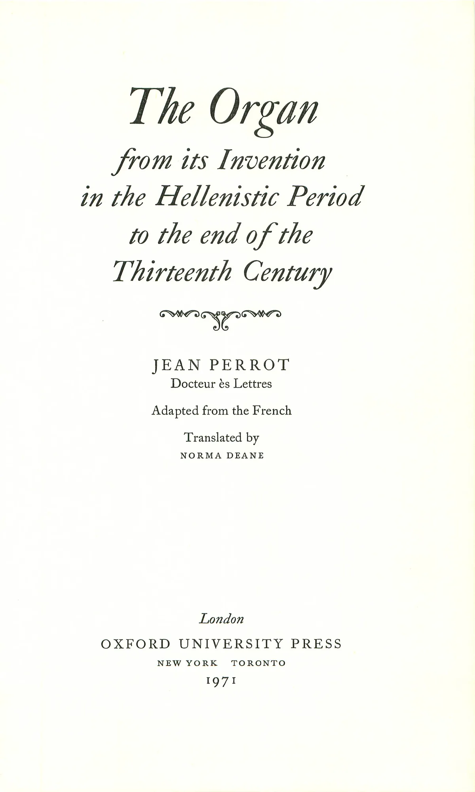
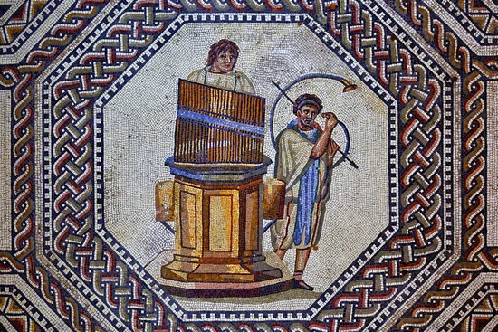
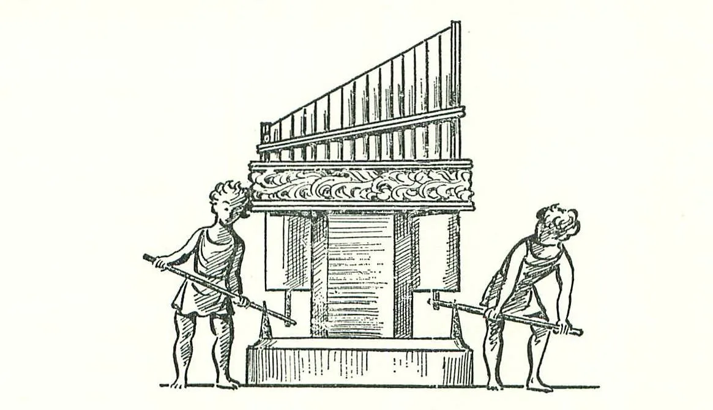
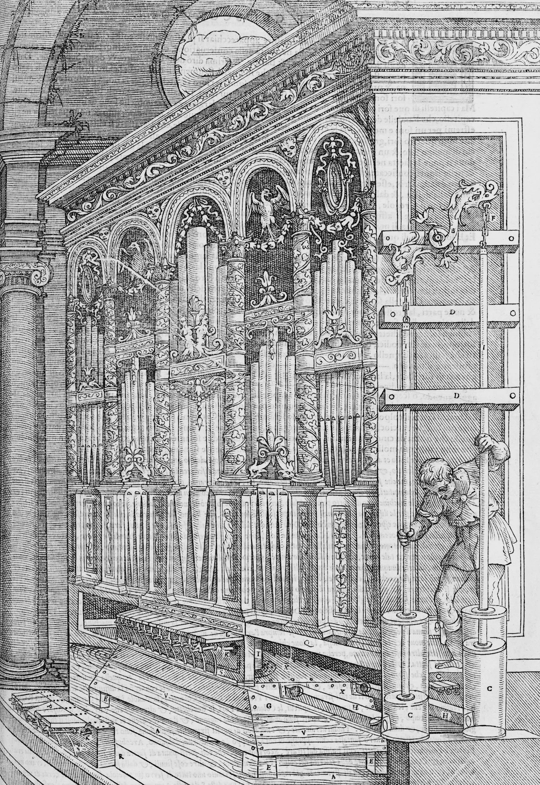
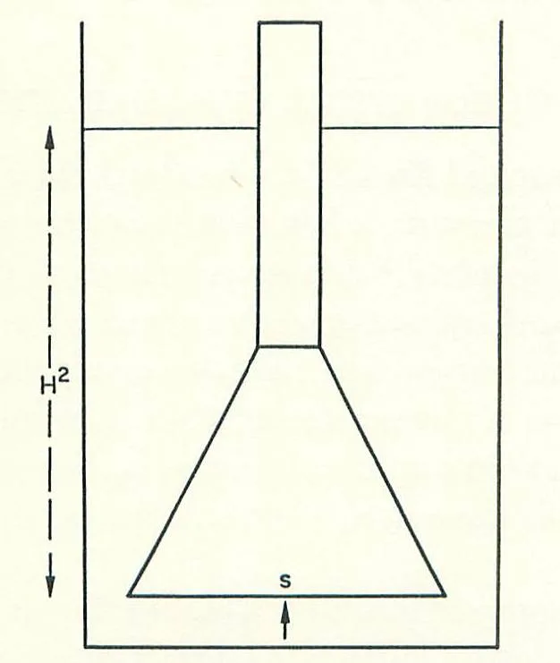
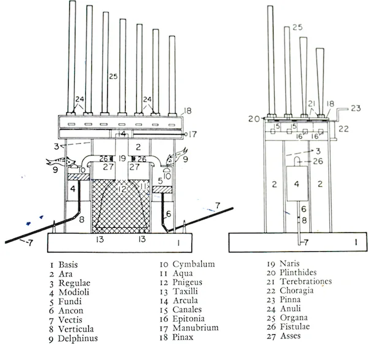
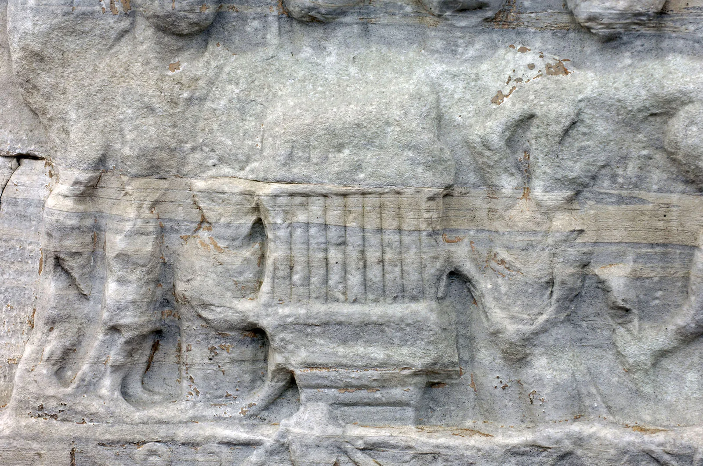
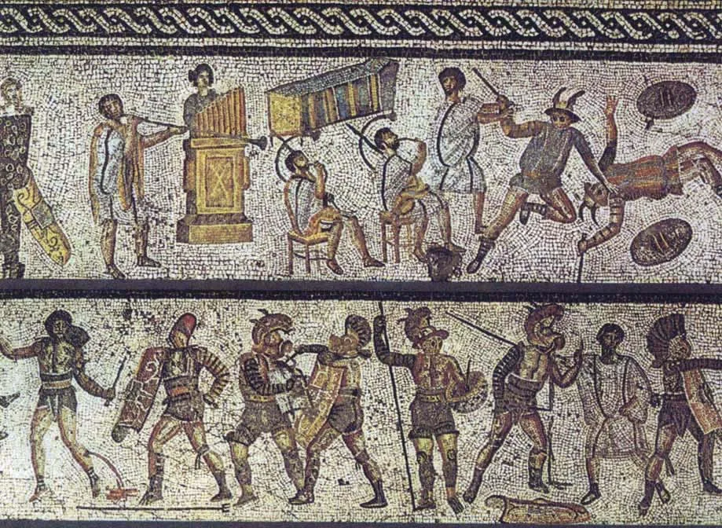
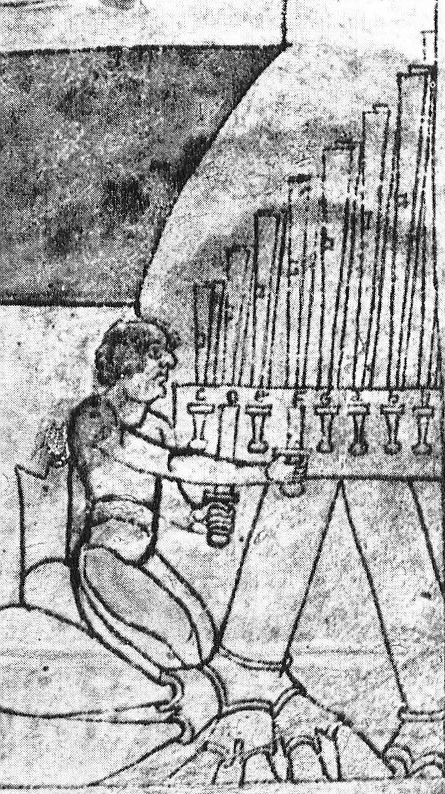
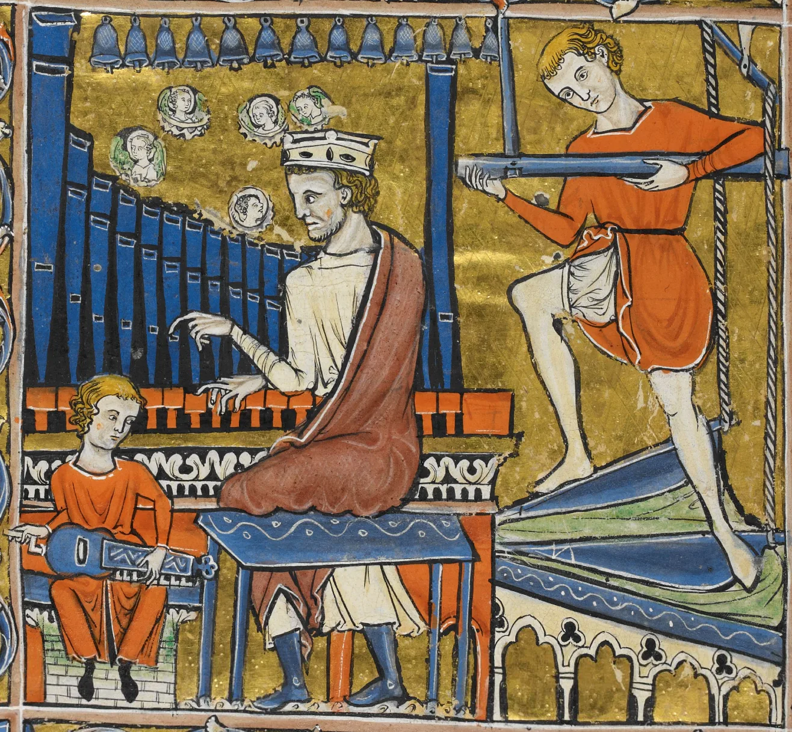

## Introduction

Back in October 2013, as part of a quest to understand the origins of the modern piano keyboard, I [set a goal](/posts/october-reading-resolution/) to read a 300-page book recommended by the curator of the [Musée Suisse de l'Orgue](https://www.orgue.ch/), Jean-Jacques Gramm:[^passed-away] Jean Perrot's scholarly classic on the early history of the *pipe organ*.[^perrot]

{:standalone width="45%"}

You might think that this is an obscure topic! Yet the book turned out to be packed with fascinating engineering and cultural history. It took me about four months of steady reading and note-taking[^perrot-notes] to finish it, after which I started drafting an article - and promptly left it unfinished for years.[^meanwhile] Here, at last, are some takeaways, paired with a companion post on [the origin of the modern musical keyboard](/posts/2021-xx-xx-The-origin-of-the-modern-musical-keyboard/).

The biggest surprise right away is just how *ancient* the pipe organ[^organon] is: it dates back to the 3rd century BCE, about 2,300 years ago. Even more remarkably, most of the core building blocks of a modern pipe organ were already in place from the very beginning:

- neatly aligned *pipes* ordered by size,
- mechanical air *pumps*,
- an air pressure *regulator*,
- and a spring-loaded *keyboard* played with the fingers.

{:standalone width="75%"}

*Note: Curiously, the Nennig mosaicist reversed the usual pipe order, placing the tallest bass pipes to the organist's right - likely a slip from memory, as nearly all other ancient depictions place the shortest treble pipes on the player's right.*

## Engineering the *hydraulis* (and beyond)

### Ktesibios and the surviving evidence

As far as we know, the organ was single-handedly invented by one person: [Ktesibios][ktesibios-link] (or Ctesibius) of Alexandria, who lived around 285–222 BCE - an early "geek" with a passion for pneumatic machines and pumps.

The ancient Greeks already had wind instruments such as the *aulos* (a double-reed pipe), powered by a human player's lungs. Using a machine to blow air into a row of pipes was a genuine breakthrough. To make it musical, Ktesibios had to devise a system capable not only of pumping air, but of maintaining a reasonably constant air pressure so that the sound would remain steady and pleasant across sequences of notes.

His solution pushed air from a cylinder pump into a cistern where the weight of water regulated the pressure feeding the windchest (the chamber distributing air to the pipes). Because of the role of water, the instrument was called the *hydraulis* (from the Greek words for "water" and *aulos*), or *hydraulic organ*.

Ktesibios described his invention in a treatise that is unfortunately lost, and because centuries separate him from our earliest surviving accounts, we cannot be 100% certain how much he built on earlier experiments. Still, a surprising range of ancient evidence has survived:

- **Classical texts:** Two detailed technical descriptions of the Greco-Roman organ were copied and preserved over the millennia - one by [Vitruvius](https://en.wikipedia.org/wiki/Vitruvius) (1st century BCE) and one by [Hero of Alexandria](https://en.wikipedia.org/wiki/Hero_of_Alexandria) (1st century CE).
- **Iconography:** Dozens of mosaics, bas-reliefs, lamps, and terracotta figurines depict the instrument in action.
- **Archaeology:** Actual physical remains have been unearthed, notably the 1st-century BCE [Dion hydraulis][dion-hydraulis-link] (discovered in Greece in 1992) and the small 3rd-century CE [Aquincum organ][aquincum-organ-link] from Roman Hungary (whose dedicatory plaque calls it a *hydra*, though its wind supply burned in a fire and scholars still debate whether it was water- or bellows-driven).

One of the most striking pieces of documentary evidence is a three-color Greek diagram of Hero's *Pneumatica*, preserved in a Venice manuscript from around 1300 (*Marcianus gr. Z. 516*) and faithfully reproduced in later Greek copies such as the British Library's 16th-century *Burney MS 108* - all ultimately descending from antiquity.[^hero-drawing] It shows the entire machine at a glance: the water cistern with its inverted dome on the left, the piston air pump in the center, the windchest and pipes above, and the keyboard mechanism with its horn return springs and sliders on the right.



### Misconceptions about the role of water

From antiquity to modern times, the exact role of water in the *hydraulis* has baffled commentators. Even Vitruvius [warned his readers][vitruvius-link] how hard it is to picture from text alone:

> With my best efforts I have striven to set forth an obscure subject clearly in writing, but the theory of it is not easy, nor readily understood by all, save only those who have had some practice in things of this kind. If anybody has failed to understand it, he will certainly find, when he comes to know the thing itself, that it is carefully and exquisitely contrived in all respects.

Between the 16th and 19th centuries in particular, scholars produced some wonderfully imaginative - if mechanically impossible - reconstructions. It helps to clear up three recurring myths:

- **Misconception 1: Water was the power source.** False: the *hydraulis* was human-powered, typically by attendants or youths pumping levers up and down with their arms.
- **Misconception 2: Water flowed through the pipes to make sound.** False: like every pipe organ since, the *hydraulis* sounded by blowing *air* through its pipes.
- **Misconception 3: A continuous supply of running water was required.** False: the *volume* of water stayed fixed. You simply filled the cistern once and topped it up occasionally to compensate for evaporation or leaks. Because only the static *weight* of that water regulated air pressure, the *hydraulis* remained a relatively portable instrument.

{:standalone width="55%"}

{:standalone width="50%"}

### What the water actually did

Imagine connecting a manual bicycle tire pump directly to a flute: because the piston has to be drawn back between strokes, air only flows intermittently, making it impossible to sustain a steady note. Using two pumps in alternation (as most Greco-Roman organs did) smooths the gaps somewhat, but the pressure still pulses with every stroke.

In the *hydraulis*, water acts as a pressure buffer - essentially a gravity-loaded accumulator - allowing the organist to play continuous lines or hold notes without the pitch and volume wavering. Air from the pumps feeds both the windchest above and an inverted funnel or dome, called the *pnigeus*, submerged near the bottom of the water cistern.

{:standalone width="50%"}

When the pump forces air in, excess air pushes water out from under the *pnigeus*, raising the surrounding water level. During the brief pause when the pump piston reverses direction, the weight of that displaced water presses back into the *pnigeus*, driving stored air steadily up into the windchest and pipes. In the modern cutaway of Vitruvius's organ below, you can trace how the water (11) and *pnigeus* (12) stabilize the airflow on its way to the pipes.

{:standalone width="65%"}

### From water to bellows

We do not know precisely when *bellows organs* - which needed no water at all - first appeared. Blacksmiths' bellows were already thousands of years old, but adapting them to an organ still required solving pressure regulation and windchest air leaks. By the 2nd century CE, bellows organs were definitely in use, and by the fall of the Western Roman Empire, the water-regulated *hydraulis* had largely vanished.[^bellows-hydraulic]

Bellows organs were lighter, easier to move, and spared builders the corrosion and maintenance headaches of a water tank. Initially, however, they could not match the high wind pressures and sheer volume of the *hydraulis*, so early bellows instruments favored indoor settings before growing larger in late antiquity - as seen on the base of the Obelisk of Theodosius in Constantinople (c. 390 CE), where attendants stand directly on top of the bellows to weight them with their bodies.

{:standalone width="75%"}

## Gladiators, emperors, and early organists

Soon after Ktesibios's prototype, the organ matured and spread throughout the Mediterranean world. A typical Greco-Roman organ had two pumps and between 7 and 18 pipes per rank, with up to four ranks of pipes and intervals ranging from roughly a semitone to a whole tone.

One striking contrast with later centuries is that in antiquity, **the organ was never used in early Christian worship, and only very rarely in pagan temple ritual**.[^rhodes] Instead, it led a mostly secular double life:

- **In the arena:** Driven by high wind pressure - and, as Perrot and some historians suspect, possibly loud reed pipes alongside open flue ranks[^reeds] - the *hydraulis* cut right through the roar of amphitheaters, accompanying circus spectacles and gladiatorial combats alongside brass horns.
- **In palaces and banquets:** Voiced with gentler flue pipes, it was equally prized for sweet, expressive music indoors, making it a favorite of Roman emperors - most famously Nero, who was fascinated by new organ mechanisms.

{:standalone width="85%"}

Who played these instruments? According to ancient tradition, Ktesibios's wife, Thaïs, was the very first organist - and surviving inscriptions, terracottas, and mosaics (including the Zliten mosaic above) confirm that women organists were a real feature of Greco-Roman musical life. Performers stood or sat behind the pipes facing the audience, playing with both hands and nimble individual fingers on a spring-return keyboard[^manual] - a mechanism I explore in detail in [my companion article](/posts/2021-xx-xx-The-origin-of-the-modern-musical-keyboard/).

## Lost in the West, preserved in the East

After the Western Roman Empire collapsed in the 5th century, the organ disappeared completely from Western Europe for roughly three hundred years. During that long hiatus, the Greco-Roman bellows organ survived in **Constantinople**, capital of the Byzantine Empire.

In Byzantium, the organ remained a secular symbol of imperial majesty rather than a church instrument, as Christian clergy generally opposed instrumental music in worship. Contemporary accounts describe dazzling "silver" and "golden" organs played at court banquets, processions, and Hippodrome festivities, with the golden instruments reserved for the Emperor himself. Technologically, the Byzantine organ appears to have stayed faithful to late-Roman bellows designs.

From the eastern Mediterranean, the organ also traveled east: by the 8th century it was known and built in **Baghdad**, and in the 13th century a documented organ even reached China as a diplomatic gift to [Kublai Khan](https://en.wikipedia.org/wiki/Kublai_Khan) - the same Mongol ruler Marco Polo later visited.

Meanwhile, the organ made its dramatic return to Western Europe in **757 CE**, when Byzantine Emperor Constantine V shipped an instrument from Constantinople to [Pepin the Short](https://en.wikipedia.org/wiki/Pepin_the_Short), King of the Franks, as a diplomatic gesture. Chroniclers recorded the awe it inspired: nobody in the West remembered the Greco-Roman organ anymore.

Roughly seventy years later, in **826 CE**, a Venetian priest and organ builder named Georgius (probably trained in the Byzantine tradition) arrived at the court of Charlemagne's son, Louis the Pious, in Aachen. He was the first known organ builder in the West in some five centuries. Once again, the goal was not church liturgy, but royal prestige to rival Constantinople.

Paraphrasing Perrot, the organ's survival across the first millennium followed an extraordinary geographic relay:

> Invented in Egypt in a Greek milieu, the organ conquered the Roman world, survived in Constantinople while branching east toward Baghdad, and finally returned to Western Europe through the Frankish court.

## Into the church: setbacks and reinvention (9th–13th centuries)

### Monks as master mechanics

Georgius passed his craft on to pupils, and his success gradually softened Western clerical attitudes toward instruments. Building an organ demanded literacy, geometry, carpentry, and metallurgy - skills concentrated in medieval monasteries. What began as cautious tolerance grew into widespread adoption (not without occasional grumbling from stricter churchmen!). Even the papacy took notice, and by the 9th and 10th centuries organs were appearing in cathedrals and abbeys across Europe.

### One step back, one step forward

No physical organs from the 10th through early 12th centuries survive, but monastic treatises - most notably by the 11th-century Anonymous of Berne and the early-12th-century monk Theophilus - describe contemporary organ-building in remarkable detail.

Surprisingly, these texts reveal a clear technological regression compared to Vitruvius and Hero. Medieval instruments were generally smaller, and many had lost the ancient spring-loaded keyboard altogether, reverting to plain wooden **sliders** that the player had to pull out to sound a pipe and push back in to silence it - a far slower, clumsier action. Perrot attributes this step backward both to the loss of classical engineering texts and to the leaner economic conditions of early medieval Europe.

{:standalone width="45%"}

At the other extreme sits a famous late-10th-century Latin poem celebrating a monster organ built at [Winchester Cathedral][winchester-link] in England, supposedly boasting 400 pipes in ten ranks, 40 sliders played by two organists side by side, and 26 bellows worked by 70 strong men! Because our only source is a celebratory poem, the numbers are almost certainly exaggerated - yet the Winchester account marks a genuine milestone: it is the earliest record of **sliders inscribed with letters of the alphabet** so the player could see which note was which.[^harding-bible]

### Craftsmanship, church placement, and the rise of polyphony

Those same 10th- to 12th-century treatises give us a vivid look inside a medieval organ workshop. Builders rolled thin copper sheets soldered with tin into conical or cylindrical pipes (curiously keeping all pipes the same diameter across the compass), mounted them on wood-and-copper windchests sealed with molten lead, and fed them from ram-skin bellows - whose creaking and clatter could be loud enough to distract from the music! To determine pipe lengths, monk-theorists started from the mathematical ratios of the monochord (`1:2` for the octave, `2:3` for the fifth, `8:9` for a whole tone) and soon realized that lipped pipes needed an extra **end-correction** adjustment for pipe diameter - anticipating Aristide Cavaillé-Coll's famous 1860 end-correction formula by eight centuries. Inside the church, the organ was typically tucked under a wall arch behind dust curtains, hiding both blowers and organist from the congregation - a complete reversal of the Roman arena, where the performer stood front and center.

{:standalone width="65%"}

By the 13th century, proper lever keyboards with wooden keys reinforced in iron were spreading again, and the organ had split into three distinct sizes: permanent church instruments (growing larger alongside soaring Gothic architecture), movable table- or floor-standing *positives*, and small strap-held *portatives* for secular music - the type most frequently shown in medieval illuminations. Organs played solo, accompanied chant and hymns, or joined ensembles alongside instruments such as the *cymbalum* (a rack of small tuned bells struck with hammers, visible right above King David in the [Rutland Psalter][rutland-link] above). Most consequentially of all, because one player could sustain two or more consonant lines at once across a diatonic scale (usually with an added B♭), the medieval organ helped nurture *organum* - and with it, the broader flowering of Western **polyphony**.

## Conclusion

Stepping back, the early history of the pipe organ reads almost like improbable fiction. Conceived in 3rd-century BCE Alexandria by an engineer obsessed with air pumps, it arrived in the world already equipped with graded pipes, stabilized wind pressure, and a finger-played keyboard. It thundered behind Roman gladiators, entertained emperors in Rome and Constantinople, traveled as far east as Baghdad and Kublai Khan's court, returned to Western Europe as a diplomatic marvel, survived a medieval bout of technological amnesia, and ultimately reinvented itself inside monasteries and cathedrals as the quintessential church instrument.

Yet for my original question - *where did the modern piano keyboard come from?* - Perrot's story stops right at a cliffhanger. By the end of the 13th century, after more than 1,500 years of organ building, keyboards were still essentially a single row of wide levers, without the raised groups of two and three "black keys" we recognize instantly today. How that familiar chromatic layout took shape over the next century and a half is the detective story I pick up in [The Origin of the Modern Musical Keyboard](/posts/2021-xx-xx-The-origin-of-the-modern-musical-keyboard/).

---

[^passed-away]: Who has since passed away in 2022 at age 95.

[^perrot]: Jean Perrot, *The Organ, from its Invention in the Hellenistic Period to the End of the Thirteenth Century* (translated from the French by Norma Deane), Oxford University Press, 1971.

[^perrot-notes]: I took extensive [reading notes][reading-notes-link] as I went through the book between October 2013 and January 2014.

[^meanwhile]: Along the way, my curiosity about mechanical keyboards took a decade-long detour into another family of keyed machines: vintage typewriters!

[^organon]: The Greek word *organon* (Latin *organum*) originally meant any "tool" or "instrument" in the general sense. Because ancient and medieval writers used the word both for tools/musical instruments in general and specifically for the pipe organ, historians have to read early references with great care.

[^hero-drawing]: Jean Perrot notes: *"These diagrams certainly existed in the original, since the letters correspond. Moreover, it is highly unlikely that any transcriber would have been capable of inventing them."*

[^bellows-hydraulic]: Confusingly, medieval writers continued calling purely pneumatic bellows organs *hydraulis* for centuries out of sheer literary habit.

[^rhodes]: Perrot notes one rare liturgical exception from the 3rd century CE: a Greek inscription from Rhodes naming a water-organ player (*hydraulēs*) *"charged with awakening the god,"* alongside festival competitions at sanctuaries such as Apollo's temple at Delphi (90 BCE).

[^reeds]: Whether Greco-Roman organs actually used reed pipes remains an open debate among organologists: every ancient organ pipe unearthed so far (at Pompeii, Aquincum, and Dion) is a flue pipe, though high hydraulic wind pressures could also have supported reeds.

[^manual]: In organ parlance, a hand-played keyboard is called a *manual* (as opposed to a foot-played *pedalboard*).

[^harding-bible]: The early-12th-century [Étienne Harding Bible][harding-bible-link] illustration shows this clearly, with eight sword-hilt sliders labeled with note letters (`C` through `h`).

[reading-notes-link]: https://github.com/ebruchez/public/blob/master/Reading/2013-10%20-%20The%20Organ.md
[ktesibios-link]: https://en.wikipedia.org/wiki/Ctesibius
[vitruvius-link]: https://en.wikisource.org/wiki/Ten_Books_on_Architecture/Book_X#Chapter_8
[aquincum-organ-link]: https://commons.wikimedia.org/wiki/File:Roman_pipe_organ_Aquincum.jpg
[dion-hydraulis-link]: https://en.wikipedia.org/wiki/Water_organ#The_hydraulis_of_Dion
[winchester-link]: https://web.archive.org/web/20220813191017/http://organ-au-logis.pagesperso-orange.fr/Pages/Winchester.htm
[harding-bible-link]: https://fr.wikipedia.org/wiki/Bible_d%27%C3%89tienne_Harding
[rutland-link]: https://commons.wikimedia.org/wiki/File:Salterio_de_Rutland_(%27The_Rutland_Psalter%27),_c._1260,_el_rey_David_tocando_el_%C3%B3rgano,_F._97v,_Add_MS_62925,_British_Library,_detalle.jpg
