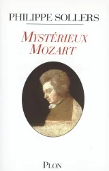

<figure class="roller-figure" data-no-lightbox></figure>

Plutôt qu'une œuvre de référence, *Mystérieux Mozart* est un plaisant voyage, sur les lieux Mozartiens d'abord, puis dans le temps, plus précisement dans la seconde moitié du XVIIIe siècle. Sollers traverse la vie du compositeur librement au gré de son enthousiasme tout en commentant les œuvres les plus marquantes, levant ici ou là quelques arguments pertinents, pointant du doigt l'anecdote révélatrice. L'éclairage des relations avec le père, la cousine ainsi que Constance sont particulièrement intéressant.

On trouvera curieux cependant la thèse de Sollers qu'"après Mozart tout s'est brusquement ralenti dans le bruit, la fureur, la lourdeur ou le tintamarre.", comme le résume la seconde page de couverture. Les pages 215 a 217 où cette thèse est présentée sont pour le moins déconcertantes. Après Mozart, la "catastrophe", selon Sollers. Des "livrets imbéciles", une "dissociation des mots et de la musique", une "militarisation de la musique" qui "a pu ouvrir la porte à de nouveaux massacres". On a rarement vu des assertions moins étayées, et les quelques citations de Nikolaus Harnoncourt et Cecilia Bartoli ne contribuent pas à réparer tant de maladresses dans le raisonnement et l'écriture. On aura compris que Sollers aime Mozart passionément (on aura même compris qu'il aime le Jazz), mais on aura également compris qu'il méconnait l'opéra du XIXe siècle (que dire en effet de Donizetti, Rossini ou du Verdi de Falstaff, pour ne parler que d'opéra ?). Bref, trois pages que l'on aurait souhaité voir échapper à la publication.
