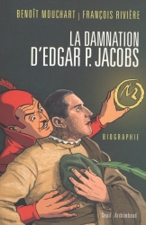

<figure class="roller-figure" data-no-lightbox></figure>

Jusqu'à *La Damnation d'Edgar P. Jacobs*, le célèbre auteur de bandes dessinées était resté mystérieux pour ses lecteurs pourtant nombreux et enthousiastes. Jacobs avait publié de son vivant ses mémoires, *Un Opéra de Papier*, mais ceux-ci ne présentaient que la perspective du maître lui-même. La disponibilité d'une véritable biographie est donc un événement à saluer.

Les auteurs couvrent en détails ce qui est connu de la jeunesse de Jacobs, son amitié avec Jacques Van Melkebeke, puis sa première et courte carrière de baryton, qui le hantera pour le restant de ses jours. Le travail aux côtés d'Hergé, dès la fin de la seconde guerre mondiale, la douloureuse séparation d'avec sa première femme, Ninie, ainsi que la naissance de *Blake et Mortimer*, font des années 40 une période charnière de la vie d'Edgar.

Les productions majeures, du *Rayon U* aux *Trois Formules du Professeur Sato*, constituent le fil conducteur du reste de l'ouvrage. Si les commentaires autour des œuvres abondent, on regrette le peu d'informations liées a la vie personnelle de Jacobs dans cette seconde partie, qui laisse l'impression que celle-ci fut somme toute banale, jusqu'a la réclusion paranoïaque des dernières années. En fin de compte, et c'est la faiblesse majeure de l'ouvrage, on peine à saisir véritablement le caractère de Jacobs.

L'ouvrage est pourtant riche en anecdotes. On apprend ainsi qui a inspire l'apparence de Blake et de Mortimer, le rôle de Jacques, l'ami d'enfance et scénariste "fantôme" à qui Jacobs dut beaucoup. On apprend également les méthodes de travail d'Edgar, de sa phobie de l'encrage à son habitude de se faire photographier dans diverses poses servant ensuite d'inspiration pour le dessin de ses personnages. On notera que l'ouvrage est agrémenté de photographies couvrant toutes les périodes de la vie de Jacobs.

Au-delà de la passion pour l'opéra et des frustrations liées à sa seconde mais véritable carrière, on découvre un homme qui aura pu jouir, ne serait-ce que tardivement, du respect et de l'admiration non seulement de ses lecteurs mais des critiques. *La Damnation d'Edgar P. Jacobs*, c'est aussi une porte ouverte sur l'histoire de la bande dessinée Belge, qui donne envie d'en savoir plus. Voici un ouvrage que le fan de Blake et Mortimer ne peut manquer de lire.
