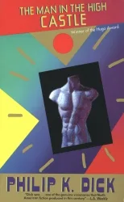

<figure class="roller-figure" data-no-lightbox></figure>

This is a surprising opus. The action takes place in San Francisco in the 1960s. Japan and Germany won World War II twenty years earlier, and split the world between them. The two countries occupy each half of the United States. Germany has brought the final solution to an extreme in Africa. The few remaining Jews are prosecuted and have to hide even in the Japan-controlled Pacific States of America, where the *I Ching* (or *Book of Changes*) is used daily and referred to as *the oracle*. The Germans have the technological advantage: Lufthansa rockets connect the continents, and the conquest of space is well underway. This is the only aspect of *The Man in the High Castle* that could place it in the category of science-fiction.

Philip K. Dick uses fascinating characters to progressively immerse the reader in his utopia, rather than going for a completely descriptive approach. Three loosely connected sets of characters share the book: first, Robert Childan, Frank Frink and Ed McCarthy; then, Mr. Nobusuke Tagomi and Mr. Baynes, AKA Captain Rudolf Wegener; and finally, Juliana Frink and Joe. Juliana and Frank are married but separated, and never meet in the story. Mr. Tagomi is an occasional customer of Childan. The three sets of characters could as well have been completely disconnected.

The variations on the English language are quite interesting. The Japanese characters speak what could be called Japanese-English, quite consistently throughout the book. In addition, the German culture is never far away, and the occurrences of German words are numerous, without being an obstacle to understanding the story.

An interesting twist is the presence in the story itself of a book, *The Grasshoper Lies Heavy*, which is about a world where Japan and Germany lost the war. This *mise en abyme* of the utopia is actually at the center of the story of Juliana, but in the end the plot falls short being really interesting. The last few pages in particular are quite anticlimactic.
