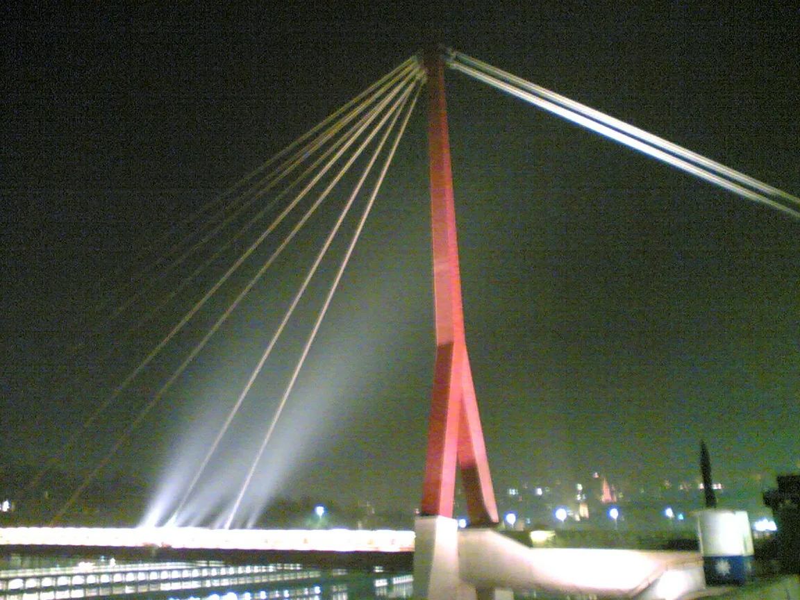

<figure class="roller-figure"></figure>

I am just back from [ObjectWebCon05](http://wiki.objectweb.org/ObjectWebCon05/), the Fourth Annual ObjectWeb Conference. For the non-initiated, ObjectWeb is "an international consortium fostering the development of open-source middleware". The consortium has picked a lot of steam over the last year or so, and [my company](http://www.orbeon.com/) is currently in the process of joining. I did a presentation in the context of the [ESBi initiative](http://wiki.objectweb.org/ESBi/), and of course I attended a few of the talks there.

Of particular interest to me, from a technical standpoint, were [C-JDBC](http://c-jdbc.objectweb.org/), a transparent clustered JDBC solution, a couple of talks about [OSGi](http://www.osgi.org/), and meeting a few very interesting people including [Sylvain Wallez](http://www.anyware-tech.com/blogs/sylvain/) from the Cocoon community, [Cliff Schmidt](http://weblogs.java.net/blog/cliff/) from BEA, [Richard Hall](http://forge.objectweb.org/users/rickhall/) from the Oscar OSGi project, and many others from the ObjectWeb community that I had for the most part already met before.

As [others](http://www.anyware-tech.com/blogs/sylvain/archives/000158.html) have mentioned, the French accents in English have reached some interesting levels during that conference, and my ears, used to the good old American accent, were sometimes hurting. On the flip side, I have my own accent so I guess it's only fair ;-)

 The picture shows the Passerelle du Palais de Justice (Palace of Justice Footbridge) by night, a picture taken with my Nokia 7610.
