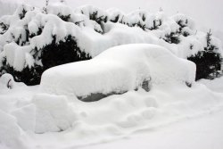

<figure class="roller-figure" data-no-lightbox></figure>

It's not only the [US North East](http://www.cnn.com/2005/WEATHER/01/24/winter.storm.ap/index.html) which is under the snow. Switzerland has just seen some pretty good snowfalls as well, without storms really, but to the point where the the Geneva airport had to be closed for nine hours on Sunday.

This kind of weather of course comes with the usual skiers and snowboarders caught in [avalanches](http://info.rsr.ch/fr/index.html?siteSect=500&sid=5488279), usually because they go off-piste. I am by the way surprised that the web site of a company like [Téléverbier](http://www.televerbier.ch/), which operates the lifts of the nearby [Verbier](http://www.verbier.ch/) ski resort, does not prominently advise against off-piste skiing, particularly days like today. It is true that when you are actually taking the gondola and other lifts, there are large yellow warning signs. Maybe they figured out that those are more effective than warnings on a web site.

The picture shows what you can see of my car at the moment. I guess I won't be using it anytime soon.
