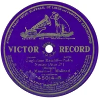

<figure class="roller-figure" data-no-lightbox></figure>

I had ordered a set of 78 rpm records from a seller in Urugay last year. I had ordered from that person once or twice before, and the packages arrived to the US safe and sound. This time since I was in the process of moving, I gave my Swiss address as shipping address.

Only recently did I start wondering about what had happened to that order. I promptly checked the DHL tracking number and got a confirmation that the package had indeed been shipped and delivered in early October 2004. But there was no way I could remember whether I had actually received it.

I started looking all over the place: in old cardboard boxes, on the top of bookcases, behind and under furniture. I went through the rest of my records, etc. But I did all this to no avail. And I figured, since DHL said they had delivered the package, they must be right, right?

Because I was in the middle of moving, with a couple of rooms full of boxes and papers, I figured that I must have been dreaming, and that I must have thrown away the precious Mascagni records still within their cardboard packaging.

Tonight I had a nice little surprise, when a person who identified himself as Eric Bruchez called me and asked whether, by any chance, I was not expecting a package from Uruguay. Mr. Bruchez is a cook who works nearby. Five minutes after the call ended, I was on my way, in the snow, to get my records.
