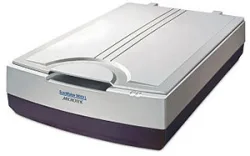

<figure class="roller-figure" data-no-lightbox></figure>

It is known that hardware manufacturers have always sucked at providing decent software on the Windows platform (my impression is that Mac users have been in a better position, that is for the hardware supported on Mac). For as long as I can remember, sound card and scanner utilities in particular have looked like they came from a galaxy far, far away. And I am not saying that in a good way.

Microtek ScanWizard Pro is no exception to this rule. It looks like a mix between a Windows 3.1 and an old Macintosh program ported to the PC. It is certainly not remotely up to any of recent (or even old) user interface standards. This is the first reason Microtek should be ashamed. This software would look bad if it came with a $50 scanner, but in fact it came with the ScanMaker 9800XL, a $1,000+ A3 scanner bought a couple of years ago. People at Microtek, can't you hire one decent software engineer? I hear they are a dime a dozen nowadays.

But what if the software kind of worked, I shouldn't complain too much, right? In fact I made the mistake of trying to upgrade ScanWizard Pro to a new version, in the hope that it will allow me to determine whether a visual glitch I am seeing could be due to a bug in the current driver. So I went to Microtek's web site. Like any hardware manufacturer web site worthy of this name, it has a support section where you can download the latest version of drivers and scanner software. Not bad.

There is a major problem though. When you click "download", you are redirected to the web site of a company that I won't name, and through which you must pay EUR 2.90 to be able to download the Microtek software. This is the second reason Microtek should be ashamed. As a hardware manufacturer, you don't make your customers pay for minor software upgrades, however small the amount. Especially since the payment system they are using has about the worst registration process I have seen in a long time. I probably spent half an hour getting to the point where I could download the software.

Now I could have been just inconvenienced and my wrath would have cooled down by now. But the best of all is that I haven't managed to make the upgrade work. My scans are always black with the "upgraded" version. And don't get me started on the Microteck installers I had to go through to get to that point, which are unable to install or uninstall anything correctly, and provide error messages probably written by a monkey.

So far, my email requests for support at Microtek have remained unanswered. They probably want you to call their paying hotlines (over EUR 1 / minute). Why should you pay to get support on non-functioning hardware or software? Shame, a third time.

There are a couple of positive things to report though. Switching back to the older application, things luckily work (or don't work) as they did before. And as a workaround to my issue, I have noticed that those glitches have not yet reappeared if I scan in 48-bit mode. They also do not always appear on the same physical vertical lines, even in a single image. This would appear to point to a software issue. Who knows, it may be fixed in a recent version of ScanWizard "Pro", but I will never know for sure if I cannot install the update.

Update 20050201: I have just received an email from the Microtek support in Germany. They provided me with a series of download links, and I managed to upgrade to the latest version of the ScanWizard software after installing the missing bits. This is a good news. The bad news is that the stripes still occur if I don't use the 48-bit mode. I am told that to fix it, I would have to send the scanner to Germany.
