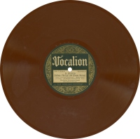

<figure class="roller-figure" data-no-lightbox></figure>

Friends of mine have had a good laugh more than once watching me listen to vintage audio recordings on my computer headphones. None of them of course would listen to muffled, crackling and popping, monophonic audio records. After all, this is the century of digital audio, where a $50 piece of equipment records at 24-bit / 96 kHz, and where your look dumb if your audio system does not have six or height speakers.

But I digress. The question is to understand why you would listen to one century-old music, when you can listen to last year's brand new opera CD. The answer requires a little bit more context information.

A century ago or so, opera was flourishing. Verdi had just passed away. Composers like Puccini, [Mascagni](http://www.mascagni.org/), and Strauss, enjoyed huge popularity. Opera singers were the stars of the time, and going to the opera was one of the greatest entertainment you could have. In that context, the first audio recordings appeared, and the result was simply that countless musical treasures were kept for posterity on 78 rpm records.

But what the heck is a 78 rpm record, you might say? It is a type of vintage [gramophone record](http://en.wikipedia.org/wiki/Gramophone_record) that thrived during the first half of the 20th century. Those records had to be played at about 78 rotations per minute (or rpm), hence the name "78 rpm" ("78 tours" in French) under which they are known today - even though they did not always necessarily play at *exactly* 78 rpm.

My interest in vintage recordings is accentuated by the fact that opera singing is not quite what it used to be. Face it, opera music has had some competition lately, from jazz to hip-hop, but also from other types of entertainment like movies and television. The new generations have difficulty producing great singers. Many will tell you that you can't find a decent tenor nowadays. So what if you want to listen to the best tenors? You turn to audio recordings, and you get to hear the Carusos and Giglis of this world.

This doesn't explain why you would actually buy some 78 rpm records. Here are a few answers:

- Many vintage recordings have been transfered to CD, but not *all* of them.
- CDs can be out of print and/or difficult to find.
- In most cases you can't put the music of a CD online on your web site. Even if the performance is old and often (but not always yet) in the public domain, the restoration and transfer work falls under a new copyright.

For [Mascagni.org](http://www.mascagni.org/), I figured it would be nice to have music as free as possible, and transfering original 78 rpm records is is a good way of doing just that.

Plus, 78 rpm records can be fun: they come in different sizes, with different labels, and even in different colors, like the brown-red Vocalion record shown here. Don't think about listening to them on the move though: they remain cumbersome and crack or even break like crystal. Better use an [iPod Shuffle](http://www.apple.com/ipodshuffle/) for that: a 1 GB model would fit over 500 monophonic sides.
