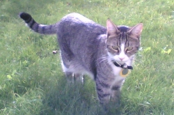

<figure class="roller-figure" data-no-lightbox></figure>

Last October, I brought my cat, Bubbles, from California to Switzerland.

How to proceeed was initially not clear, as I had never seen anybody fly with a pet on an international flight. So I assumed at first, looking for information on the internet, that you had to put the pet in a kennel in the cargo area. Opinions on how bad this is for the pet differ, some people saying that it is the worst way to travel, some the best (after all, they have room because they can be in a bigger kennel, and the absence of light calms them down - and yes, pets are put of course in a pressurized area). But, since fairly recently, you can't just ship your pet yourself, and you have to go through an authorized company. The bottom line: it costs quite a lot of money, I was told, about $500 or more.

I then found out that some companies do accept pets in the cabin on international flights, in particular the company I had my ticket with, [KLM](http://www.klm.com/). I managed to get some information online about the kennel size and pricing, and then simply confirmed over the phone. I was told I should reconfirm about one month in advance that the pet would be on board, and that they would ok it. The price: $100 (but funnily enough, I cannot remember anybody asking me to pay this fee in the end).

The pet must travel in a kennel that fits under the seat in front of you. You will find such airline-approved kennels at pet stores. The size is about 43 x 31 x 20 cm. Prefer the more expensive, but better designed semi-rigid ones, as opposed to the plastic ones. You can of course use such a kennel to transport your pet on other occasions. Most small to medium-sized cats will be all right, but dogs better be small. Your pet is not allowed to be taken out of the kennel, so it has to be prepared to stay in there for a long time. You may optionally pad the bottom with some baby underpads. The pet will remains very discreet down there, which also explains why you won't notice people with pets much anyway (as opposed to, say, babies). This said, there are indeed very few pets traveling in the cabin on international flights.

You may also want to carry a leash, which will be useful if you have to take the pet out of the kennel, for example to pass the security checks, where you have to carry it with you through the metal detector. You probably don't want to go look for your cat all over a crowded airport.

As for the administrative aspects, you need a health certificate for your pet made within 10 days. They ask for it when you checkin at the airport, and you may also need it when you pass customs in the destination country. The pet needs to be vaccinated against rabies, which is not one of the vaccines done automatically. So make sure you check what vaccines your pet had, and what you need. Also, be sure to check whether your destination country has special rules. The UK, for example, used to have very drastic quarantine rules (i.e., six-month quarantine), that have since been [somewhat relaxed](http://www.defra.gov.uk/animalh/quarantine/PETS/Procedures/owners.htm).

I did not use tranquilizers on Bubbles. I was told by the vet that if she behaved in a car, there was probably no need for it. A plane is fairly noisy, but otherwise more stable than a car. Also, tranquilizers can do more harm than good, as they weaken the animal and make it less able to react to stressful conditions. If you do use any, it is recommended to try them before the flight anyway, to see how your pet reacts.

In the end Bubbles spent an uncomfortable 20 hours in its kennel, between travel to and from airports, actual flights, connections, and a final trip by train in Switzerland. I feared that she may keep mewing, or do all sorts of stuff inside the kennel. But she behaved great (the underpads ended up not being necessary) and just arrived very thirsty (I did not give her anything during the flight, but a little bit of water would probably have been welcome).

Bubbles has been quite a happy cat in Switzerland for about four months now.

*Needless to say, if you plan to travel yourself with a pet, be sure to double-check this information with your airline company, veterinarian, and destination country.*
