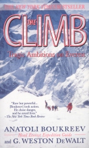

<figure class="roller-figure" data-no-lightbox></figure>

Many have read *Into Thin Air* by Jon Krakauer, the true story of a disastrous day on Mount Everest in May 1996, when several expeditions were caught in a storm that killed eleven people, including team leaders Scott Fisher and Rob Hall.

Krakauer's best-seller is a fantastic read that has inspired many. At the same time, while Krakauer acknowledges Russian mountain guide Anatoli Boukreev's heroic efforts to rescue fellow climbers, he criticizes many of his actions prior to the rescue. This situation motivated Boukreev and DeWalt's attempt to rectify the facts in *The Climb*.

Krakauer was climbing with the expedition of Hall's Adventure Consultants, and his account reflects in great part that point of view. Most casualties occurred in Hall's expedition, and Krakauer was on the front line to describe them. *The Climb* on the other hand tells the story from the point of view of Boukreev, who guided with the expedition of Fisher's Mountain Madness. Consequently, Boukreev spends less time on Hall's expedition, and more on his own, including an interesting account of his involvement with the preparation of the expedition.

Boukreev's point of view is that above 8,000 meters, you cannot be a guide anymore, at least not in the traditional sense of the term. You cannot constantly hold the clients by the hand. This is the basis of Boukreev's defense of his actions in the 1996 expedition. While he rarely shows any willingness to admit being wrong, he does recognize that his poor command of English at the time of the expedition became an obstacle on the mountain, a situation he had not anticipated.

What will convince the reader of Boukreev's professionalism is the long description of his expedition to Everest in 1997. In that expedition, as a "consultant" for an Indonesian team of climbers, he shows by example how the mistakes made by Fischer and Hall could be avoided with good planning. For example, he made sure that a Camp V would be installed and provided with enough oxygen on summit day (it turned out that Camp V was actually used by the descending team). He also insisted that he should have total control of the clients on the summit day.

Bad luck played a role in the 1996 expedition and appears to have led to Fisher's unexpected exhaustion, or even, as suggested in *The Climb*, HACE (High Altitude Cerebral Edema). However the book also points to the fact that the planning of Fisher and Halls's expeditions was sub-par (case in point, the fact that clients were still climbing after 2 PM on summit day, without a clearly communicated turnaround time, without radios, and without spare oxygen supply).

Fisher and Hall's deaths are utterly tragic. Both were good men and respected mountaineers, and Boukreev's admiration for them did not falter after the tragedy. But *The Climb* shows that as team leaders on the Everest in 1996, they probably deserve more criticism than Boukreev does as a guide. It is sad that Boukreev himself died in an avalanche in December 1997.

While most of the book is written by DeWalt, I was impressed by the amount of material narrated by Boukreev himself. These sections are edited from conversations between DeWalt and the guide. In addition, the crucial moments of the rescue on the South Col are presented as an unedited conversation between DeWalt and Boukreev. Content from the "debriefing tapes", recorded by nine expedition members a few days after the tragic events, is also directly quoted. There should be little doubt that DeWalt respects Boukreev's ideas.

*The Climb* is by no means as well written as *Into Thin Air*. It is also less dramatic, provides less historical and technical background on Mount Everest, and does not picture the general situation on the mountain in May 1996 as well as Krakauer does. For these reasons, it is probably a good idea to read *Into Thin Air* first, but *The Climb* remains an excellent and easy read that nicely complements Krakauer's opus.
