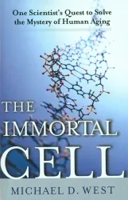

<figure class="roller-figure" data-no-lightbox></figure>

I just finished reading *The Immortal Cell* by Michael D. West and wrote a short [review](/posts/the-immortal-cell/) (also at [Amazon](http://www.amazon.com/gp/cdp/member-reviews/A80L38RKIE38J/)) of it. Coincidentally, I came today across an [article](http://www.cnn.com/2005/HEALTH/diet.fitness/02/15/one.mans.immortality.ap/index.html) about Ray Kurzweil, famous inventor, and author of a book I read last year, *The Age of Spiritual Machines*.

The two men clearly have different outlooks and goals. One of the reproaches I make about West's book regards his fairly reserved enthusiasm, as if he doesn't dare getting really excited by the discoveries made. Kurzweil on the other hand is a visionary and knows no limits. To sum things up he believes that soon humans will be able to live virtually forever, thanks to progresses made in medicine, nanotechnology, and computers.

We are so used to associating great age with illness that many people's first reaction upon hearing about the perspective of extended human life consists in pointing out how so many old people suffer from infirmities. But the reality is that it is simply no fun living when you are ill or disabled, whether you are 20 or 90, and this only has something to do with age in that getting older often brings infirmities with it, from arthritis to atherosclerosis to Parkinson's Disease to blindness and many more. But if you can reverse cellular aging, as West describes it, and treat more age-related illnesses, then getting old is no longer necessarily synonymous with getting debilitated.

Even today, you will see many octogenarians (like my grandfather who, at 84, drives, goes out with friends and family, and can't seem to be able to rest), nonagenarians or even centenarians who are happy to live and not looking forward to dying at all, sometimes in spite of many ailments.

Another reaction is the "ethical" reaction: do we have the "right" to do this; "should" we do this. And the "ethical" people to try to wonder what "we" should do. I do think that deeply reflecting on this subject should be done. After all, you don't want to do this kind of research at any cost. But once the research itself is deemed acceptable, I do not think that a group of people should dictate to another whether extended life is a good thing or not: if you don't want to benefit from life-extending treatments, don't get them, but don't prevent other people to try to stay alive.

Do we have a choice in this matter anyway? Can we stop research in this area? The technologies that will allow fighting against cancer, diabetes, and many other illnesses are likely to be the same that will allow fighting aging. If conservatives in the US have castrated research about embryonic stem cells, in Europe on the other hand it is going forward. In Switzerland, the legislation was even submitted to popular vote and [accepted with a large majority](http://news.bbc.co.uk/2/hi/europe/4049141.stm). So my guess is that this research will go forward no matter what.

And I think that such developments are wonderful. There is so much to do and learn in the world that assuming I can remain healthy and lucid, I would look forward to living for as long as science permits. There is a lot you can contribute when you are older and in good health, to your family and friends, maybe to the world. Travel, read, write, and communicate the experience and, hopefully, the wisdom that you have acquired over the years.

There is little doubt based on recent research that future drugs and treatments will allow for prolonged human life expectancy by countering cellular aging. Whether improvements will be measured in decades or centuries remains to be seen. But the best thing to do consists in looking forward to it and starting getting ready for the challenges posed by the possibility of extended human life. The pyramid of ages could be drastically modified (not unlike the modifications it has already seen over the last hundred years, thanks to the progress of medicine). This will have deep implications on social security, the age of retirement, birth control, etc. The question of just access to anti-ageing drugs and treatments and minimizing the divide between the rich and the poor will be crucial.
