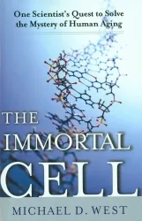

<figure class="roller-figure" data-no-lightbox></figure>

In *The Immortal Cell*, Michael D. West tells about his lifelong search for solutions to aging and age-related illnesses.

West's quest starts with an ideal of compassion: if we can help it, why should we keep suffering from Alzheimer, Parkinson, macular degeneration, atherosclerosis, and so many illnesses associated with aging?

West first thought religion and the bible would provide him with answers to his questions about life and death. One is surprised that a bright young man with a scientific mind would have fallen for creationism for as long a period of time as ten years, but West finally recognized that creationism does not resist serious analysis and that at the end of the 20th century, it is just nonsense. Because of this however West has kept a certain understanding for the point of view of the more conservative religious parties.

West then tells of the scientific quest, amidst fierce competition between scientists and even corporations, to understand the mechanics of cellular aging: the discovery of the importance of telomeres, those chromosome ends that turn out to be associated with the cellular clock; the discovery of telomerase, the enzyme able to repair telomeres; the discovery of the tight relationship of such research with cancer research; the first experiments to rewind the cellular clock by implanting somatic cells DNA into egg cells; the cloning of the first mammals; and the experiments to produce embryonic stem sells in vitro, from somatic DNA and egg cells.

The most important result is the proof that cellular aging is not a fatality, as one could have thought initially: it is caused by a mechanism that we are now able to somewhat tweak. From there, there are two main therapeutic perspectives. First, the idea of fixing the aging cells of the body. A lot of research remains to be done in this area. So far, nobody has managed to find a mechanism to reliably deliver a fix to a significant number of cells, and the fix itself has yet to be developed. Second, the idea that any somatic cell can be used to produce embryonic stem cells. This opens the door to building tissues and even entire organs in vitro. Such tissues and organs could be then grafted to the donor without risk of rejection. The perspectives go from implanting skin and bone marrow cells to finding a cure for diabetes and atheroscleriosis. Ultimately, it may allow for entire organ replacement.

West is probably a better scientist than philosopher, but in the last chapter of the book, he makes a good case for therapeutic cloning, including addressing some religious questions regarding "life" with very sound arguments.

*The Immortal Cell* is a good and easy read. I had fairly high expectations about it because it was very well rated online, and I was a little disappointed by several aspects of the book. West could have communicated even better the excitement this research should generate. He neglects related developments such as the impact nanotechnology research could have.

He also fails to address exciting but disruptive perspectives. If in fact cellular therapy becomes one day mainstream, there is a clear possibility that humans could see their life expectancy increase dramatically, from about 80 years today in developed countries to... 100? 120? 150? 200? 1000? The social impact of such a change would be enormous. It is quite possible that West does not wish to speculate about such subjects so as not to disrupt current research. After all, his own work has put him in the middle of the controversy about research on human embryonic stem cells and human cloning.
