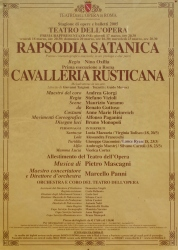
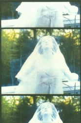
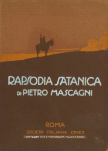
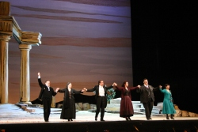

<figure class="roller-figure" data-no-lightbox></figure>

I attended on Sunday a performance at the Rome opera of Mascagni's *Rapsodia Satanica*, followed by *Cavalleria Rusticana*.

I enjoyed *Rapsodia Satanica* very much. I had already heard different audio records of the music, and watched a black and white version of the movie on video, so I was not entirely new to the work. Following is a mini-review of the work and performance. The bottom line is that *Rapsodia Satanica* should be done more often!

The Story

The story of *Rapsodia Satanica* is similar that of Faust. Here is a brief synopsis:

> Prelude: Alba d'Oltrevita (I guess that "Dawn of the Beyond" could be a valid translation) is old and frail in her castle of Illusions. She regrets her youth. Arrives Mefisto (the devil), who proposes a pact: if she renounces love forever, he will make her young again.
>
> First part: Alba has accepted the deal. She has opened the gates of the castle and the guests flow. She parties like crazy. Two brothers, Sergio and Tristano, fall in love with her. She seems to like Tristano but not so much Sergio, who in turn is madly in love with Alba and jealous of his brother. When Tristano learns about this, he backs off, and hopes that Alba will indeed accept his brother's love. Sergio tells Alba he will kill himself if she doesn't appear at her window at midnight. Tristano tries to convince her, fails to (Alba could maybe love him, but she cannot fall in love because of the pact), and Sergio dies. She regrets her act, starts loving him, and a wrinkle appears on her forehead.
>
> Second part: Alba lives secluded in her castle. Nobody can visit anymore. Suddenly, she opens up to life and love again: she places flowers everywhere, goes out in the garden, marvels at butterflies, etc. Mefisto arrives, engulfs her in his cape. When he frees her, she is old and frail again. She looks at herself in a pond, and dies.

*Rapsodia Satanica* was intended to be a very synesthetic piece of art: colored movie, music, and yes, a poem, available [here](http://www.mascagni.org/books/rapsodia-satanica).

The poem is akin to the script of the movie. Whether audiences were supposed to read it before watching the movie or afterwards is not clear. The poem is by Fausto Maria Martini. A co-author, "Alfa", pseudonym of baron Alberto Fassini, is also credited. See [this page](http://www.mascagni.org/pictures/rapsodia-scenes) for more information.

The poem was published in a [booklet](http://www.mascagni.org/book-reader/image/504842/1/0) in 1915.

<figure class="roller-figure" data-no-lightbox></figure>

The Movie

The projection was on the big screen. I really did not know exactly what to expect regarding the coloring of the movie, and it was good to finally see what this was really about.

First, entire sections of the movie are colored. That is, instead of appearing black and white, the tones are uniformly yellow, green, sepia, etc., depending on the sequence. Some scenes are entirely in regular black and white. Then some sequences are colored differently, with different areas of each frame colored separately. For example, parts of Alba's dress will be in various colors (green, blue, red, etc.), the rest of the frame remaining black and white; trees will be greenish, etc. This is clearly the most interesting aspect of the coloring, and the one that must have required the most work.

It is difficult to judge a 90 year old movie without being an expert in the matter, but I found it pretty good. The action makes sense, it is well organized and edited, the scenes are not too long (and because of the music you don't get bored anyway, after all you could do just with the music and no movie), and the acting is fairly good. There is of course a style of acting that warrants exaggerations that we wouldn't do today, but that were the custom in 1915.

Mefisto turns out to be quite scary and ugly! He once appears out of a picture frame, then from within a bunch of flowers (the scariest apparition in my opinion), or from behind curtains.

There is a beautiful mirror scene, where alba plays with her veil, and her reflection in the mirror is played by a second actress. Quite well done!

There are a few short missing parts in the movie which were replaced with black frames. I am not sure exactly why: you would expect that the other black and white copies of the movie would be complete and could have provided the missing parts.

Also, the "slides" providing indications about the action, typical of silent movies were not all in the same format: most were red on black, with a big "Cines" logo in the background, yet a few were just black and white text.

Somehow, I expected the film to be "fully" restored, and by that I meant cleaned of dust and scratches, the image stabilized, etc. None of this appears to have been done here. This would probably require digital treatment, and I understand that this would be very expensive. It would be a good thing to do however, because the pleasure of watching could only be increased. Then a DVD release would be absolutely fantastic.

<figure class="roller-figure" data-no-lightbox></figure>

The Music

Seeing the movie performed with live music allows you to better understand how the music fits with the action. I hadn't realized that fully until Sunday.

For example, when Tristano tries to convince Alba to accept the love of his brother Sergio who threatens to kill himself, you see the clock (with colors) getting closer from midnight, while Tristano pleads for his brother. The music is intense in its slowness, pathetic and tragic, reaching progressively those lyrical apexes typical of Mascagni's style. Then midnight arrives, the music becomes suddenly dark and mysterious, and you hear a bass drum "bang". Sergio has just killed himself.

When Alba realizes what she has done and bends over Sergio's body, the music becomes extremely sad, almost to make you cry. This is the end of the first part of the movie.

The beginning of the second part really captures Alba's sad life in her castle. The music is romantic and full of melancholy but incredibly beautiful.

The scene where Alba opens again to a sort of spring of love is again supported by magnificent music.

The last notes are extremely dramatic, in the fashion of Mascagni's opera endings, reminiscing of *Parisina* (Mascagni's most recently completed opera at the time he wrote Rapsodia). I noticed that *Rapsodia*, while not at the level of *Parisina*, frequently uses chromatisms that echo that of that opera as well.

Mascagni said he was very meticulous during the composition to be exactly in synchronization with the movie to the second. The conductor, Marcello Panni, did a good job at remaining in sync with the movie overall, but not perfectly. For example in the end, the orchestra's last notes happened well after the word "Fine" appeared on screen. It is probably quite a difficult job.

The booklet features an interview with the conductor, who says that he has a stopwatch and a monitor showing him the movie. He also says that there are scene changes that are announced and that the score helps the conductor by providing before such changes "rallentandi" allowing him to adjust.

The interview also mentions that Panni revised the orchestral score, which allegedly was only available from a May 1961 version rebuilt by a copist from individual score parts. The score was apparently full of mistakes or omissions, like that of a bass clarinet part.

An interesting trick is that Alba sits at the piano twice in the movie (one of them at least is a Chopin piece). In both cases the music is played by an actual piano in the orchestra, solo first, then joined by other instruments.

<figure class="roller-figure" data-no-lightbox></figure>

Cavalleria Rusticana

*Cavalleria Rusticana* was just all right. The settings were very simple. No church! I did not care much for the tenor's voice, nor did I care for the soprano, but she was better. The tenor missed his first "Bada, Santuzza" and got completely out of sync with the orchestra, which was a little scary. He got a good round of applause in the end, as did the soprano. The *Intermezzo* had a particular sound this time, and I found myself enjoying it very much! It got a lot of applause as well. This matinee audience was full of Americans and Asians visiting Rome on tours. Few of them probably realized that they won't have an opportunity to see *Rapsodia Satanica* ever again!

Finally, you may want to check some [personal pictures](http://erik.bruchez.name/pictures/ebruchez/album/521930) taken during my day trip to Rome.
