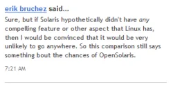

<figure class="roller-figure" data-no-lightbox></figure>

And the Earth also happens to rotate on itself.

Engineers writing software for the web should be kindly reminded of this fact when they start putting dates and times on their web pages. Case in point, while posting a [comment](http://otazi.blogspot.com/2005/04/is-it-too-little-too-late.html#comments) to Blogger today: no Sir, it's not "7:21" or even "7:21 AM" right now. I posted this comment at 4:21 PM Central European Summer Time (CEST), or, if you wish, 14:21 Universal Time (UTC), or 7:21 AM Pacific Daylight Time (PDT). Time zone information is not an optional, cool feature when you display time, it is an indispensable source of information!

So by the way are dates. Just yesterday, I visited a web site where news items didn't have any date information. One news entry went something like: "Back in February..." February of what year, please? Luckily, I contacted the web site's owner, who was kind enough to tell when the news item was posted, and that this would be fixed in the future. Other fun items include:

- Web sites dead for ten years saying: "The new version of the software will be released this coming June."
- The JavaScript clock that gives you the current time but in California or Italy or the UK. In fact, you have no idea unless you check your own watch.

Please, developers: use times and dates that make sense for the visitors of your web sites and users of your web applications. Yes, the world has become a village thanks to the Internet, but don't take that too literally.
