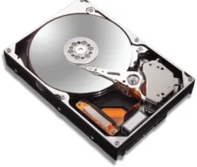

<figure class="roller-figure" data-no-lightbox></figure>

I don't know if it's just me (well, in fact, I have evidence that it's not the case), but I seem to collect problems with hard drives. While I have been lucky not to have had a serious problem with laptop hard drives (crossing my fingers), my desktop machines and servers keep causing me trouble.

Take my main server, which hosts my personal data archive (music, etc.) as well as a few public web sites.This machine is equipped with a [RAIDCore BC4852](http://www.broadcom.com/products/Enterprise-Small-Office/Storage-Solutions/BC4852) configured in RAID 5. During last summer, one drive failed. I did not have a hot spare, and did not notice the issue because the notification email from the RAID software was caught by my spam filter. When I realized the problem, a second drive was already failing. I managed by miracle to rescue most of the data and to rebuild an array.

Now in this case, I always suspected a heat problem. I promptly upgraded to a new drive enclosure with a good fan, and bought an additional drive which now acts as a hot spare. Since then, I haven't had any problem. It may just be luck.

I have been thinking for a while about my "personal information architecture", that is, where do I store my data, and how do I maximize the chances that I won't lose it. From a hardware perspective, this has since last summer consisted of having two machines: one in California, one in Switzerland. One acts as a main data archive, and the other as a backup.

The Swiss backup machine is a [Shuttle FX83](http://eu.shuttle.com/en/desktopdefault.aspx/tabid-72/170_read-4150/), a pretty nice-looking PC, with the big benefit that it can be transported. Because that machine had one of those built-in [VIA RAID chips](http://www.via.com.tw/en/products/chipsets/southbridge/vt8237/), I figured I would configure RAID 1.

Last week, one drive in the RAID 1 array failed. I promptly bought a replacement drive, removed the failed drive, put the new one in, and then used the VIA software to synchronize the array. Alas! The synchronization failed midway. After much moving around of drives, I ended up with one dead drive, and two healthy drives with a thoroughly corrupted filesystem. There went my backup.

What exactly happened remains a mystery . Did I have in fact two bad drives? Did the filesystem get corrupted after the first drive failed? Did I make a mistake and attempted to synchronize the bad drive to the new drive? I don't know. I do know that next time, I will take more steps before just switching in the new drive.

Here again I believe heat was the initial problem. Three drives in a poorly cooled XPC? I don't think so. I have now configured the fan to seriously blow on the remaining drive. My Shuttle is no longer silent, but oh well.

I will have to figure out how to get a new backup from the other machine which is across the atlantic. Unfortunately I can't simply copy over about 120 GB of data: it would take months.

Oh and yes, I do regular backups of my notebook's 120 GB RAID 0!
