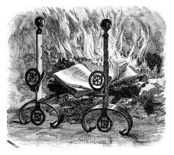

<figure class="roller-figure" data-no-lightbox></figure>

A [Slashdot](http://slashdot.org/) news ([*ALA President Not Fond of Bloggers*](http://slashdot.org/article.pl?sid=05/02/25/0441239&from=rss)) directed me to two recent articles written by Michael Gorman, president-elect of the American Library Association. They relate to the question of the digitization of printed content, which is a favorite subject of mine. I am not familiar with ALA, but I am sure it is valuable and means good. I also would have assumed that Mr. Gorman, given his position, is an insightful person. It turns out not to be the case.

The first article, *Google and God's Mind*, was published in the LA Times on December 17, 2004. It is a diatribe against one of Google's latest projects, which consists of [digitizing millions of books from a few select libraries](http://searchenginewatch.com/searchday/article.php/3447411), putting online the content of the books that are out of copyright, and providing search access to all of them. Mr. Gorman asserts that the project is a total waste of money. Curiously his main argument revolves around the idea that Google will provide a useless contextual result. *"The books in great libraries are much more than the sum of their parts. They are designed to be read sequentially and cumulatively, so that the reader gains knowledge in the reading."*.

First, one fails to see why such books have to be in "great" libraries. Then it doesn't take a rocket scientist to figure out that there are numerous useful scenarios where a contextual search is useful. There are reference books and dictionaries, of course. But consider a book about a music composer: the author of the book will likely dedicate pages to a biography of the musician, and then discuss each of his works. If you are looking for particular information about a particular work of this composer, sequential reading may be better, but not necessarily, and very likely you will obtain great insight about the particular work just by reading a few pages. You may also be searching for a particular excerpt of a novel that you remembered or that somebody indicated to you. In fact give me any book, and I am likely to find a little scenario showing how a contextual search can be useful. And I am not even talking about the obvious research scenarios ("Who said that first?"; "Am I plagiarizing now?"; "What book contained this piece about a computer searching for the answer to ['Life, the universe, and everything'](http://en.wikipedia.org/wiki/The_Answer_to_Life,_the_Universe,_and_Everything)?").

Mr. Gorman also attacks the question of online book reading. *"So, you abandon that line of inquiry or resolve to read the book. Are you going to do that online, assuming it's out of copyright?"*. This question is asked as if the obvious answer was a resounding "No!". But my answer is: read it online if you feel like it. If you don't want to, you can go borrow or buy the book, but at least now you have determined that you want to do so. You can also print a few pages or even an entire chapter on your home or office printer. Give the reader the freedom he or she deserves. I personally don't like reading entire books on screen. As a matter of fact I have never managed to do it and even long articles quickly tire me. But a few pages? Certainly, I will read them on screen. It is also important to be a little optimistic about the future of technologies such as so-called electronic paper. While long overdue, some incredible prototypes of electronic paper technology have been shown recently by [E Ink](http://www.eink.com/), and once mature there is almost no doubt that a fantastic market will emerge around such technology.

Mr. Gorman concludes his first article with this line: *"This latest version of Google hype will no doubt join taking personal commuter helicopters to work and carrying the Library of Congress in a briefcase on microfilm as "back to the future" failures, for the simple reason that they were solutions in search of a problem."* There is no doubt that the technologies Mr. Gorman mentions were failures, but searching millions of books digitally will likely prove that it is not.

There are many reasons for this. First, existing library catalogs are poor. Some collections are not even catalogued. When they are, you don't have a unified catalog for all the libraries of the world. Most libraries even have internally multiple catalogs! When you find a catalog entry, you have no idea of the subjects treated in the book other than by looking at the book title and subtitle, sometimes (rarely) with a brief summary of the contents of the book. How are you going to make a selection of books relevant to your research? You will have to leave your comfortable home or office to go spend hours, days, and maybe months as a library rat all over the world to find the information you are looking for.

There is also the question of rare books. How do you access them? There is a good chance that you will have to travel half around the world, ask for special permission, and maybe fail to obtain it. After that, you may not be allowed to make copies of the book. Making a digital copy of it would allow spreading the contents of such rare books, after a single but careful phase of digitization.

There is something exciting about the idea of searching dusty books and finally finding the gem you were looking for. But if there is a better way, nobody should be nostalgic of this.

Now it should be said that unfortunately the current state of affairs with libraries won't change any time soon. It is not because Google is scanning a few million books that all the printed content in the world will be instantly available digitally. Google, or any other company or government for that matter, does not have infinite resources. But what will be available digitally will be invaluable. It will also be a world premiere experiment on such a scale, and if it works, it may spawn similar projects all over the world. In fact, Jean-Noël Jeanneney, president of the French National Library, believes that Google's project is so awesome that he wrote a book ([*Quand Google défie l'Europe : Plaidoyer pour un sursaut*)](http://www.amazon.fr/exec/obidos/ASIN/2842059123/) about the threat it creates to the French language. Mr. Jeannenet believes that Europe should unite and launch a similar project to try to counter the hegemony of English online (which reminds me that I should write more blog posts in French).

Mr. Gorman apparently received a lot of negative feedback on his first article, which is understandable. He reports on this in a [second short article](http://www.libraryjournal.com/article/CA502009?display=BackTalkNews&industry=BackTalk&industryid=3767&verticalid=151&&) in LibraryJournal, where he directly insults every blogger in existence (and there are about 40,000 more every day) with this introduction: *"A blog is a species of interactive electronic diary by means of which the unpublishable, untrammeled by editors or the rules of grammar, can communicate their thoughts via the web.'* Yes, most blogs out there are of poor quality. They speak nonsense, have poor grammar, have very unstructured content, when there is any content at all. You have to realize that a lot of them are written by kids and teenagers, and for fun. There are however excellent blogs out there, and there will be more and more. Search engines will also eventually put some order in this: blogs with the best content are linked and read more, their success is measurable, and they will show up first in search engines. The online world just needs a little more time to adjust to the blog phenomenon.

On the other hand, there is a lot of terrible edited content, online or not. Grammar doesn't do everything. Ironically, Mr. Gorman's texts in particular are not very bright or researched. They are quick-and-dirty opinion pieces, where ignorance, arrogance and short-sightedness take place of clear thought. As a Slashdot poster puts it: *"I find myself struck by nothing so much as how very much like a blog entry this alleged "article" reads..."*

But in the end what is Mr. Gorman's concern? He *"believe[s], however, that massive databases of digitized whole books, especially scholarly books, are expensive exercises in futility based on the staggering notion that, for the first time in history, one form of communication (electronic) will supplant and obliterate all previous forms."*I for one could not disagree more. Mr. Gorman simply appears to be irrationally enamored of dusty libraries and books. [Not that there anything wrong with that](http://edition.cnn.com/SHOWBIZ/seinfeld/video/), except that it clouds his appreciation of some technologies that he does not fully understand. Worst of all, Mr. Gorman does not propose any alternative to digitization and online search software to facilitate the dissemination of information.
