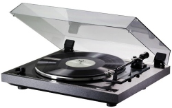
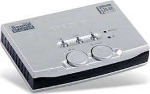
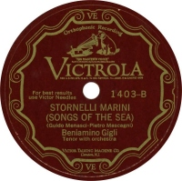

78 rpm records can be quite fun, and I have now acquired a few dozens of them over time. The big question is: what do you do with them? The answer appears simple: transfer them to some digital audio format, and just keep the originals safe in a closet. But how do you get from a hundred years old record to an mp3 file?

<figure class="roller-figure" data-no-lightbox></figure>

First, you need to play the record. For this purpose, I have a Thorens turntable which supports a rotating speed of 78 rpm, and a stylus appropriate for 78 rpm records (those are bigger than the needles used for LP records). Ideally, you should have a collection of styli and choose the one best adapted to the record you are playing, depending on type of record and condition, but I have not yet experimented with different styli.

The speed of the turntable is 78 rpm and not adjustable. Many web sites out there advise about using a fully adjustable turntable, because records may actually have to be played at 80 rpm, or 77, or other speeds: there was no actual 78 rpm standard at the time. If you play at 78 rpm and the record was intended to play at 80 rpm, the music will last a little longer, and the pitch will be a little lower. But my assessment is that nowadays an adjustable turntable is not required: with the appropriate software, you can resample your audio and adjust it to the correct speed and pitch. You could even record at 45 rpm, a speed supported by pretty much all the turntables out there. The pitch would be about half what it should be, but the frequency response of the cartridge and preamp will be good enough that you won't lose sound definition in the bass, which are usually weak on 78 rpm records in the first place.

All mainstream phono preamps have a built-in RIAA equalization curve. More modern microgroove LPs are recorded with reduced bass and increased treble, for technical reasons not worth discussing here. So the preamp pumps up the bass and attenuates the treble. 78 rpm records were not recorded with the RIAA curve in mind, so you should not use that curve during playback. Again, you are often advised to use a special phono preamp which doesn't apply that curve or can apply a bunch of different equalizations. My solution instead: digitally apply a reverse RIAA curve after the sound is recorded!

<figure class="roller-figure roller-figure--left" data-no-lightbox></figure>

To actually go from the analog world to the digital world, I use my notebook computer. The internal sound card is absolutely awful by any standard you can imagine, so using it is not an option. I use an Audigy 2 NX instead, an external USB 2 sound "card", which so far has worked very well. So here you go: with a fixed-speed turntable, a stock phono preamp, and a computer with a sound card, you can record a 78 rpm at the correct speed and with a flat response curve.

When you get to that point and listen to the result, chances are it will be fairly bad! In fact, 78 rpm records have usually had a long life before reaching you: they have been stored, manipulated, shipped, and may have been played a lot. This means that usually they have some wear and scratches. In addition, not all 78 rpm are equal: records from the early 1900 will not only typically have more scratches due to age, but the original sound quality, measured by the frequency range and the dynamic range, is also usually inferior to, say, a recording from the 1920s.

In order to reduce the noise due to scratches on the disc's surface, you should of course try to obtain a record in as good a condition as possible. But it also appears important to have records as clean as possible. I have not done much to clean records so far, because I lack the cleaning equipment. Some records I have bought are very clean, but some do appear to have dust within the grooves which should be removed.

Even a clean record will likely produce many audible clicks and pops. One first processing step which may reduce them is converting the audio from stereo to mono by mixing the left and right channels. 78 rpm records are obviously monophonic, but most turntables will provide a stereo signal, corresponding to measuring movements of the stylus at 45 degrees within the inner and outer part of the groove respectively. This means that the left and right signal you obtain by using a stereo cartridge on a monophonic record may pick up more or less dust or scratches.

Another technique consists in using "declicking" software. I have tried Cool Edit Pro's built-in declicker as well as Dart XP Pro. As is the case with noise reduction tools, it is a question of balance: you can quickly get to a point where the clicks or the noise are gone, but where the signal is also noticeably modified. For example, the music can sound boxy, or have "holes" instead of clicks. Removing clicks also doesn't make the sound perfectly clean: the sound may be almost "click"-free, yet remain very noisy due to other factors. Beyond automatic tools, it is useful to try to manually fill-in larger clicks. You do this by selecting an audible click or "dirty" area of the recording, which is then replaced with audio content coming from just before or after that area. The results are often surprisingly good.

<figure class="roller-figure" data-no-lightbox></figure>

Finally, some equalization of the resulting audio file may be needed. This is an art which I have not mastered yet. In fact, most of the time I have not done any equalization at all. But even though there was no standard equalization curve at the time of 78 rpm records, record companies did apply some type of equalization before recording. Eventually, what matters is how good the music sounds, and a strategy for equalization can consist in just listening and trying to obtain a natural sound.

The results I have obtained so far are clearly amateur and it is very frustrating to listen in comparison to recordings restored by somebody like [Ward Marston](http://www.marstonrecords.com/). Of course, Marston has access to the best source material, the best equipment, and he is the Mozart of antique records restoration! But still, I believe it is possible to enjoy those home-made transfers.

One of my goals was to provide music for free on [Mascagni.org](http://www.mascagni.org/). My first experiments can therefore be downloaded from Mascagni.org's upgraded [Audio Files](http://www.mascagni.org/works/sounds) section. The wonderful [duet from *Il piccolo Marat*](http://www.mascagni.org/works/sounds/8), a gem recorded by Hipolito Lázaro and Mafalda de Voltri, should not be missed. The music comes from four 78 rpm sides, for a total of almost 15 minutes of dream music. Another beautiful track is the version of *Stornelli Marini*, one of Mascagni's best songs, [sung by Beniamino Gigli](http://www.mascagni.org/works/sounds/501013), one of the greatest tenors of the 20th century. There is much more - just [explore for yourself](http://www.mascagni.org/works/sounds)!
