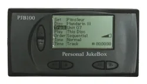

<figure class="roller-figure" data-no-lightbox></figure>

The [PJB-100](http://en.wikipedia.org/wiki/PJB) was the first ever hard disk mp3 player. I bought my 6 GB version back in July 2000, for a price of USD 783.71, shipping included. At the time, this was simply incredible: you could store the equivalent of about 100 CDs in your pocket. Besides the sheer capacity of the device, it also had a rechargeable battery with a life of over 10 hours, and a simple but very slick user interface.

For a very long time, looking at all the flash-based mp3 players out there, and then at the first (and terrible) [Creative Nomad](http://en.wikipedia.org/wiki/Creative_Nomad) Jukebox hard disk mp3 player in late 2000, I have considered the PJB-100 to be simply the best player out there. Only with the release of the iPod in late 2001 did at last something as good or better arrive on the market.

I am forced to realize that today, the PJB-100 has a few shortcomings:

- It is a fairly large unit compared to an iPod
- It is based on USB 1.1, which means that transferring files is quite slow
- My version doesn't have a backlight
- The software is not as good as iTunes

But to this day I use the PJB-100 in my car, and you can tell by the [Wikipedia article about the PJB](http://en.wikipedia.org/wiki/PJB) that I am not the only one to like (love?) this unit! Since I have been using my PJB for exactly five years now, I thought it was time to render homage to a wonderful piece of technology.
