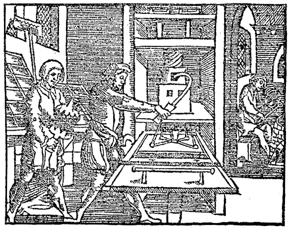

<figure class="roller-figure"></figure>

It is no news that web browsers suck. For example, Netscape 4 sucked big time (it was rushed out), which was one of the causes of its demise. Nowadays, it's the turn of Internet Explorer to suck, having stalled for over five years due to a lack of competition allowed by Microsoft's monopoly abuse. But with all the hype around [Firefox](http://www.mozilla.org/), [Opera](http://www.opera.com/), and [Safari](http://www.apple.com/macosx/features/safari/), you would think that at last, we are in good shape. Well, yes and no.

First, I have to say that I have been using Firefox forever, and before that the Mozilla suite (even before it reached version 1.0). The current success of Firefox is one of the greatest events on the web since the end of the browsers war, because it ends over half a decade of stagnation on the web. Thanks to Firefox, Opera and Safari, competition is back, developers must care, and end users will benefit. In other words, the web has just restarted.

I am usually fairly happy as a user of Firefox. It is fairly fast and comfortable. In contrast, I would no longer touch IE with a 10-foot pole. Just yesterday, playing with Deer Park Alpha 2 (the latest Firefox alpha), I have been happily surprised by the "fast back" feature (long provided by Opera), which in addition to providing way faster back / next navigation, is a boost for Ajax applications. The issues arise when you start writing web pages and web applications. That's when you just wonder why, in spite of all the recent developments, browsers still suck.

For example, Firefox does not support [CSS 2](http://www.w3.org/TR/CSS2/) completely ([CSS 2.1](http://www.w3.org/TR/CSS21/) is still in the works), a specification which came out in 1998. Isn't that a shame? And I am not talking only about features of CSS 2 supposedly impossible to understand. I am talking about things like [paged media](http://www.w3.org/TR/CSS2/page.html), partially supported by Opera. In fact, with Opera itself, in spite of numerous recomendations found on the web, I still haven't been able to generate repeating table headers and footers when printing. Maybe it's just me. At least, basic page breaks work with Opera.

My guess is that printing is not consider very sexy by browsers developers. Not a single browser prints decently, although Opera is ahead of the others by a long shot. Norm Walsh has [blogged](http://norman.walsh.name/2004/12/07/webarchPdf) about this not long ago, and he is of course right. I for one would be inclined, with some [CSS specialists](http://www.xml.com/lpt/a/2005/01/19/print.html), to think that we should be able to print documents with HTML and CSS directly from the web browser. While XSL-FO is good and has different goals than HTML, the reality is that you often have HTML to print, and that you don't want to go through the pain of converting your HTML to XSL-FO. Furthermore, open source XSL-FO libraries are far from being complete.

So here we are, in 2005, unable to decently print an HTML document. I will maybe give a shot later to Norm's XHTML to XSL-FO transformation, and run the output through the free personal edition of [XEP](http://www.renderx.com/).
