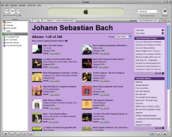

<figure class="roller-figure" data-no-lightbox></figure>

Credit is clearly due to Apple for being the first popular and legal music download site. They are now nearing 500 million downloaded songs. Maybe against all odds, they managed to convince backward-thinking music labels executives that downloading music was the future of music distribution and that there was money to make, not to lose, on the internet.

But everytime I give a try to the iTunes music store, I end up frustrated.

- The choice is extremly poor. Arguably, it is not as poor as last century music stores' (you know, the brick-and-mortar stores that are disappearing), but I just expect a *huge* choice for an online music store, as the cost of storage is cheap and getting cheaper with time (500 GB hard drives are available today at your neighborhood computer store). In the realm of classical and jazz music in particular, the choice is disastrous. Granted, these music styles account for probably 10% of music sales combined at most (I read somewhere the number of 3.5% of music sales for jazz in the US), and unfortunately young people are not the most likely to buy classical or jazz.
- You can't download sounds in a lossless format. Apple has its own lossless format that they could provide as an option, adding DRM if they wish so, as they do now for AAC. Savvy users can get rid of DRM anyway, and legally with that, by just burning a CD with iTunes.
- Prices are fairly expensive given that you don't get a physical media, a booklet, or a lossless file format. There is still an unfortunate belief in the music business that music should be expensive. Make it cheaper: you will sell more of it and people will be happier and less likely to get music through illegitimate channels.
- There is a confusion with national stores. I just got a certificate for three free songs at the Montreux Jazz Festival. Pretty cool, uh? Except that, because I already have US account, I wasn't able to redeem them easily. I had to create a new account in the Swiss store, with a new email address, to manage to get my coupon accepted. In addition, I can't even use my US credit card in the Swiss store: it has to be a Swiss credit card. The French saying "l'argent n'a pas d'odeur" ("money doesn't smell") should apply here: why does anybody care what credit card I use to buy music online? I may be a minority here, but given the international appeal of the Montreux Jazz Festival, more than one attendee may have hit these problems.
- I get the Swiss site in German language, with a German national flag, and without a way to change language settings. In addition, I keep receiving messages (in German) that a particular album is not available in my location, and that only at the time of redeeming the song.

All in all, there is huge room for improvement. In particular, Apple and recording labels should really get their story together at the European level, as their national stores provide nothing less than a disastrous user experience at the moment. Let's hope that a little bit of serious competition for Apple gets things moving again.
