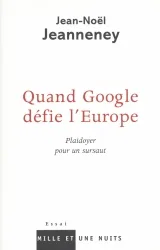

<figure class="roller-figure" data-no-lightbox></figure>

J'avais récemment commenté les faibles articles de Michael Gorman, président de l'Association des Bibliothécaires Américains, et à cette l'occasion fait une courte mention de Jean-Noël Jeanneney qui s'exprimait sur le projet de numérisation de Google. Pour en savoir plus sur l'opinion de M. Jeanneney, j'ai acquis son petit opuscule d'environ 110 pages, *Quand Google défie l'Europe*.

La thèse centrale de M. Jeanneney est relativement simple et tient en quelques phrases: le projet de Google en soi n'est pas foncièrement mauvais, mais il s'agit du projet d'une entreprise américaine réalisé en collaboration avec des universités américaines, ce qui laisse à penser que la majorité des ouvrages numérisés seront en anglais et présenteront donc une vision anglo-saxonne de la culture et de l'histoire mondiale. L'Europe se doit de réagir en lançant un projet de numérisation et de moteur de recherche qui assurera une place de choix à la culture européenne sur la toile, et qui soit libre des risques liés au contrôle total d'un tel projet par le secteur privé.

Pour s'assurer une audience maximale, soit tout simplement pour maximiser l'utilité de l'information partagée en ligne, l'anglais est une langue incontournable car la proportion d'internautes comprenant l'anglais dépasse de loin celle de ceux comprenant, par exemple, le français. A moyen terme, il est certainement utopique de voir le français, ou une quelconque langue autre que l'anglais, gagner sa "juste" place sur Internet : tout au plus peut on espérer ne pas voir les autres langues simplement péricliter. En principe, on ne peut donc qu'être d'accord avec la thèse de M. Jeanneney. Les millions d'ouvrages scannés par Google risquent de faire pencher la balance encore davantage du côte de l'anglais.

Pourtant, M. Jeanneney mélange deux aspects fondamentaux dans son projet pharaonique de numérisation et de recherche au niveau européen. Il faut en effet effectuer une distinction fondamentale : premièrement, la question de la numérisation elle-même. Deuxièmement, celle de l'indexation (voire du catalogage) et du moteur de recherche donnant accès à ces ouvrages.

En ce qui concerne la numérisation, il va de soi qu'elle doit être suivie d'OCR (reconnaissance optique de caractères), même approximative, sinon aucun résultat probant ne peut être espéré d'un moteur de recherche. Il s'agit là probablement d'un point qui n'a pas été bien étudié par M. Jeanneney, car sinon comment expliquer son obsession des catalogues ? En effet, il ne cesse de revenir à la charge, en faisant d'abord la critique des moteurs de recherche, en particulier de Google, qui selon lui ne sont pas satisfaisants. L'alternative ? M. Jeanneney a en tête des armées de bibliothécaires européens en charge de créer ces catalogues. Apres tout, pense-t-il, ces bibliothécaires sont indispensables à la société. Ce sont eux, ceux qui savent, qui organisent la connaissance, pour ceux qui ne savent pas. Ceux-ci seraient chargés non seulement des catalogues, mais également de sélectionner les ouvrages a numériser.

Une telle idée est pourtant absurde. On parle de 100 millions d'ouvrages publiés depuis le début de l'imprimerie, et probablement bien moins qui sont actuellement dans le domaine public. Sachant que Google planifie de numériser environ 10 millions d'ouvrages, et que l'effort européen se devrait d'être concurrentiel, il n'y a plus de *choix* à faire : on parle bien de scanner tous les ouvrages que l'on peut trouver, million par million ! Le problème de la sélection ne passe donc pas par un choix méthodique, ouvrage par ouvrage. Tout au plus va-t-on choisir quelles collections d'une bibliothèque vont être numérisées.

Alors qu'il serait intéressant de s'interroger sur les méthodes qui vont permettre de numériser des millions d'ouvrages en quelques années seulement (une petite révolution en soi), la question du "catalogage" et de la recherche est elle-même passionnante.

Mais à nouveau, il semble que M. Jeanneney ait en tête un classement manuel de ces millions d'ouvrages, toujours par son armée de bibliothécaires, et sous la houlette des grands "esprits" nationaux européens. Nouvelle idée absurde, pour la raison citée plus haut : comment imaginer qu'on puisse classer manuellement des millions d'ouvrages ?

M. Jeanneney entend par exemple s'assurer que les "têtes de listes", c'est-à-dire, on imagine, les premiers résultats de recherche pour certains mots-clés, soient protéges d'un biais anglo-saxon grâce à un mécanisme de catalogage manuel. Pourtant, il suffirait de fournir à l'utilisateur le choix d'effectuer une recherche sur la base de la langue de l'ouvrage, voire de la langue originale s'il s'agit d'une traduction, pour régler ce problème.

M. Jeanneney fait ensuite une profession de foi politique explicitement gaulliste (c'est a dire très à gauche, avec une reconnaissance en surface de l'utilité du marché pour éviter une "léthargie"). Jeanneney prône des acteurs "financièrement désintéressés" et le recrutement de l'élite européenne pour le classement des ouvrages selon des "blocs de savoir". Sa vision du monde l'encourage à proposer une solution coûteuse et élitiste à l'excès, mais qui apporterait en passant des montagnes d'argent a la BNF. Or bien souvent les projets des "désintéressés" traînent et coûtent. Une telle entreprise ne serait en fin de compte qu'une énorme perte d'argent, j'en fais le pari.

C'est que M. Jeanneney manque cruellement d'imagination. Il a bien saisi les bases algorithmiques qui régissent des moteurs de recherches comme Google. Mais, et c'est pour le moins curieux de la part du président d'une des grandes bibliothèques mondiales, il ne comprend pas que l'indexage et le catalogage de grandes quantités d'information requièrent des méthodes nouvelles.

L'une de ces méthodes, bien sûr, c'est le moteur de recherche de l'avenir, c'est-à-dire le Google du futur, européen ou non, qui sur la base du contenu des documents et des relations entre ceux-ci (explicites ou implicites), des références qui y sont faites par les internautes, des requêtes de recherche elles-mêmes, ainsi que d'autres facteurs, sera capable d'extraire l'information la plus pertinente automatiquement. Que l'on ne s'arrête pas aux résultats actuels de Google ou de ses concurrents : il est certain que bien du progrès peut encore être fait dans le domaine des moteurs de recherche. Après tout, ceux-ci, sur une telle échelle, ne datent que de quelques années (AltaVista, le premier d'entre eux, a été proposé au public en décembre 1995). Que l'on considère en guise d'entrée de petites innovations telles les [Phrases Statistiquement Improbables](http://www.amazon.com/gp/search-inside/sipshelp.html/ref=sib_sip_help) et les [Mots en Majuscules](http://www.amazon.com/gp/search-inside/capshelp.html/ref=sib_caps_help) d'Amazon.

Les autres méthodes, ce sont bien sûr les méthodes collaboratives, entérinées par le succès de [Wikipedia](http://www.wikipedia.org/). Or, M. Jeanneney connaît l'existence de Wikipedia, mais en diminue immédiatement la valeur par la mention du manque d'une "instance sûre de validation". En fait, la pensée de M. Jeanneney est résumée tout entière par cette attitude. Pour lui une telle absence discrédite immédiatement un projet tel que Wikipedia. Pour lui, seul fonctionnera l'armée de bibliothécaires, pourtant irréalisable. Or, que l'on regarde les chiffres : en juillet 2005, Wikipedia a déjà 634,091 articles en anglais et 132,382 en français (en troisième position mondiale avec 257,592 articles pour l'allemand, 128,384 pour le japonais, et pour référence, 87,778 pour le suédois, 79,277 pour le hollandais, 75,986 pour le polonais, 57,705 pour le portugais, 55,756 pour l'espagnol, et 51,332 pour l'italien).

Et pourtant, pour ajouter des méta-données, pour lier entre eux ces millions d'ouvrages et les commenter, comment imaginer système plus efficace qu'un système collaboratif à la Wikipedia ? Ceci ne veut pas dire que des bibliothécaires avertis "officiels" ne puissent participer à la tâche, bien au contraire : maints articles de Wikipedia sont écrits ou mis à jour par des professeurs, des enseignants, ou tout simplement par les spécialistes d'un domaine particulier. Il y a fort à parier que Wikipedia, grâce également à de nouvelles solutions techniques (critiques et validation d'articles, que sais-je), puisse dans un futur proche converger vers un véritable ouvrage de référence très "sûr", selon la terminologie de M. Jeanneney. Bien sûr, on peut croire ou pas au succès final de Wikipedia, mais jusqu'à présent ses résultats sont extraordinaires, et il est à parier que ses faiblesses puissent être corrigées.

M. Jeanneney commet donc ici une erreur qui est de ne pas considérer les systèmes émergents qui fonctionnent, mais au contraire de considérer les possibilités *a priori* pour qu'ils ne fonctionnent pas (recherche automatique avec moteur de recherche élaboré, édition collective avec Wikipedia). Il ne considère également pas que l'implication du citoyen, de l'étudiant ou même de l'écolier puisse être un facteur d'encouragement décisif pour la culture et la langue sur la toile.

Voici les grandes lignes d'une solution alternative a celle de M. Jeanneney :

- Utiliser l'argent du citoyen seulement pour organiser l'aspect de numérisation (et de reconnaissance de caractères) en collaboration avec les grandes bibliothèques nationales européennes, et celui des frais d'hébergement des données, qui peut s'avérer massif.
- La partie recherche et indexation sera développée entièrement en parallèle et gérée comme un projet indépendant, qui ne mettrait en cause à aucun moment la partie liée à la numérisation et stockage des données.
- Le développement des solutions techniques liées à ces activités se fera par l'encouragement à l'entreprise et au déploiement de capital-risque au niveau européen dans le domaine du logiciel informatique, et non pas par l'injection d'argent public dans des institutions d'état.
- Les solutions collaboratives seront favorisées.

En conclusion, je suis d'accord en principe avec la thèse initiale de l'ouvrage : l'Europe doit travailler à une présence culturelle sur le web, et ceci passe par des efforts de numérisation conséquents. Là ou mon opinion diverge très fortement avec celle de M. Jeannenet, c'est sur sa méthode élitiste et gaulliste, qui promet en deux mots d'être chère et de manquer ses objectifs.

---

En post-scriptum, voici une liste d'erreurs commises par M. Jeanneney dans son court ouvrage:

- Il rejoint M. Gorman dans sa défense de la "lecture séquentielle d'ouvrages", et j'ai beau me creuser la tête, je ne vois toujours pas ni ce dont ces messieurs veulent parler, ni pourquoi cet aspect les préoccupe tant ! Cet épisode est d'autant plus navrant qu'il semble suggérer que ces grands bibliothécaires se lisent entre eux sans exercer de fonction critique. Pour sa défense, M. Jeanneney est "pro-numérisation", au contraire de M. Gorman.
- Il se méprend sur les monopoles aux Etats-Unis: ceux-ci n'y sont pas interdits, mais bien les abus de ceux-ci, comme l'obtention de nouveaux monopoles par le biais d'un monopole existant.
- Il pense que Google ne se préoccupe pas de la pérennité de l'information. Cette assertion est pourtant sans fondements. Google possède un vaste système de stockage distribué et redondant, et on peut imaginer que personne ne fasse mieux aujourd'hui. Peut-être que M. Jeanneney pense encore au CD-ROM?
- Il ne se pose pas la question du pourquoi du succès de Google, Yahoo, et des autres, et du pourquoi de leur émergence aux USA. Au lieu de penser, en conséquence, à encourager l'entreprise européenne, il propose encore plus de fonds publics. Pour sa défense, il est opposé au brevetage des algorithmes, un point de vue compatible avec l'encouragement du secteur privé européen.
- Il cite l'ABU comme projet français faisant le pendant au projet Gutenberg, mais l'ABU n'a plus publié depuis Janvier 2002.
