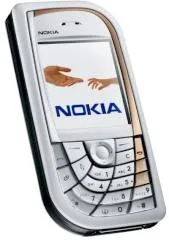

<figure class="roller-figure" data-no-lightbox></figure>

There is no doubt that [Wikipedia](http://en.wikipedia.org/wiki/Main_Page) is one of the great projects of the moment. Many articles are still lacking, but there is regular progress made with regards to the quantity and the quality of the information. If the next four years of Wikipedia are as productive as the last four years, the results will be astonishing.

During my recent vacation I have found myself rediscovering my cell phone, a [Nokia 7610](http://www.nokia.com/nokia/0,,54665,00.html), bought last year. My prepaid Swiss SIM card did not work for sending SMS in China (shame on Orange), but I ended up using the phone for writing down a few notes and ideas using the built-in Notes application. While visiting different monuments and cities, it also occured to my friend Alex and I that having access to Wikipedia on the device would be invaluable.

Here we are not talking about accessing the online Wikipedia through a wireless connection, but about having a Wikipedia dump stored on the cell phone itself. The drawback is that the information accessed is likely to be at least slightly out of date, since Wikipedia articles are constantly updated online. On the other hand this is the only reasonable solution when data coverage is lacking and/or expensive. It is in fact a very convenient option which promises fast access times and ubiquitous access.

We are not the first to think about this idea, of course. Some versions of Wikipedia have been built for eBook readers. I found a [version](http://www.five-alive.de/wikipedia.html) of the German Wikipedia for the [Mobipocket](http://mobipocket.com) eBook reader. There is also an [English version](http://members.chello.nl/epzachte/Wikipedia/) for the [TomeRaider](http://www.tomeraider.com/index2.html) eBook reader. However the former is lacking an English alternative, and the latter does not appear to work on Symbian S60 platforms.

The Nokia 7610 is said to support 1GB RS-MMC cards, which is probably still sufficient to hold the current English Wikipedia (without images) based on the fact that back in November 2004 the TomeRaider version took 450 MB. At about the same time, the version with images took 1.5 GB, which would require a 2GB card (which I believe are not yet available), or excluding some images. I believe that images would be nice, but not exactly necessary. At any rate this means that it is realistic to store Wikipedia on such a cell phone from a hardware perspective.

But according to this preliminary research it looks that there is as of yet no satisfying software solution for S60 (you are better served if you have a Palm or Pocket PC device). I may have missed the obvious though, and I would be very happy to hear about existing solutions!

**Update:** I have sucessfully been able to run the Mobipocket reader and an old dump of the German version of Wikipedia which fits in the 64 MB card of my phone. The reader is fine and the results encouraging, but I don't have much interest in the German version of Wikipedia! Please please please, can somebody work on the English version?
