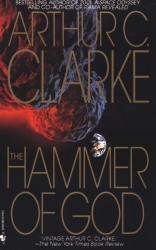

<figure class="roller-figure" data-no-lightbox></figure>

This is a good execution of a theme which has by now become a classic: that of an asteroid menacing the existence of planet Earth. Clarke is as usual a precursor and treats the subject with his typical style and insight, but the book is not without weaknesses. The character of captain Singh, for example, while developed at length during the first part of the book, seems to lose its definition at the end of the story.

More importantly, the treatment of the social impact of the menace and its consequences is somewhat naive. For example, one would imagine that on Earth, the news of the sabotage would have caused the Reborn to be chased down. The handling of social aspects has never been Clarke's strength, but this is maybe what gives his novels this color so familiar to science fiction enthusiasts around the planet.

Overall, this remains a good read, all the more because it touches on a subject which actually concerns all of mankind and deserves awareness. It certainly fares much better than the movies on a similar subject that appeared in theaters in 1998, *Armageddon* and *Deep Impact*.
