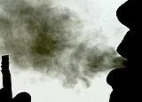

<figure class="roller-figure" data-no-lightbox></figure>

Après l'association GastroSuisse, c'est au tour d'un juriste, Andreas Auer, de se vendre sans scrupules aux compagnies de tabac. En effet, d'après un [article du *Temps*](http://www.letemps.ch/template/suisse.asp?page=5&article=166831) d'aujourd'hui, M. Auer, payé par Camel, Mild Seven, et Winston, aboutit à la conclusion qu'interdire la fumée dans les établissements publics serait anticonstitutionnel en Suisse. Quelle surprise de découvrir que le lobby de la cigarette puisse acheter... n'importe qui, à ce qu'il parait. Malgré les protestations d'honnêteté de M. Auer, on a honte pour lui et pour sa profession d'avoir accepté ce mandat. C'est permettre aux lobbys d'acheter de tels rapports qui devrait être anticonstitutionnel !

On lit tous les clichés dans les propos de M. Auer reportés et commentés par le *Temps* : "dangers du politiquement correct" (une allusion d'un anti-américanisme latent); "atteinte disproportionnée au droit de chacun au respect de sa sphère privée"; "dangers [pour les] libertés fondamentales"; "'le doute est permis' quant à la nocivité réelle de la fumée passive." On croit décidément rêver en lisant tout ceci, alors que les premières études démontrant la nocivité du tabac sur la santé datent de 1953, et que depuis les stratégies de l'industrie du tabac (en particulier : déni pur et simple, lobbyisme, campagnes publicitaires, études mandatées, et même falsification de données scientifiques) ont été analysées et bien comprises.

Passé le premier choc de voir un juriste tomber dans le panneau aussi facilement, on en arrive au second choc : les propos tenus par M. Auer. Dans le doute, pense-t-il, il faut considérer que la fumée passive ne tue pas et ne puisse pas rendre malade. Et pourquoi pas le contraire, s'interroge-t-on ? Pourquoi, dans le doute, ne pas considérer le danger réel pour la santé du citoyen suisse ? Quels seraient les impacts négatifs de l'alternative ?

La réponse est double. Premièrement, on risque de mécontenter la puissante industrie du tabac. Deuxièmement, on risque d'atteindre au respect de la sphère privée. Or on ne considère pas avec cet argument le respect de la sphère privée du non-fumeur. Mais dans les lieux publics, le fumeur est une véritable torture pour beaucoup de non-fumeurs, qui je le rappelle sont majoritaires. J'en ai encore fait l'expérience il y a quelques jours dans un restaurant : autour de notre table de non-fumeurs, pas moins de cinq personnes fumaient à plein poumons et projetaient leurs fumées nocives dans notre direction. Est-ce que M. Auer se préoccupe de notre liberté dans pareil cas ? A une table voisine, plusieurs adultes enfumaient trois ou quatre de leurs enfants - bien sûr dans le plein respect de la sphère privée de ceux-ci, et, dans le doute, considérant le tabagisme passif sans danger pour leurs propres enfants ! On comprend bien que l'argument de la liberté individuelle ne tient pas la route.

On oublie curieusement ici que, sans même considérer le tabagisme passif, la fumée tue. Elle a causé plus de morts que la seconde guerre mondiale. Trois fumeurs dans ma famille sont décédés du tabac dans leur cinquantaine. Mis à part les drames crées par de tels décès prématurés, le coût sur le système de la santé est énorme. Or, on ne naît pas fumeur : on le devient sous l'influence d'une pression sociale favorisant cette pratique, entretenue savamment par l'industrie du tabac. Interdire la fumée dans les établissements publics réduit cette pression sociale sur le non-fumeur comme sur le fumeur. Le résultat en sera des non-fumeurs plus heureux et des ex-fumeurs reconnaissants.

M. Auer, GastroSuisse, et les compagnies de tabac préfèrent prendre le risque de tuer que celui de ne pas gagner un peu d'argent. Carl Sagan a très bien exprimé cette attitude : "On pourrait croire que, avant de dénoncer des résultats de recherche dérangeants, les grandes entreprises privées utiliseraient leurs ressources considérables pour vérifier que les produits qu'ils proposent sont sans danger. Et s'ils ne trouvent rien, si des scientifiques indépendants suggèrent qu'il puisse y avoir un danger, pourquoi ces entreprises protesteraient-elles ? Est-ce qu'elles préféreraient tuer plutôt que de ne pas réaliser un profit ? Si, dans un monde incertain, une erreur doit être faite, ne devrait-elle pas l'être dans la direction de la protection les clients et du public ? [...] Est-ce que nous ne sommes pas dans le cas où au moins une certaine intervention du gouvernement serait dans l'intérêt du public ?"

Suivons Carl Sagan et, dans le doute, protégeons les enfants, les adultes fumeurs comme les non-fumeurs, ainsi que le personnel des établissement publics ; dans le doute, rendons l'expérience du restaurant ou du bar plus agréable ; dans le doute, créons une pression sociale sur les fumeurs pour les aider a se débarrasser de leur habitude mortelle ; dans le doute, rendons à tous la liberté de respirer un air non vicié.
