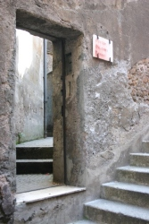

<figure class="roller-figure" data-no-lightbox></figure>

A [recent article](http://lanazione.quotidiano.net/chan/firenze:5389604:/2005/10/25:) of *La Nazione* looks at street names in the region of Florence, Italy. In the section "classical music composers", Verdi comes first with 30 streets, Puccini second with 22 streets, and [Mascagni](http://www.mascagni.org/) third with 18 streets, before Rossini with 17. This is not bad at all, especially considering that while Mascagni was from Tuscany, he was not from Florence but from Livorno.
