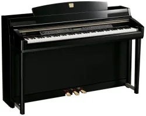

<figure class="roller-figure" data-no-lightbox></figure>

The world has progressed much in terms of shopping thanks to online resources, but there is still progress to make. A few recent cases in point:

- **Shopping for new home phones.** The requirements: I wanted two decent-looking, latest-generation wireless phones with one additional handset each to replace the two 20 year-old two-line phones my parents are still renting from Swisscom (for about CHF 10 / month). The difficulties: I have not found a web site with comprehensive reviews of such phones. Some sites review a few models. Many sites have the keyword "review" while actually featuring no user review at all. Some manufacturers' web sites are abysmal. In particular, [Switel](http://www.switel.com/)'s web site is a shame: they feature dozens of models categorized in an arbitrary way; their web site does not support the "back" button (and it is a basic HTML web site - I don't know how they achieved that!); they don't feature product comparison charts; and finally, their model numbers rarely match the model numbers of the phones actually sold in Swiss stores. My email to them remained without response. The bottom line: I did not buy from them, but from Siemens (the cheaper [Gigaset C340](http://gigaset.siemens.com/shc/0,1935,hq_en_0_61096_rArNrNrNrN,00.html) with [C34 handset](http://gigaset.siemens.com/shc/0,1935,hq_en_0_61098_rArNrNrNrN,00.html), and the more modern [Gigaset S440](http://gigaset.siemens.com/shc/0,1935,hq_en_0_69336_rArNrNrNrN,00.html) with [S44 handset](http://gigaset.siemens.com/shc/0,1935,hq_en_0_69341_rArNrNrNrN,00.html)). I am by the way curious about their [USB adapter](http://gigaset.siemens.com/shc/0,1935,hq_en_0_69566_rArNrNrNrN_pageType%253ADescription,00.html), which allows the handsets to talk to Skype through your computer.
- **Booking hotels in Italy.** Here, [TripAdvisor](http://www.tripadvisor.com/) is a great resource, although it seems to be largely used by americans, based on the style and expectations visible in the reviews. I have also had success with [Bookings](http://www.bookings.net/), which features unfortunately a limited number of hotels and reviews (but it does have SOME reviews), but except for the fact that it doesn't let you (I think) search by hotel name, beats all the other similar sites I have tried in terms of usability. The difficulties: you will spend literally hours browsing the web with these tools (Florence has over 400 hotels, Rome almost 1000); different booking sites show different availabilities, and some will show availabilities when in fact there is none, in which case your booking will be canceled after a few days and you will have to start over. In one case, Orbitz supposedly sent our booking information to the hotel only three days before our arrival. Had I not exchanged emails with the (kind) personel at the hotel right after booking online, our reservation might have gone down the drain.
- **Amazon.fr.** I do like Amazon.com, in spite of their ridiculous "1-Click" patent, and I have shopped there for many years. My shopping cart is always full of "saved for later" items, even though I don't always end up buying from them. I always look forward to improvements in their shopping system. Lately, I found the "wiki products comments" cool, although it looks like those disappeared almost immediately (and I had taken the time to write something - damn! I hope they bring them back). In the US, their free shipping over $25 is quite good if you are not in a hurry to receive your items. However, Amazon.fr has not kept up with Amazon.com. It still features a much older version of the site, without the latest improvements. I have also found out that they are censoring reviews, and that it is difficult to figure out what is happening with that. Maybe French law puts more pressure on Amazon to review "every single line" (as I was told by their customer service) written by users? Or maybe my review, even after two revisions, was simply not politically correct enough? I suspect that this is one reason for Amazon.fr's quite poor user reviews. This makes the site that much less useful. I have still bought from them, since they have a quite reasonable flat EUR 5 shipping fee to Switzerland (unlike fnac.com).
- **Shopping for an electronic piano.** The latest experience in date: looking for a decent electronic piano. By that I man an acoustic piano replacement, not just a keyboard. I own a P-80 (the predecessor to the more recent [P-90](http://www.yamaha.com/yamahavgn/CDA/ContentDetail/ModelSeriesDetail/0,,CNTID%253D21486%2526CTID%253D,00.html)), which has been doing its job, but that is really a portable electronic piano, without built-in speakers, and I find its sound a little tiring over time. Give me a [Steinway Grand](http://www.steinway.com/steinway/catalogue/models.shtml) any time... Anyway, in the medium term future, I will be looking for a "real" electronic piano (which will arguably provide better sound than an acoustic piano of the same price, and will be easier on the neighbours). The catch: it looks like nobody really seriously reviews those, except some keyboard magasines, of which I found the (paying, at GBP 3.50 apiece) reviews to be fairly poor. Some good candidates at Yamaha: the top of the line [CLP-280](http://www.yamaha.com/yamahavgn/CDA/ContentDetail/ModelSeriesDetail/0,,CNTID%253D59013%2526CTID%253D203500,00.html), and the interesting-looking [Slimline CLP-F01](http://www.yamaha.com/yamahavgn/CDA/ContentDetail/ModelSeriesDetail/0,,CNTID%253D63161%2526CTID%253D600150,00.html). Now the real question: how do they sound?

  By the way, Yamaha has a fairly good [product comparison](http://advisor.music.yamaha.com/v41/Advisor.asp?User=yamahakeyboards_en_US&Rnd=339) site (provided by a third-party company), complete with dynamic PDF generation. An example to follow, and improve upon (this is 2006 after all).

There is a clear need for a consolidation of online shopping guides: we need less sites with each more reviews. Who will really tackle the task? Google, who wants to organize the world's information? There is also a need for Europe to do better in that respect, even though its multilingualism will remain a real obstacle: how do you translate user reviews into Europe's main languages?
