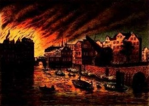

<figure class="roller-figure" data-no-lightbox></figure>

The Ernest Hemingway museum and bar on a Bahamas island has just been completely [destroyed by fire](http://www.cnn.com/2006/WORLD/americas/01/13/bahamas.hemingway.reut/index.html), including "hundreds of photographs and artifacts of the author".

This event is just one more example that highlights the need for digitization projects. Even more tragic was 2004's [fire in Weimar](http://www.chicagotribune.com/news/nationworld/chi-0512180239dec18,1,1855638.story?ctrack=1) which destroyed an irreplaceable collection of Goethe's manuscripts and books (40,000 to 50,000 volumes were lost). Recognized artists, musicians and authors' manuscripts and photographs should be quickly digitized and photographed so as to ensure that future generations have at least access to reproductions in the unfortunate case of catastrophic events (fire, flood, war, etc.).

I am thinking about setting up such a project to preserve [Mascagni](http://www.mascagni.org/)'s manuscript scores, letters and photographs that are owned by his family and by a small museum in Livorno, Italy. There is a lot you can do just with a good scanner, and it seems to me that the project could be realized for quite a low cost, assuming the number of documents to digitize remains, say, under ten thousand.
