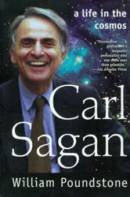

<figure class="roller-figure" data-no-lightbox></figure>

I knew Carl Sagan from *Pale Blue Dot*, *Billions and Billions*, and especially his wonderful *Cosmos* (truly, if there is one book everybody should read, *Cosmos* is it). The man that transpires from these books appeared to me as an wonderful example of what human beings should strive for, and I naturally picked up Poundstone's biography out of curiosity.

Poundstone covers Sagan's life adequately. He does not limit himself to that however, dedicating ample space to explaining the scientific context behind much of Sagan's work. He defends Sagan's positions well, but also presents the positions of some of Sagan's adversaries with apparent honesty.

The low point of this reading is the revelation that Sagan's personal life was not always exemplary. Living with a man as busy and allegedly full of ego as Sagan was a challenge. He married three times, finally finding the ideal partner in his relationship with Ann Druyan, who in particular appears to have made him a better family man.

Sagan's life is fascinating and shows admirable continuity. From his involvement with the question of whether there is life on Mars to the search for extraterrestrial intelligence (SETI), he has remained largely devoted to the question of extraterrestrial life, a new field initially called exobiology.

Sagan's influence in the scientific world has been huge, if not as a traditional scientist, then as a man who seeded ideas. But his role as a popularizer of science has probably been even more important. In particular, his hit TV show from the 80s, *Cosmos*, has made his name famous to the point probably of being at some point the second-best known scientist in the 20th century (after Einstein, of course), at least in the US. Many have become scientists later in life after watching the show as kids.

Sagan knew how to teach, as his Cornell students can testify. He was able to inspire awe from the contemplation of the physical world. His always perfect (if a little snobbish-sounding) elocution, and his sometimes poetic stances, touch the mind and the heart.

Poundstone's biography confirms that Sagan was an extremely smart man, and a constant defender of reason. He never tired and always loved what he was doing. Through his books and teaching, he has sent the message that humans should not let their brains at the door. What Voltaire and Swift did with satire, Sagan did with science.

Sagan's untimely end in 1996 at age 62 is tragic, first on a personal level because he was in the end fully aware that his illness could take him, and second for the world at large, as he could have easily provided his insight and wisdom for another twenty years.
