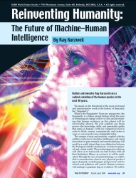

<figure class="roller-figure" data-no-lightbox></figure>

While still progressing in my reading of Ray Kurzweil's *[The Singularity is Near](http://www.amazon.com/gp/product/0670033847/)*, I found an article from [The Futurist](http://www.wfs.org/futcontma06.htm) (get the [PDF](http://www.singularity.com/KurzweilFuturist.pdf)), where Kurzweil summarizes what the Singularity is about. The article is followed by reactions to his perspective, among them one by [Richard Eckersley](http://www.kurzweilai.net/meme/frame.html?main=memelist.html?m=17%23641), fellow at the National Centre for Epidemiology and Population Health at the Australian National University, Canberra, Australia. Eckersley begins: "I have sometimes asked audiences if they are inspired or excited by the sort of techno-utopian vision represented by the Singularity; almost no one is." He follows with a fairly strong criticism of Kurzweil's vision of the future, arguing that not only does that future not bear much resemblance with what we today call "human", but also that we have not actually made a choice of that future yet.

Eckersley's position is understandable and also defendable in a way: the future that lays ahead of us may or may not globally be of our liking. I do not know if Kurzweil looks forward to everything the future he predicts will bring humanity. Certainly he wants a good part of that future, in particular he has made it clear that he does not look forward to disease and death. I tend to share this desire of living long and healthy.

And this is in my opinion the crux of the issue: we may not want that future, but it will be difficult not to get to it. To understand why, just answer this question for yourself: given the opportunity, provided by scientific research, to live longer and in good health, will you take it? The answer I expect from most people is a resounding yes. In fact, this has been most people's answer for as long as the world has known ways to treat damage done to our bodies. Listen to people who have had to deal, directly or indirectly, with heart attacks, cancer, Alzheimer, AIDS, etc. The search for cures to all these diseases is considered, at least in Western society, a laudable goal. In other words, the population at large wants to get rid of disease. To get there, it supports medical research and it agrees to spend a quite large portion of its money for medical care.

On the other hand science is progressing, arguably increasingly faster. Remember that the role of DNA was discovered only about 50 years ago, in 1953, and consider the progress accomplished since then in all the areas of medical science. We now understand in many ways why cells die, how the brain works, what genes intervene in certain diseases, etc. Almost every day a new discovery is made. In conclusion: you have on one hand demand (people do not want to suffer, get ill, and die) and on the other hand supply (medical science is finding more and more ways to repair the body). Guess what happens when there is supply and demand: consumption.

This cocktail is what will get us to a future probably not very different from that described by Kurzweil. If you believe that the human body is a (biological) machine, and that there is nothing to stop us, if we keep looking, understanding all the mechanisms of that machine, then we will get to a point where the known diseases will be treatable, and where we will be in a good position to treat new ones extremely rapidly. It does seem like eradicating disease (let's be reasonable and say "in 99 % of the cases") is at least a theoretical possibility.

Some will argue that yes, people want to live long and healthy, but that there is a limit. Surely, if you live up to something like 90, or maybe 100, years old, you should consider yourself happy and look forward to a nice, peaceful death? This is a fundamental misunderstanding, and here is why. The technology that will help get rid of cancer, Alzheimer, and many other dreaded diseases, requires understanding in depth the mechanisms of the human body, including aging. The very concept that aging is not a fatality and can be slowed down or even reverted is now broadly thought to be a reality. Medication or treatments that will slow down or revert aging will see the light of day. Looking at today's global trends toward staying young, at least in appearance, you can imagine the success those will have, whatever their cost.

In addition, as Kurzweil is pointing out, life expectancy, even accounting infant mortality, was in the 30s about 200 years ago. It is now 85 for Japanese women (the current world record). In western countries, somebody who dies at age 65 is commonly considered to die "young". Clearly, people have now fully integrated the idea that life should last for around 80-90 years. Not so long ago, this was not the case. So the idea people have of life expectancy has changed, and it will probably change again in the future as life expectancy actually increases. There is no reason to place the bar at 90 or 100 year old, or even 150. The sky is the limit.

There are ways of curbing this seemingly inevitable trend. One is a global war that would destroy civilization. Another one would be oppressive laws blocking scientific research and/or blocking access to certain types of medication which also cure cancer and Alzheimer. It seems unlikely that the developed world will go in that direction, and the demand will be so strong that there will be a place on the planet where those developments will take place anyway.

Dramatic life extension is not all there is to Kurzweil's predictions, but it is one which appears ineluctable. We may not deliberately choose it, but humans' strong desire for life and the simple fact that medical science will be able to answer that desire will cause human life to change drastically. Now is the time for thinkers to ponder the consequence of those changes and outline solutions to the new problems that will arise from them: the concept of generation will be blurred; the way people generate wealth will have to adapt to the new pyramid of ages; pensions will have to be revisited; keeping the population stable or slightly decreasing will require revisiting family policies. On the other hand, as the earth population gets older and therefore requires less children, there will be no reason for every kid not to have access to the best education there is on the planet.
