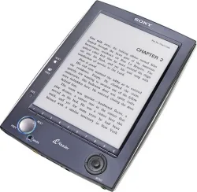

<figure class="roller-figure" data-no-lightbox></figure>

An article at [BusinessWeek](http://www.businessweek.com/magazine/content/06_09/b3973111.htm) suggests that good electronic book readers are real close nowTM. Prototypes of e-ink and e-paper have shown that the technology is a reality. [E-Ink's technology](http://www.e-ink.com/technology/howitworks.html), for example, relies on small capsules containing black and white particles. By appropriately applying an electric field, you can make the particles move to the top or the bottom of the capsule, making the surface of it appear black or white. The promise: low-power, high-contrasts display that provide the experience of reading on paper. They may not even erase when you shut down the power, and be flexible, although I am not sure wether E-Ink's technology provides these features yet.

The recent [Sony Reader](http://www.sonystyle.com/is-bin/INTERSHOP.enfinity/eCS/Store/en/-/USD/SY_DisplayProductInformation-Start?ProductSKU=PRS500) that makes use of the E-Ink technology is a step in the right direction. Its main drawback, besides being made by Sony, is its price of around USD 400. I believe this kind of technology will really spread once it passes under the USD 100 bar. But there is no reason, with mass-production and competition between manufacturers, that this won't happen.

Another drawback is the lack of availability of recent books in formats free of [Digital Restrictions Management](http://www.gnu.org/philosophy/words-to-avoid.html#DigitalRightsManagement) (DRM). As much as Apple has been successful with their iTunes Music Store (they are seeling their [billionth song](http://www.apple.com/itunes/1billion/) any day now), their format remains encumbered. I admit that I have "freed" the few songs I have bought from them. Recently, I even bought a few TV shows. To my horror, when starting to play one of those, I got the message: "This file has been authorized on 3 computers out of 5 already. Authorize to play on this computer?". But I can swear that I never played or even moved these files to a computer other than the one I am using now. What do I do when buggy software tells me that I can't play my files anymore? Sure, we are talking about USD 0.99 or USD 1.99 stuff here, but people will buy for thousands of dollars worth of music and videos. What if they lose it all because of DRM?

Luckily there are many good [books that are out of copyright](http://www.gutenberg.org/) that will work on any decent ebook reader. You can download articles from the web as well. But for the market to take off, it will be necessary to provide ebooks that are cheap (it doesn't make any sense for an ebook to be more expensive than a paper book) and unencumbered. But we are of course talking here about an [industry](http://www.publishers.org/) which is really scared of unauthorized copying, and which misunderstands technology and its future evolution. It may take time for consumers to finally get what they really want.

I personally very much believe in electronic books. I have a few books on my [Nokia 7610](http://www.nokia.com/nokia/0,,54665,00.html) (I want a full copy of the latest English [Wikipedia](/posts/wikipedia-on-cell-phones-not-quite-there/) as well), which I read from time to time when I happen to be stuck somewhere and bored. This is possible since I pretty much always have my cell phone with me. However I would be unwilling to do serious reading on a display with such low contrast, small resolution and small size. Now imagine every single cell phone sold with such an e-ink display: you would get a killer device. In the same way that smart phones have been taking over the entry-level digital camera market, and will likely do the same for the good old PDA market and the mp3 player market as well, cell phones may be the key to a large adoption of e-ink technology.
