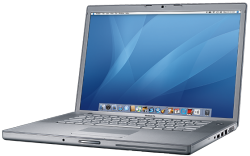

<figure class="roller-figure" data-no-lightbox></figure>

Like many, I have been thinking about switching to MacOS X from Windows for a long time. Why? As much as I dislike Windows, it does the job and I have got used to most of its quirks. Most of all, it runs all the applications I need, for development and for fun. So really the major reason is a sort of disgust for the whole Windows user experience after all these years, and the fact that significant OS updates only occur every five years or so due to Microsoft's broken development methodologies and release strategies. Finally, I can't forgive Microsoft for what they did with IE, namely dropping the development of a broken browser for 5 years, causing headaches that we will still have to deal with for years. Switching to MacOS X would provide a novel user experience, more frequent software updates, and possibly a less evil company to deal with (something I have yet to be convinced of).

But so far, this desire has been mainly hampered by:

- The abysmal CPU performance of the PowerBook G4
- The mediocre screen resolution of Apple's notebooks
- The fact that some software I use is not available on the Mac

But now Apple has done the right thing and is using decent CPUs; the display resolution is up to par with my current notebook; and you can dual-boot (an option which I actually don't like at all except as a last resort), with hopes that good emulators will see the light of day soon since you don't have to do CPU emulation anymore.

For fun I tried to look at similarities and differences between my current 17-inch notebook, a Sager bought two years ago, and the latest 17-inch MacBook Pro:

| Feature | Sager NP8790 | MacBook Pro |
| --- | --- | --- |
| CPU | Pentium 4 3.4 GHz | Intel Core Duo 2.16 GHz |
| Maximum RAM | 2 GB | 2 GB (some have suggested that it actually supports 4 GB, but this is not official - and 4 GB is currently way to expensive anyway) |
| Hard Drives | Up to 2 7200 rpm drives in RAID 0 or RAID 1. I am using two 60 GB drives in RAID 0 for a total of 120 GB. | Single 7200 rpm drive, with a current maximum size of 100 GB (more once larger 7200 rpm drives come out). |
| Display | 17-inch, 1680 x 1050 | 17-inch, 1680 x 1050 |
| Numeric Keypad | Yes | No |
| Card Reader | Yes | No |
| Integrated Camera | Yes | Yes |
| USB 2.0 | 3 ports | 3 ports |
| FireWire | 1 x 400 | 1 x 400 + 1 x 800 |
| Wi-Fi | B/G | A/B/G |
| Bluetooth | 1.0 | 2.0 |
| Video | ATI Mobility Radeon 9700 with 256MB DDR Video Memory | ATI Mobility Radeon X1600 graphics processor, dual link DVI support, 256MB of GDDR3. |
| Weight | 10.5 lbs with battery | 5.6 lbs |
| Dimensions | 1.7"x15.4"x11" | 1"x15.4"x10.4" |
| Battery Life | 1/2 to 1 hour (effective) | 5.5 hours (advertised) |
| Fan Noise | Bad | Unknown |
| Price | $3800 paid in May 2004 | $3800 (price for 2 GB of RAM, 100 GB 7200 rpm HD, extended warranty, second power supply, and California taxes) |

**What's bad about the Sager.** Clearly, the Sager has some clear disadvantages in comparison with the MacBook: it is much heavier, thicker, and because it uses a desktop P4 CPU and two hard drives, its battery life is terrible. Another big annoyance is the noise produced by the 3 fans on the main unit and the additional power supply fan.

**What's bad about the MacBook Pro.** On the other hand, the MacBook pro doesn't have that impressive features: the screen resolution is the same (17-inch PC notebooks have long come with 1920x1200 options, known as WUXGA), as is the maximum RAM (affordable 3 or 4 GB would be good). Hard drive capacity would be going down from what I have now (going under 7200 rpm is not an option), and hard drive speed would likely go down as well since I am running in RAID 0. There is no handy card reader, and no integrated numeric pad (a shame, since you clearly have room for one in a 17-inch notebook). There are only 3 USB ports, which are quickly used up (this issue will be solved once Wireless USB arrives). Of course there is the issue of software compatibility: I still use some software that doesn't seem to have a perfect MacOS X equivalent, and vendors tend to release for Windows first (for example, the latest beta of Skype is only available for Windows).

**What's good about the MacBook Pro.** FireWire 800, ExpressCard, possibly even better video (the Sager's is excellent), DVD drive, and Express Card. A the moment I don't care about any of those. But Bluetooth 2.0 sounds good: I have been using a bluetooth headset, mouse and cell phone for a long time, and look forward to a longer range and stereo bluetooth headphones. The sound card of the MacBook Pro is going to be better than that of the Sager (which is the worst sound card I ever had in a notebook, bar none).

The question is now whether it is worth spending $3800 mainly for a more portable notebook, MacOS X, and the cool factor. Unless, of course, the Core Duo chip really performs significantly better than the P4 3.4 GHz, which remains an unknown to me at the moment for the exact type of applications I have. In the meanwhile, I hope my Sager will hold until later this year so I can postpone this decision.
