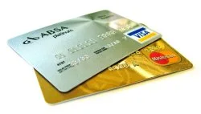

<figure class="roller-figure" data-no-lightbox></figure>

Yesterday I used my credit card instead of my debit card to get cash at an ATM (incorrect brain processing). From my credit card's web site:

> Are there fees associated with cash advances ?
>
> > The cash advance fee for ATM transactions, transfers and convenience checks is $5 per transaction for transactions of $100 or less or 4% of the cash advance, with a minimum of $15 for transactions greater than $100. The cash advance fee for all other transactions is 4% of the cash advance with a minimum fee of $15.
>
> How are finance charges calculated ?
>
> > Finance charges for purchases will not accrue if you pay your balance in full each month. However, if you have an outstanding cash advance balance, finance charges for cash advances will accrue each day beginning on the date of the advance, until the full amount is paid. Therefore, you may incur additional finance charges on future statements when you use your card to take cash advances or use convenience checks.

Ouch!
