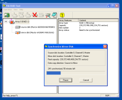

<figure class="roller-figure" data-no-lightbox></figure>

It's summer again, so hard drives start failing. This time, it's just a hard drive in my backup PC, which is part of a RAID 1 array, so that's not too serious. Restoring the array almost failed though. This is one of those built-in VIA RAID chips, and you just never know if things will happen the way they are supposed to.

Take this particular case: the "source" disk failed, and the "mirror" was ok. So I bought a new drive, plugged it in in place of the failed drive (be sure to correctly identify the right drive, or you may just end up with two drives with corrupted data!), and started my PC again. The result: the RAID software tells me there is now no drive in the array. Darn.

So I tried several things, from hot-plugging the new drive to putting back the old drive just to make sure things still work. Note that if I do that, the RAID software tells me the array is out of sync, but proposes right away to synchronize by copying from the failed "source" drive to the sound "mirror" drive. Don't say yes to that!

Finally, I figured out that my new drive was configured by default for the 3 Gb/s rate, while my PC only supports the old 1.5 GB/s. Change the jumper on the drive and voilà, the drive is recognized, appears in the user interface, and I can use it as a spare to copy from my "mirror" disk, which now acts as "source". One hour later, and the array is restored. Phew (you know that it's typically during restore that the only remaining drive with good data fails)!

Now I just need to find an external enclosure that supports two drives, a good fan and air flow, and that's it. Something like [this](http://www.firewiremax.com/dubaynasaexe.html), but isn't this a tad expensive?

As a side note, some predict that if trends continue (which they may or may not), the price of Flash will be competitive with hard drives around 2015. I for one can't wait for that to happen, and you can bet that in fact Flash as a mass-storage technology for PCs will occur well before that year.
