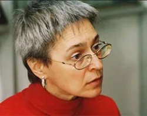

<figure class="roller-figure" data-no-lightbox></figure>

Journalist [Anna Politkovskaya](http://en.wikipedia.org/wiki/Anna_Politkovskaya) was [murdered yesterday](http://edition.cnn.com/2006/WORLD/europe/10/08/russia.murder.ap/index.html) in Moscow.

I had read her first book about Chechnya, [A Dirty War](http://www.amazon.com/Dirty-War-Anna-Politkovskaya/dp/1860468977/), and been impressed by her courage and by the depth of her stories about the horrors committed in Chechnya. She has made many enemies over the years by denouncing corrupt Russian and Chechen officials, including Putin and Kadyrov, especially about the war in Chechnya.

The world needs more people like her.
