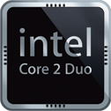

<figure class="roller-figure" data-no-lightbox></figure>

It certainly took Apple some time to upgrade its MacBook Pro, especially when you think that the CPU is a drop-in replacement for the original Core Duo. Dell and other manufacturers have been shipping Core 2 Duo machines for weeks. So what do we get for waiting besides the CPU? The answer seems to be "not that much, as expected, but it's not too bad":

- **Good.** The Core 2 Duo CPU, of course. 2.33 GHz, 4 MB L2 cache, and supposedly 34-39% faster than the previous Core Duo. I will take better performance any time.
- **Good.** 3 GB of RAM is now officially supported. I've had 2 GB of RAM for 2 1/2 years now, and it's really starting to hurt. Funnily enough, the 2 GB modules cost USD 1,170 at [Crucial](http://www.crucial.com/store/partspecs.Asp?IMODULE=CT25664AC667), almost 4 times the price of two 1 GB modules (USD 334). However apple prices the 3 GB option at USD 575 more than the 2 GB option, so either they get their memory cheaper or they rip you off on the 2 GB option (maybe both). So either you get 2 GB today (there is no lower option) and upgrade later when the 2 GB modules are cheaper (you throw away one 1 GB module), or you pay a hefty USD 575 today.
- **Neutral.** No enhancements (functional or looks) to the case. The current design is ok, and it's certainly one of the best-looking notebooks around, but it's starting to be a little old. Rumors say there won't be any such enhancements until summer 2007 with the next generation CPUs and chipsets.
- **Bad.** Same old 1680x1050 display. Again, I've had this on my notebook for 2 1/2 years, and 1920x1200 displays have been available for at least over a year, so I don't see why Apple doesn't ship the latest display. Back in the days when operating systems had trouble scaling graphics, Apple had at least an excuse to standardize on ridiculous resolutions, but today, doesn't Apple have Display PDF?
- **Bad.** No 7200 rpm 160 GB hard drive. To be fair, I don't think the [160 GB Seagate Momentus 7200.2](http://www.mobilewhack.com/reviews/seagate_unveils_3_new_notebook_hd.html) is out yet.

Price for a 17" / 2 GB / 160 GB configuration with 3-year warranty (a must): USD 3,148. Same with 3 GB: USD 3,723. This does not include sales tax. I think it's a go, but honestly, I am getting ready psychologically to run Vista on it.
