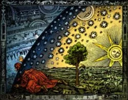

<figure class="roller-figure" data-no-lightbox></figure>

On ne sait par où commencer pour décrire ce qui a mal tourné dans [l'émission Infrarouge de ce soir](http://infrarouge.tsr.ch/forum-197_4-astrologie-science-recreation.html), qui proposait un "débat" entre Jacques Neirynck (physicien et écrivain) et Elizabeth Teissier (astrologue):

- Parmi les 10 à 20 personnes présentes sur le plateau (qui en général dans Infrarouge prennent équitablement la parole pour défendre l'un ou l'autre parti), il ne s'est apparemment pas trouvé une seule personne pour prendre sérieusement la défense de la raison et de la science. On se pose des questions sur la façon dont les invitations à l'émission se sont effectuées.
- M. Neirynck n'a quasiment pas eu la parole alors que Mme Teissier l'a monopolisée, d'ailleurs de façon constamment impolie. La modératrice a été faible et n'a pas joue son rôle et a en conséquence implicitement supporté le parti de Mme Teissier.
- Il faut bien dire que M. Neirynck a fait preuve d'une mollesse décevante: interventions pauvres voire mal a propos, et acceptation de se voir son temps de parole monopolisé par la partie adverse.

L'astrologie est une insulte à la raison. Mme Teissier, en particulier de par la popularité qu'elle a donnée à l'astrologie, et donc de par son travail constant contre la science, à mon sens ne mérite que le mépris. Il est triste et choquant de voir que l'émission de débat phare de la Télévision Suisse Romande ait, sciemment ou par incompétence, clairement choisi le parti de la charlatanerie et de la superstition.
