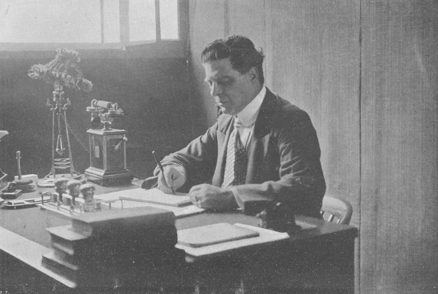
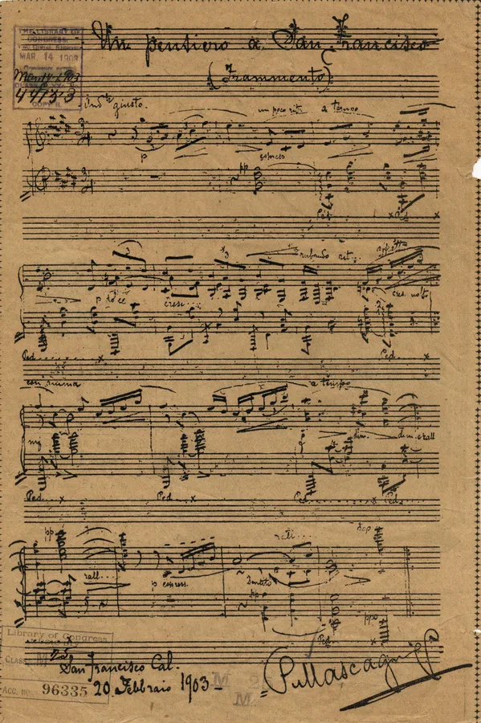

{:standalone width="75%"}

After nearly a decade offline, I have finally brought [Mascagni.org](https://mascagni.org/) back to life!

## A bit of history

I started putting together a site about Italian opera composer Pietro Mascagni (1863–1945) under the domain [mascagni.org](https://mascagni.org/) in 1999. While Mascagni is universally remembered for his 1890 one-act masterpiece *Cavalleria rusticana*, he composed 16 operas and operettas along with dozens of vocal, piano, orchestral, and sacred works, much of it wonderful and vastly underrated music.

For many years, the site grew thanks to archival research, acquisitions of material, and generous contributions from *Mascagnani* around the world. Technically, it also served as a testbed: Mascagni.org was dynamically generated using XML pipelines on Orbeon Presentation Server (an earlier name of [Orbeon Forms](https://www.orbeon.com/)) backed by a relational database. Unfortunately, as servers and dependencies aged, the original site eventually went offline around late 2016 / 2017.



## Rebuilding for longevity

One lesson from running websites across nearly three decades is that dynamic server-side runtimes inevitably bit-rot if not constantly tended to, whereas static files can last almost indefinitely. Well, at least longer, and up to a point, as we know that web browsers and protocols have evolved significantly as well, and incompatibilities have surfaced (for example the universal move to HTTPS, and the disappearance of some media formats like Real Audio and Macromedia Flash).

For this revival, Mascagni.org is generated ahead of time as a completely static website using [Astro](https://astro.build/). At build time, it compiles the structured relational catalog from SQLite alongside XML documents for libretti, historical articles, and performance chronologies. Everything interactive runs directly in the browsers without a backend application server:

- **High-resolution archival scans:** Over 2,100 scans of vocal and orchestral scores, manuscripts, contracts, first-edition libretti, and historical photographs, viewable with [OpenSeadragon](https://openseadragon.github.io/) and PhotoSwipe.
- **Catalogs and texts:** Pages for [67 compositions](https://mascagni.org/works/list), [Italian libretti and literary sources](https://mascagni.org/works/libretti), [414 discography entries](https://mascagni.org/recordings/), [live performance history](https://mascagni.org/works/performances), and [147 bibliography entries](https://mascagni.org/bibliography/).
- **Historical audio and film:** Native HTML5 streaming for [175 audio excerpts](https://mascagni.org/works/sounds) (including 78 rpm sides, Mascagni's own conducting, and spoken broadcasts) as well as [1935 newsreel footage of Mascagni conducting *Nerone* at La Scala](https://mascagni.org/movies/nerone).
- **Instant full-text search:** Static site-wide search across the entire archive powered by [Pagefind](https://pagefind.app/).

## New and restored material

Alongside migrating the archive, I took the opportunity to restore and complete several pieces of content:

- Completed the [**Mascagni in San Francisco (1903)**](https://mascagni.org/features/san-francisco) special feature — a fun connection for me here in the Bay Area — including six February 1903 *San Francisco Examiner* and *San Francisco Chronicle* articles with original newspaper sketches, as well as Mascagni's signed autograph score of [*Un pensiero a San Francisco*](https://mascagni.org/features/pensiero).
- Published a complete English translation of Mascagni's January 1914 *La Lettura* essay, [*How Parisina was Born*](https://mascagni.org/articles/), paired with the Italian text and magazine scans, and Giovanni Targioni-Tozzetti's March 1932 memoir *Mascagni prima della « Cavalleria »*.
- Expanded the [biography](https://mascagni.org/biography) and individual work pages, and restored all 2007–2009 posts from *The Mascagni.org Blog* into the [News Archive](https://mascagni.org/news/).

{:standalone width="55%"}

If you have any interest in Italian music, musical archives, or turn-of-the-century cultural history, head over to [Mascagni.org](https://mascagni.org/)!
