## Introduction

Have you ever wondered when the familiar layout of the modern piano keyboard came into existence - that repeating pattern of seven white keys and five raised black keys? When I first went looking for a clear answer, it turned out to be surprisingly hard to pin down online. That question sent me to brick-and-mortar libraries, inter-library loans, and eventually a 300-page history of the ancient and medieval pipe organ.[^perrot]

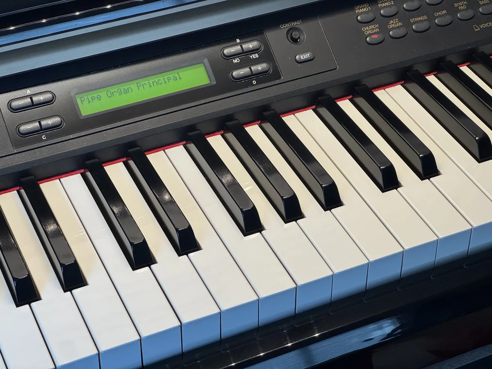{:standalone width="75%"}

Why pipe organs? Because the earliest musical keyboards were *organ* keyboards.[^manual] Unlike a flute or a harp, a multi-pipe organ fed by mechanical pumps or bellows needs a valve mechanism so the player can choose which pipe speaks and when. In a companion post, [The Early History of the Organ](/posts/early-history-of-the-organ/), I trace how that remarkable machine traveled from Hellenistic Egypt to medieval cathedrals. Here, I want to follow the interface itself: how a row of ancient organ levers evolved into the chromatic keyboard we play today.

## A spring-loaded keyboard 2,300 years ago

### Hero of Alexandria's key action

To me, the single most stunning fact in Jean Perrot's book[^perrot] is that the Greco-Roman *hydraulis* (water-regulated pipe organ) *already* featured something we would immediately recognize as a finger-played musical keyboard. The invention is at least 2,000 years old, and very likely goes back to the organ's inventor, Ktesibios of Alexandria, in the 3rd century BCE.

Thanks to a 1st-century CE treatise by Hero of Alexandria, we know the exact mechanical recipe of this ancient action:

- perforated **sliders** resting inside the windchest beneath each pipe,
- **keys** arranged horizontally in front of the player,
- pivoting **cranks** (bell-cranks) linking each depressed key to its slider so air could enter the pipe, and
- flexible **horn spatulas** acting as return springs, tied with gut to pull the slider shut and return the key as soon as the finger lifted.

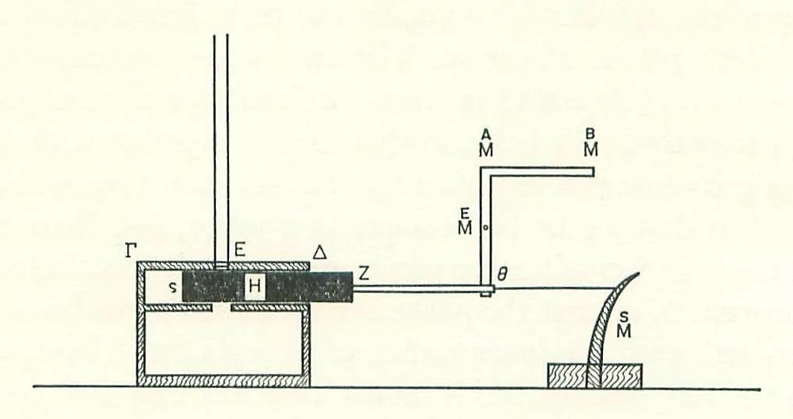{:standalone width="65%" .img-shadow}

Modern reconstructions of the *hydraulis* have confirmed how responsive this action is. Just like a modern organ or piano (though pianos use gravity and balance weights rather than springs), the keys sat roughly horizontal, went down under finger pressure, and sprang back automatically on release. On the working *hydraulis* reconstruction I photographed at the [Musée Suisse de l'Orgue](https://www.orgue.ch/) in Roche, Switzerland, you can see Hero's diagram come to life in wood, brass, and horn - eight L-shaped wooden bell-crank levers pivoting on a horizontal rod directly beneath their pipes, with dark curved horn return springs tucked underneath:

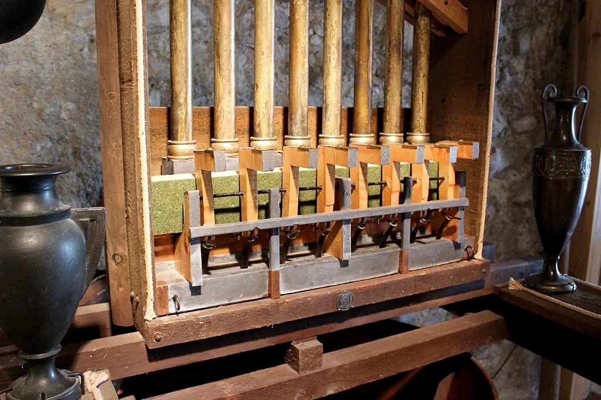{:standalone width="75%"}

### Clues from archaeology, texts, and mosaics

Because Greco-Roman artists almost always depicted the organ from the front - showing off its decorated base, gleaming pipes, and the performer's face - the keyboard itself sat hidden behind the pipes. Fortunately, archaeology and late-antique writers fill in many of the missing details:

- **Physical remains:** While the 1st-century BCE [Dion hydraulis][dion-link] (unearthed in Greece in 1992) lost its perishable keyboard parts - leaving only its copper pipes, windchest plates, and frame collar - the 3rd-century CE [Aquincum organ][aquincum-link] (buried in a c. 294 CE fire) preserved actual metal action components matching Hero's design, including bronze key casings (with traces of burned wood inside) and ~9 cm bronze return springs.
- **Ancient descriptions:** In the 4th century, Porfyrius Optatianus wrote of *"a line of square-shaped keys whereby the musician's hand opens and shuts in time the openings for the air"* - keys *"which ever tremble to the slightest touch."* His contemporary, Emperor Julian ("the Apostate"), described a *"man with nimble fingers […] manipulating the keys which give voice to the pipes,"* and 6th-century Roman statesman Cassiodorus referred explicitly to *"wooden keys."*
- **Rare rear views:** A 2nd-century CE terracotta lamp in the Carthage museum (signed *Possessoris*) shows a keyboard of 18 oblong, relatively broad keys, and the late-antique "Rusticus" organ carving near Rome depicts *"15 keys longer than broad, lying close together as in the modern manual."*[^perrot]



How close was this to a modern piano? Think of a single row of "white" keys with no raised "black" keys yet. Because each key sat directly in line with the slider feeding its pipe - without a rollerboard to fan the motion sideways - the keys had to match the spacing of the pipes, putting key centers roughly 5 to 7 cm (2 to 3 inches) apart, wider than on a modern piano. Even so, ancient writers consistently emphasized nimble two-handed finger dexterity rather than fist-pounding: sliders *"continuously in motion"* under *"masterly fingers."*

### Why are high notes on the right?

One detail I find especially intriguing is pipe ordering. Even when ancient mosaics hide the keys, the graded pipe lengths betray which way the scale ran - and in nearly every surviving Greco-Roman depiction, the shortest treble pipes sit to the **right** of the organist, just like high notes on a piano today!

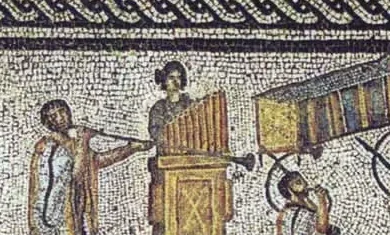{:standalone width="60%"}

Perrot treats this left-to-right bass-to-treble convention as an arbitrary habit that simply stuck from Hellenistic times onward. I cannot help wondering whether ergonomics played a role too: most players are right-handed, and agile melodic lines tend to gravitate toward the higher register where the right hand sits.

Summing up the classical evidence, Perrot concludes:

> The piano keyboard […] derives directly from that of the Greco-Roman organ, and the position of the hands on that primitive manual probably contributed in no small measure to the evolution of polyphonic music.

## Medieval amnesia and diatonic recovery

After the fall of the Western Roman Empire, organ-building knowledge in Western Europe frayed (as I recount in [The Early History of the Organ](/posts/early-history-of-the-organ/)). When monastic treatises resume in the 10th through early 12th centuries, many Western organs had lost the Greco-Roman spring-return key action altogether, falling back on slow wooden **sliders** that had to be pulled out by hand and pushed back in to stop the note. At the same time, medieval builders introduced a helpful visual aid: both the 10th-century Winchester poem and Theophilus's treatise (*Schedula diversarum artium*) describe inscribing **letters of the alphabet** directly onto sliders or keys so the organist knew which pitch each controlled.[^cambridge]

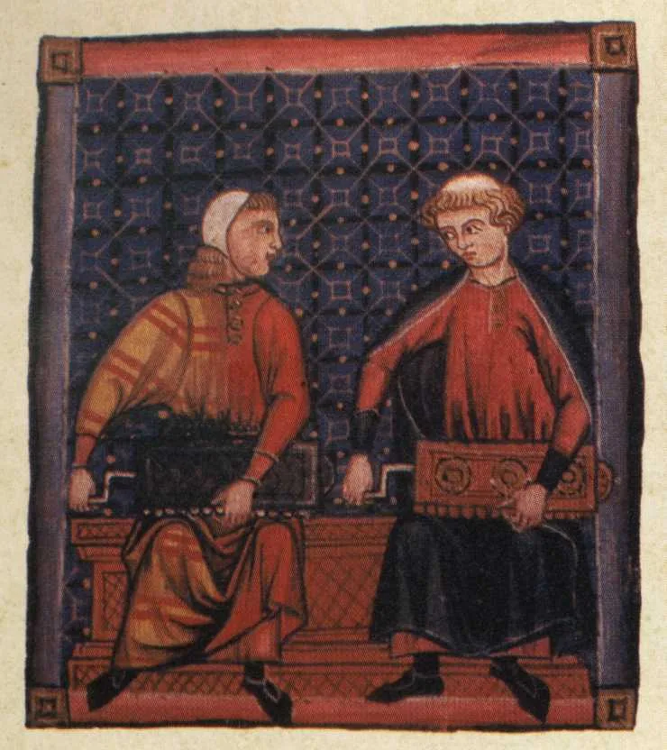{:standalone width="45%"}

By the 13th century, proper spring- or lever-returned wooden keyboards (often reinforced with iron) were back in widespread use across church, positive, and small handheld portative organs - visible in manuscripts like the c. 1260 Rutland Psalter and the [Cantigas de Santa Maria](https://en.wikipedia.org/wiki/Cantigas_de_Santa_Maria) above. Yet as far as we can tell, 13th-century manuals still arranged a diatonic scale (often with an added B♭) in a **single row of evenly spaced keys**. There is still no clear sign of a second, raised row of "black keys."

## Splitting the tone: Halberstadt and Norrlanda (1330–1400)

The 14th century is where chromaticism - and a second tier of keys - finally breaks into the historical record:

- Around **1330**, theorist Jacobus of Liège noted that on certain instruments, including the organ, *"almost everywhere the tone is divided into two unequal semitones"* (in Pythagorean tuning).[^encyclopedia]
- In the first half of the 14th century, **Johannes de Muris** explicitly mentioned semitone keys for **F♯** and **G♯**.[^grove]
- Around **1360**, the [Robertsbridge Codex](https://en.wikipedia.org/wiki/Robertsbridge_Codex) preserved the earliest surviving music written specifically for a keyboard instrument (almost certainly the organ), calling for a compass of two octaves and a third, fully chromatic above F.[^grove] Listening to a performance today is a reminder of just how different medieval keyboard music sounded from later Baroque or Classical repertoire:

  <iframe width="100%" style="aspect-ratio: 16 / 9; border: 0; border-radius: 6px;" src="https://www.youtube.com/embed/3QF4BCKYZxc" title="Robertsbridge Codex (c. 1360) performed on organ" loading="lazy" allowfullscreen></iframe>

### The Halberstadt organ (1361)

That brings us to **1361**, when organ builder Nicholas Faber completed a landmark permanent cathedral organ in **Halberstadt, Germany**, with wind supplied by twenty bellows worked by ten men.[^allen] [^watanabe] Substantially renovated in **1495** by Gregor Kluge, the old Halberstadt organ was documented in detail in Michael Praetorius's famous 1619–1620 treatise *Syntagma Musicum*. On its upper *Diskant* manuals (left and top-right panels below, drawn with 14 keys from `B` to `c'`, while the lower manual and pedalboard below have 12 long levers), there it is: **the unmistakable 7-and-5 chromatic grouping of a modern keyboard!**

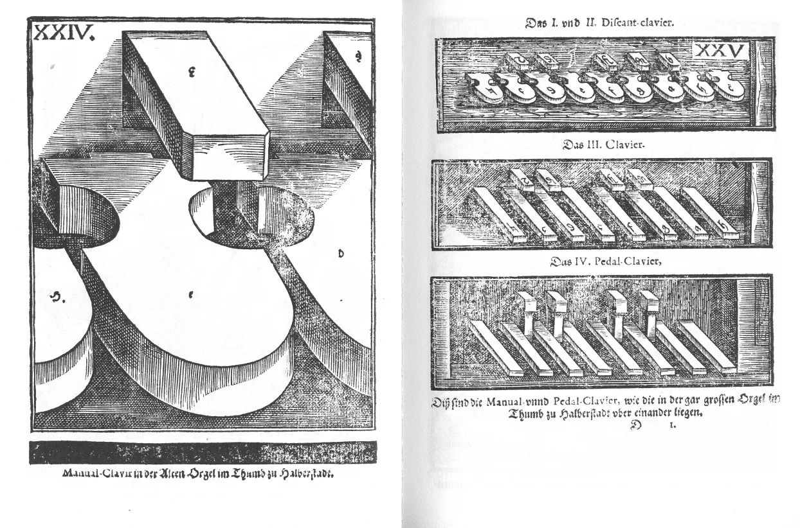{:standalone width="85%"}

Of course, playing Halberstadt was nothing like playing a modern Steinway. Its upper manual keys look like spade-shaped levers, spaced 5 to 8 cm apart - wide enough that players long had a reputation (perhaps exaggerated) as "organ beaters" pressing keys with the whole hand rather than agile modern fingerings.[^allen] [^cambridge] [^grove] And because Praetorius saw the organ after its 1495 rebuild, historians still debate how much of the depicted keyboard layout goes all the way back to 1361 versus 1495.

### Physical proof in Sweden: the Norrlanda organ (c. 1400)

Fortunately, we do not have to rely on later engravings alone: for the end of the 14th century, untouched medieval wood survives! Preserved in the Swedish History Museum in Stockholm are the fragments of the **Norrlanda organ** from Gotland, dated c. 1370–1400 (or before 1430) - the world's oldest surviving organ case, windchest, pedals, and manual.[^rumsey]



*Photo credits: archival manual close-up via [Wikimedia Commons / Riksantikvarieämbetet (Kulturmiljöbild)](https://commons.wikimedia.org/wiki/File:Norrlanda_kyrka_-_KMB_-_16000200025694.jpg) (Public Domain); color console detail cropped from [Statens historiska museer (SHM)](https://samlingar.shm.se/media/22F919ED-EA74-48A9-BB0B-546AEFB49C7F) ([object `116311_HST`](https://samlingar.shm.se/object/1158466A-7686-4E18-88B9-B0D4BE39E7CF), [CC BY 4.0](https://creativecommons.org/licenses/by/4.0/)).*

Its 22-note chromatic manual (`c` to `a'`) clearly splits into two main levels, with a revealing quirk: **B♭ still sits down on the lower row** alongside the diatonic naturals (giving 14 lower keys, with `A`, `B♭`, `B♮`, and `C` side by side), leaving the 8 sharp keys (`C♯`, `D♯`, `F♯`, and `G♯` across two octaves) arranged in raised pairs above![^rumsey] (The tiny isolated key perched even higher up near the center of the photo is thought to have served an accessory function, such as a drone, rather than a regular melody note.[^meeus]) Builders had clearly invented the two-tier chromatic manual, even if B♭ had not yet moved upstairs to join F♯ and G♯.

### A cautionary detour in Verona: why medieval art is a minefield

Because surviving medieval instruments like Norrlanda are so rare, it is tempting to lean heavily on paintings and sculptures to date the arrival of raised accidentals. In practice, medieval art is a dating minefield - as I discovered firsthand in 2022 at the Museo di Castelvecchio in Verona, photographing a stone statue of *Saint Cecilia* attributed to the Master of Santa Anastasia and dated on the wall label to the **first half of the 14th century**:

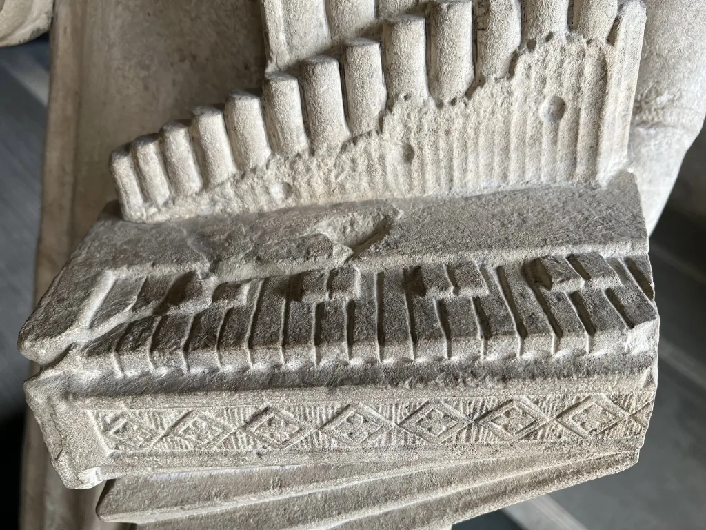{:standalone width="75%"}

At first glance, that small portative organ looks like a bombshell: neat, block-shaped raised keys predating both Halberstadt (1361) and Norrlanda (c. 1400)! Reading the fine print on the museum's placard quickly brings you back to earth: the statue underwent heavy 19th-century restorations, and **the hand, arm, and portative organ are later additions carved from stone from a different quarry** - so much so that curators are no longer even sure the sculpture originally depicted Saint Cecilia. Look closely at the keys themselves and a second pitfall jumps out: artistic license. Instead of a real 2-and-3 chromatic layout (or even Norrlanda's musically asymmetric pairs, where `C–D–E` has three naturals and `F–G–A–B♭–B` has five), the sculptor simply repeated four identical, symmetrical pairs of raised keys (`2–2–2–2`) as decorative shorthand for "keyboard."

## Block keys, a painted-over altarpiece, and Switzerland's oldest playable organ (1430s–1456)

### The Ghent Altarpiece's infrared secret (1432)

Just a generation later, Hubert and Jan van Eyck's **Ghent Altarpiece** (completed in 1432) brings us dramatically closer to a modern keyboard's appearance. On the *Music-Making Angels* panel, the raised accidentals now have rectangular **"block" shapes** right between the rounded natural key fronts:

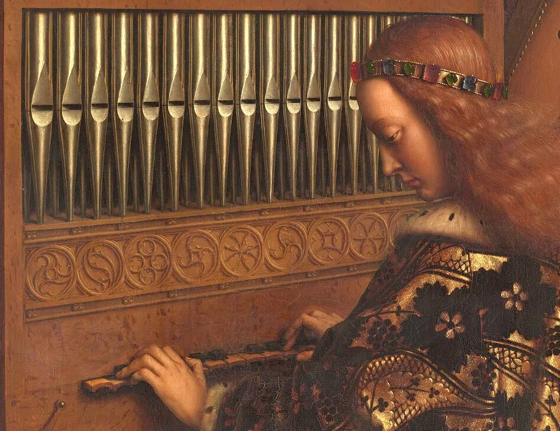{:standalone width="75%"}

Look closely, though, and the proportions look slightly odd - until you learn what lies underneath the paint! In a classic 1974 study, instrument historian Edwin M. Ripin showed that **infrared photography of the panel reveals an older keyboard painted underneath**.[^ripin] In Ripin's reconstruction drawn over the infrared photo below, the block-shaped sharps are gone, replaced by curved, Norrlanda-like key plates set back behind the naturals - starting with a purely diatonic bottom octave on `G` (no accidentals at all under the left hand) before three raised keys appear together higher up:[^meeus]

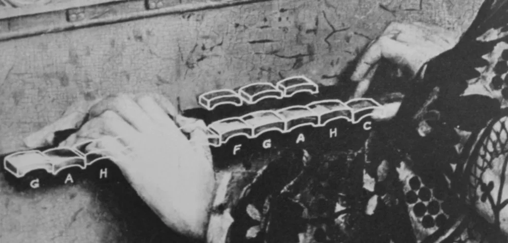{:standalone width="75%"}

Even the angel's left hand was repainted higher up! On the earlier keyboard, which lacked raised accidentals under that part of the hand, the fingers could rest flat; once modern block sharps were painted in - almost certainly by Jan van Eyck himself before finishing the polyptych in 1432, as subsequent high-resolution imaging from Belgium's [Closer to Van Eyck][van-eyck-link] conservation project has made easy to inspect online - the hand had to be arched above them. That mid-project "keyboard upgrade" explains why the visible natural key heads look stubby, since they had to share the shallow space originally allotted to naturals alone (though natural key heads on historic organs did remain comparatively short, around 3.5 cm, right up to the 18th century[^grove]). Either way, by **1432**, block-shaped black keys in the modern 2-and-3 grouping were real enough to prompt van Eyck to update his painting!

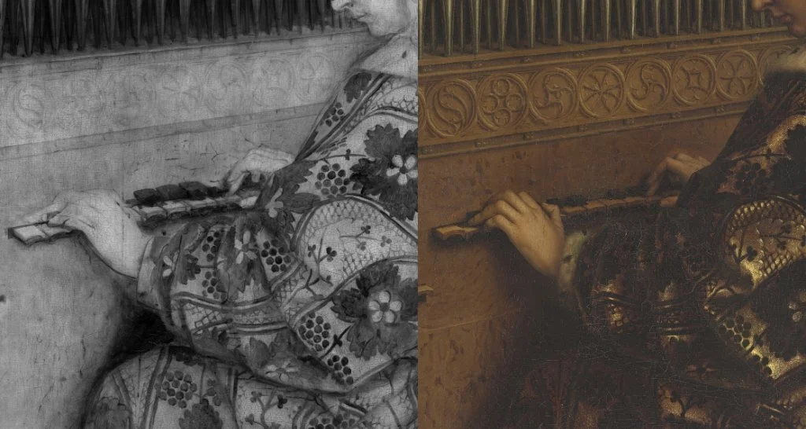{:standalone width="100%"}

### Brunswick (1456) and the Valère organ in Sion (c. 1430s)

Praetorius's *Syntagma Musicum* gives us another milestone from **1456**: the keyboards of the Aegidienkirche organ in Brunswick (*Braunschweig*), Germany. Here the natural keys are longer and better proportioned than on the repainted Ghent panel, and although the block accidentals stand a bit taller than today's, the overall geometry is unmistakably modern:

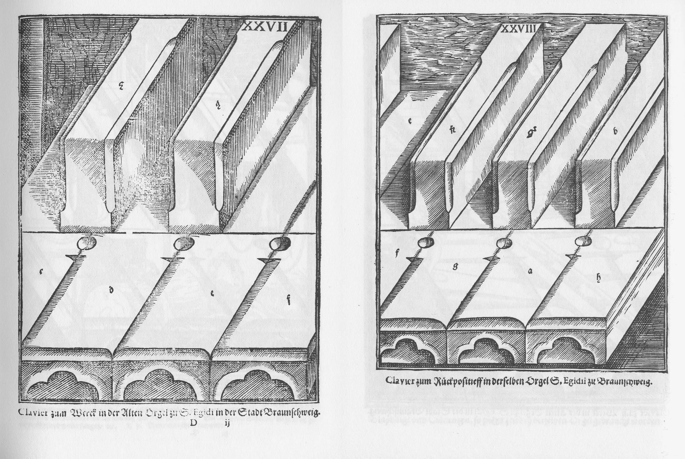{:standalone width="75%"}

Finally, I cannot resist mentioning the **world's oldest playable organ**, built around **1430–1435** in the Basilica of Valère in **Sion, Switzerland** - not far from where I grew up![^valere] I was lucky enough to have a private visit and demonstration by Edmond Voeffray, titular of the Valère organ. Seeing and photographing the Valère manual up close, my immediate hunch was that the keyboard itself looked far too clean and modern to be untouched from the 1430s:



And indeed, archival records confirm that hunch: while the Gothic swallow's-nest case, the 1435 painted shutters, and several ranks of high-lead pipes are genuinely medieval, the visible 45-note manual dates from a major **1687** rebuild by Solothurn organ builder Christoph Aebi, who enlarged and repositioned the keyboard (notice the Baroque ["short octave"](https://en.wikipedia.org/wiki/Short_octave) at the far left end).[^valere-aebi] Even so, given what we already see at Halberstadt (1361), Norrlanda (c. 1400), Ghent (1432), and Brunswick (1456), the original 1430s Sion organ almost certainly already had a two-row chromatic manual of its own.

## Conclusion

Stepping back across seventeen centuries of organ building, the evolution of our musical keyboard falls into a remarkably clear sequence:

- **3rd century BCE – 6th century CE (Greco-Roman *hydraulis* & bellows organs):** Finger-played, spring-returned horizontal keys are invented right alongside the first organs - spaced 5–7 cm apart in a single row, already placing bass notes on the left and treble notes on the right.
- **10th – 13th centuries (Medieval recovery):** After a period where many Western organs regressed to lettered push-pull sliders, fingered diatonic manuals (often including B♭) return - still in a single row without raised "black keys."
- **First half of the 14th century:** Theorists (Jacobus of Liège, Johannes de Muris) and keyboard music (*Robertsbridge Codex*, c. 1360) document chromatic semitones splitting the diatonic scale.
- **1361 / 1495 (Halberstadt):** Praetorius's engravings of the Halberstadt organ (built 1361, renovated 1495) record the modern 7-and-5 two-row arrangement on its upper manuals, still built with wide, spade-shaped levers.
- **c. 1370–1400 (Norrlanda):** The oldest surviving medieval keyboard fragments confirm raised pairs of sharp keys in untouched wood, with B♭ still sitting down on the lower row.
- **1432 (Ghent Altarpiece):** Jan van Eyck paints rectangular, block-shaped accidentals directly over an earlier diatonic-bass underpainting - giving us hard visual proof of modern-looking block keys by 1432.
- **1456 (Brunswick):** Longer natural keys paired with 2-and-3 block accidentals bring the organ manual - and with it, the harpsichord, clavichord, and eventually the piano - essentially to the keyboard geometry we still play today.

---

[^perrot]: Jean Perrot, *The Organ, from its Invention in the Hellenistic Period to the End of the Thirteenth Century* (translated by Norma Deane), Oxford University Press, 1971.

[^manual]: In organ terminology, a hand-played keyboard is called a *manual* (to distinguish it from a foot-played *pedalboard*).

[^cambridge]: Nicholas Thistlethwaite and Geoffrey Webber (eds.), *The Cambridge Companion to the Organ*, Cambridge University Press, 1998.

[^encyclopedia]: Douglas Earl Bush and Richard Kassel (eds.), *The Organ: An Encyclopedia*, Routledge, 2006.

[^grove]: *Grove Music Online* (Oxford Music Online), entries on "Keyboard" and "Organ."

[^allen]: John S. Allen, ["The Traditional Music Keyboard"](https://bikexprt.com/music/traditio.htm), 1997.

[^watanabe]: Ruth Watanabe, ["Michael Praetorius and his *Syntagma Musicum*"](https://rbscp.lib.rochester.edu/2470), *University of Rochester Library Bulletin*, Vol. X, No. 3 (Spring 1955).

[^rumsey]: David Rumsey, *The Norrlanda Organ* (monograph on the c. 1370–1400 Gotland organ in the Statens Historiska Museum, Stockholm), and early-keyboard discussions on the HPSCHD-L archive regarding B♭ placement on 14th-century manuals.

[^ripin]: Edwin M. Ripin, "The Norrlanda Organ and the Ghent Altarpiece," in *Studia instrumentorum musicae popularis III* (Festschrift to Ernst Emsheimer), Musikhistoriska museet, Stockholm, 1974, pp. 193–196.

[^meeus]: Nicolas Meeùs, ["Le clavier disparu : Le clavier originel de l'orgue de *L'Agneau mystique*"](http://nicolas.meeus.free.fr/NMOrgano/NMAgneauMystique.pdf) (French translation of *Celesta* 1.2, April 1987, pp. 102–109), analyzing both the Ghent underpainting and the Norrlanda manual's 22-note (`c`–`a'`) layout and central accessory key.

[^valere]: See [Valère Basilica - Organ](https://en.wikipedia.org/wiki/Val%C3%A8re_Basilica#Organ).

[^valere-aebi]: Solothurn organ builder Christoph Aebi signed his 1687 overhaul inside the wind supply (*"Christoph Aeby 1687"*), expanding the manual to its present 45-note compass (`C` to `c'''` with a bass short octave).

[dion-link]: https://en.wikipedia.org/wiki/Water_organ#The_hydraulis_of_Dion
[aquincum-link]: https://commons.wikimedia.org/wiki/File:Roman_pipe_organ_Aquincum.jpg
[van-eyck-link]: https://closertovaneyck.kikirpa.be/
