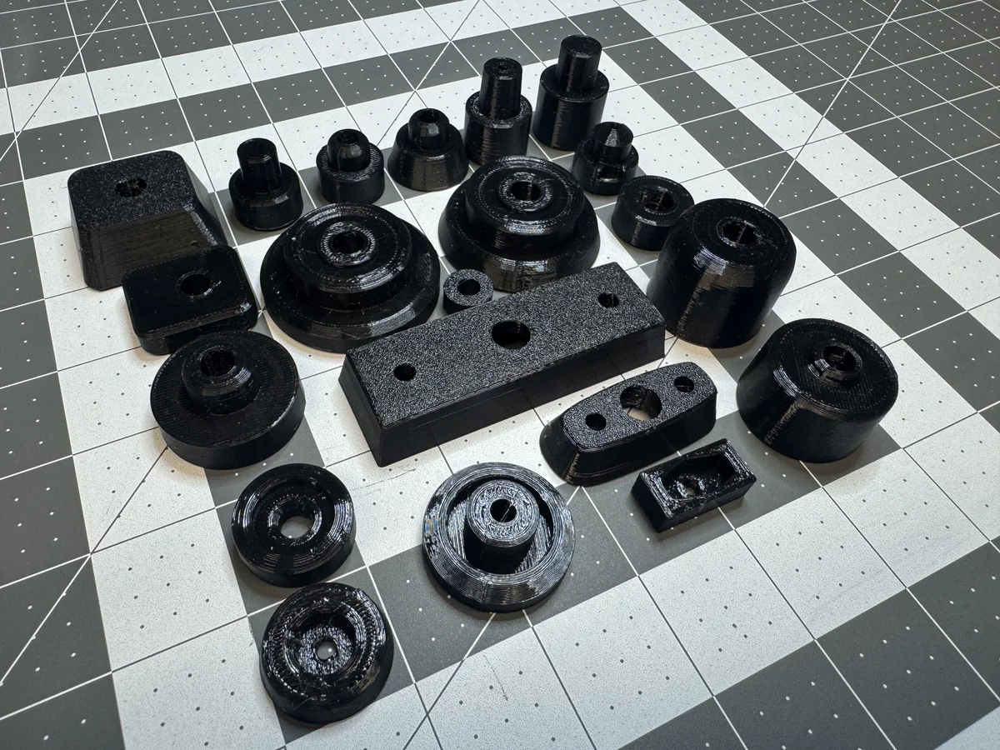{:standalone}

## Pourquoi imprimer en 3D des pieds de machines à écrire ?

Les pieds d'une machine à écrire jouent un rôle bien plus important qu'on ne le croit généralement :

- Ils empêchent la machine de glisser sur un bureau lisse lors de la frappe ou du retour du chariot.
- Ils amortissent les vibrations et le bruit, rendant la frappe plus silencieuse et plus agréable.
- Ils protègent à la fois la surface du bureau et la machine elle-même contre les rayures et les chocs.

Pour remplir ces trois fonctions, les pieds doivent être relativement souples et adhérents, raison pour laquelle ils étaient traditionnellement fabriqués en caoutchouc. Au fil des décennies, cependant, le caoutchouc vieillit mal : sur la plupart des machines anciennes, les pieds d'origine sont devenus durs comme de la pierre, aplatis, effrités ou ont tout simplement disparu. On peut raisonnablement considérer les pieds de machine à écrire comme des pièces d'usure — tout comme les cylindres d'impression ou les pneus de voiture.

La plupart des fabricants de machines à écrire ont disparu depuis longtemps, et les pièces de rechange d'origine ne sont plus produites depuis des décennies. Jusqu'à récemment, les solutions habituelles consistaient à :

- conserver les pieds durcis et poser la machine sur un tapis ;
- bricoler avec des pièces de quincaillerie génériques, comme des patins de meubles en caoutchouc, des butées ou des bouchons de laboratoire ;
- sculpter des pièces de remplacement dans du caoutchouc modelable comme du Sugru ; ou
- acheter des pieds neufs modernes auprès de vendeurs spécialisés en pièces de machines à écrire.

Cette dernière option est tout à fait valable, et certains pieds en caoutchouc moulé vendus aujourd'hui sont remarquablement bien faits. Au fil des ans, j'ai moi-même dépensé des centaines de dollars pour en acheter. Le problème est double : à 20–40 USD le jeu, la facture grimpe vite, et l'offre se limite aux modèles les plus courants. À l'échelle d'une grande collection — qui comprend des machines rares du XIXe et du début du XXe siècle pour lesquelles aucun pied de remplacement n'existe, ainsi que des machines à restaurer ou servant de donneuses de pièces entreposées sur des étagères — acheter des jeux en caoutchouc moulé pour tout le monde n'est tout simplement pas envisageable.

Une fois équipé d'une imprimante 3D, concevoir et imprimer mes propres pieds de remplacement s'est révélé une véritable révolution. Après un premier essai pour une Underwood 5 de 1920, j'ai rapidement conçu des pieds pour plus d'une vingtaine de machines couvrant huit décennies d'histoire de la machine à écrire.

## Choisir le bon matériau : le TPU Shore 85A

Le PLA et le PETG, les filaments de référence de l'impression 3D amateur, sont mal adaptés aux pieds de machines à écrire : ils sont beaucoup trop durs et glissants. Le **TPU** (*polyuréthane thermoplastique*), en revanche, est un filament élastomère souple vendu selon différents degrés de dureté sur l'échelle Shore A.

Le filament flexible le plus répandu est le **TPU Shore 95A**. C'est celui que j'ai essayé en premier : s'il convient pour une simple exposition statique, je l'ai trouvé trop rigide et pas assez adhérent pour une utilisation réelle. Passer à un **TPU Shore 85A** plus souple — en particulier le Siraya Tech Flex 85A — a tout changé.

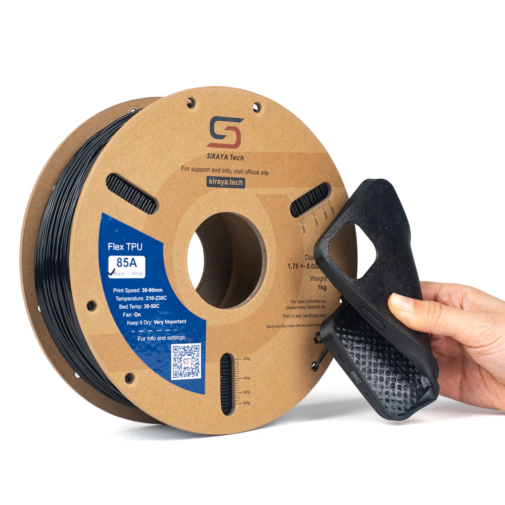{:standalone width="50%"}

En termes d'élasticité et d'amortissement, le TPU Shore 85A est excellent et offre un toucher très proche du caoutchouc. On peut également ajuster la fermeté réelle d'un pied en faisant varier le taux de remplissage dans le trancheur (*slicer*) — j'ai utilisé des valeurs allant de 100 % plein jusqu'à environ 25 % selon l'épaisseur et la géométrie du pied. Certes, le TPU reste légèrement moins collant que du caoutchouc naturel frais, mais le poids d'une machine à écrire compense largement cet écart en pratique, et le résultat est sans commune mesure avec des pieds manquants, pétrifiés ou effrités.

Le choix de couleurs est beaucoup plus limité en TPU souple qu'en PLA ou en PETG : le noir domine largement, accompagné du blanc, du transparent et de quelques teintes vives comme l'orange. Heureusement, le noir convient parfaitement à presque toutes les machines à écrire.

## Réglage de l'imprimante pour le TPU souple

Le TPU souple a la réputation d'être capricieux, même si les imprimantes modernes le gèrent beaucoup mieux que les anciennes générations. Malgré tout, le Shore 85A est suffisamment mou pour que je ne puisse pas le pousser de manière fiable à travers le tube guide PTFE de mon imprimante. À la place, j'alimente le filament directement par le haut de l'extrudeur — un montage facilité par une modification antérieure qui me permet de retirer le capot supérieur de l'imprimante.

[//]: # (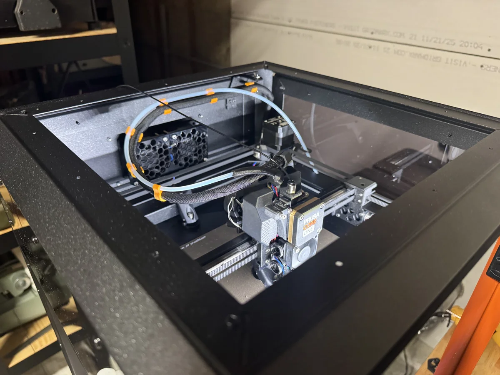{:standalone})

Au début, j'ai rencontré quelques bourrages d'extrudeur, probablement provoqués lors des rétractions du filament. Le réglage des vis de tension du galet presseur de l'extrudeur a largement résolu ces blocages. Tout aussi important, le TPU est hygroscopique et *doit* être sec pour s'imprimer proprement : un sécheur de filament est indispensable, et je fais passer la bobine directement depuis une boîte sèche vers un plateau d'impression texturé afin qu'il n'absorbe pas d'humidité en cours d'impression. La courte vidéo ci-dessous montre cette installation en action :

## Du caoutchouc pétrifié à la CAO

Avant de poser un nouveau pied, il faut retirer les restes de l'ancien. Lorsque le caoutchouc d'origine était moulé dans une coupelle métallique, son extraction peut se révéler étonnamment délicate : ces coupelles sont souvent embouties dans un acier ou un laiton très tendre qui se tord facilement si l'on force trop avec un levier. Sur deux ou trois machines, le vieux caoutchouc était si dur que j'ai dû l'évider à la perceuse, ne laissant que quelques rayures mineures à l'intérieur des coupelles.

Une fois la quincaillerie de fixation nettoyée, le cycle de conception est rapide et gratifiant :

1. **Examiner ce qui reste** du pied d'origine, en reconstituant mentalement (ou sur papier) son profil avant écrasement.
2. **Mesurer les cotes clés** — diamètres intérieurs des coupelles, trous de tiges, dégagements des vis et déports du châssis — au pied à coulisse numérique.
3. **Modéliser la pièce en CAO** (j'utilise Autodesk Fusion).
4. **Imprimer une pièce d'essai rapide en PLA** pour vérifier l'ajustement sur la visserie et le châssis, en corrigeant les dimensions si nécessaire.
5. **Affiner et imprimer en TPU Shore 85A**, en ajoutant congés et chanfreins pour l'esthétique et la facilité d'impression.

Voici cette étape de prototypage en PLA pour mon tout premier modèle, l'Underwood 5 de 1920, montrant le pied d'origine dur comme de la pierre à droite et le prototype en PLA orange à gauche (tous deux vus de dessous) :

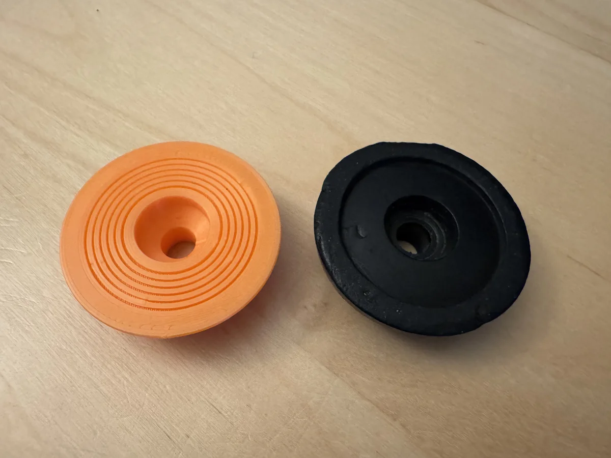{:standalone}

Une contrainte importante en impression 3D consiste à éviter les **supports**. Les cavités en porte-à-faux nécessitent normalement de la matière de support sacrificielle, très pénible à retirer proprement sur du TPU souple (à moins de disposer d'une imprimante multi-matériaux utilisant du PLA pour les supports). En recourant à des chanfreins internes inclinés et à des rainures concentriques sous la base plutôt qu'à des surplombs plats non soutenus, **aucun des pieds que j'ai conçus jusqu'à présent ne nécessite de supports**.

## Huit décennies de machines à écrire passées au crible

Ce qui m'a le plus surpris après l'Underwood 5, c'est la diversité des solutions imaginées par les fabricants entre les années 1880 et les années 1960 pour fixer quatre morceaux de caoutchouc sous un châssis. Regrouper mes modèles par mode de fixation et par géométrie offre un joli tour d'horizon mêlant ingénierie mécanique et techniques de CAO.

### 1. Tiges emboîtées, tiges de renfort et encoches de dégagement (1885–1917)

Les pieds les plus anciens de ma collection ont aussi été les plus simples à modéliser : des bouchons cylindriques étagés qui s'emboîtent directement en force dans des trous ronds du socle en fonte, comme sur la **Remington 2** (1885), la **Densmore 1b** (1894–1896) et la **Smith Premier 5** (1907).

<!-- Photos supplémentaires facultatives dans assets/posts/3d-printing-typewriter-feet/2x/ :
     IMG_1463.webp = Remington 2, IMG_1470.webp = Densmore 1b -->

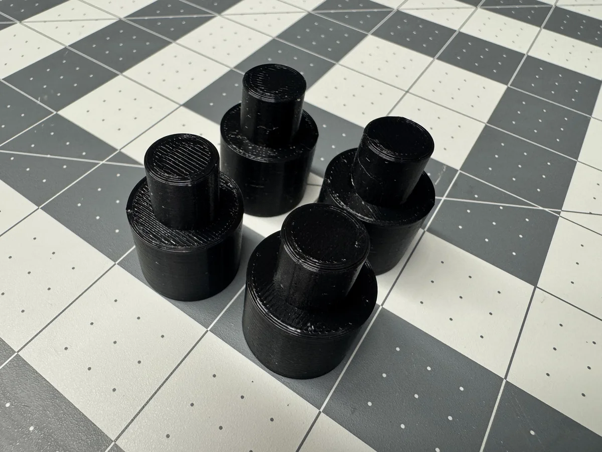{:standalone}

Comme la CAO rend l'expérimentation pratiquement gratuite, j'ai essayé deux variantes pour ma **Densmore 4** de 1899 (dont les pieds sont vissés) : un profil cylindrique sobre — sans doute plus proche de l'origine — et une version conique légèrement plus élégante.

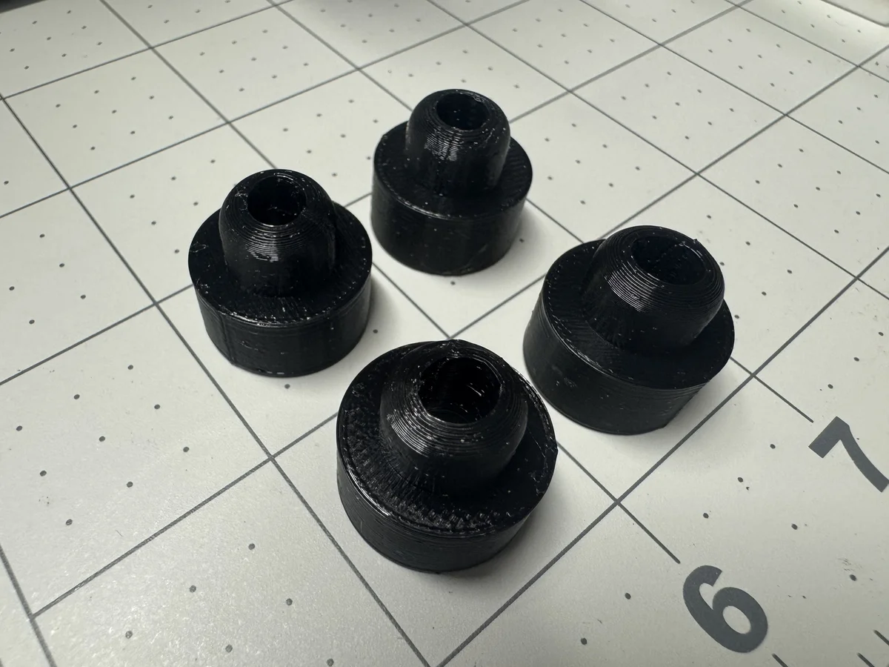{:standalone}

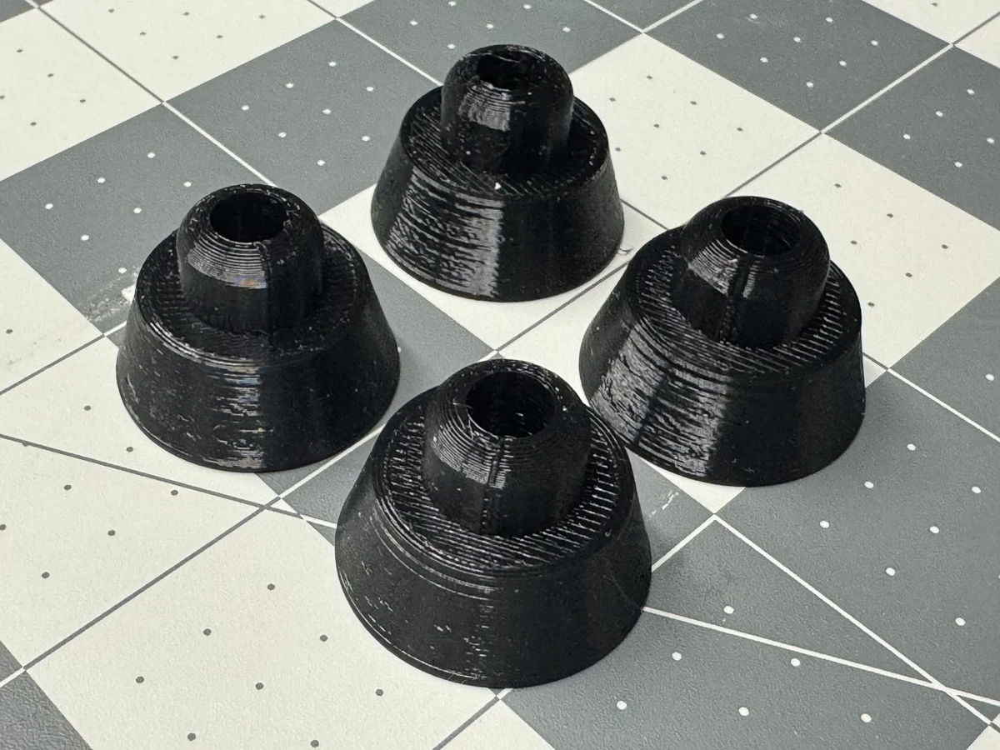{:standalone}

Les hauts pieds emboîtés de ma **Remington 7 à tabulateur Gorin** de 1907 se ressemblent de l'extérieur, mais cachent un détail structurel astucieux : une tige d'acier d'environ un pouce se glisse au centre du pied pour le rigidifier et le stabiliser. Conserver cet alésage interne dans la version imprimée en TPU (avec une variante conique) a été un jeu d'enfant.

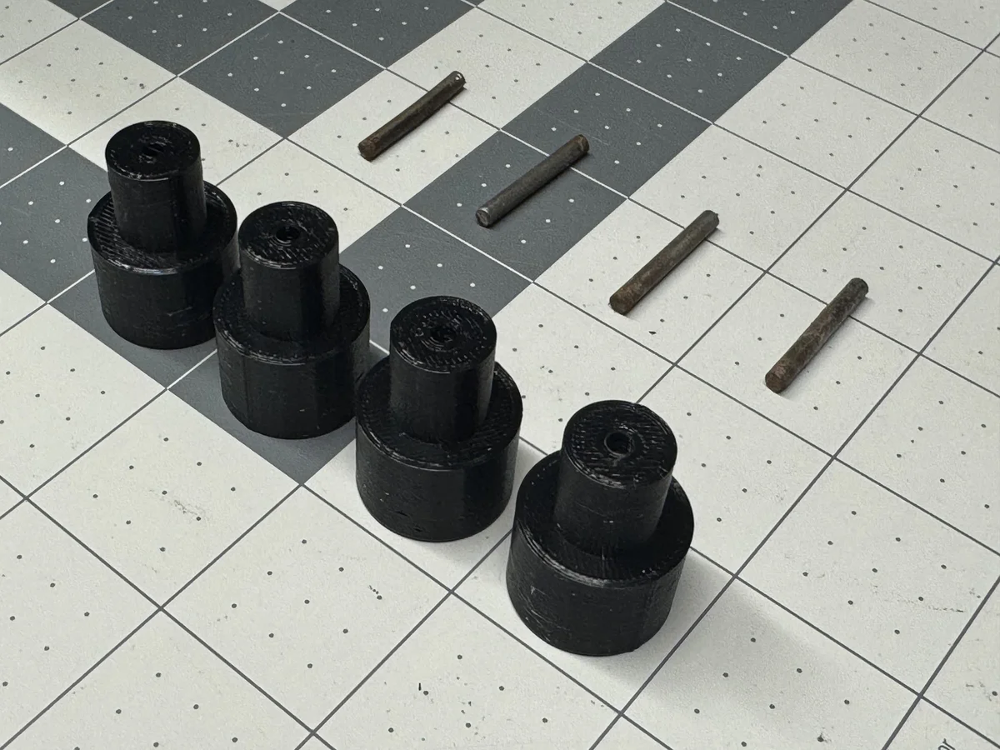{:standalone}

La CAO sur mesure brille aussi lorsqu'une machine réclame un ajustement asymétrique. Ma **Blickensderfer 5** en aluminium de 1909 est arrivée avec seulement deux pieds déformés et fossilisés ; il y a des années, j'avais bricolé des pieds arrière de fortune en Sugru, avec un résultat médiocre. En modélisant de vrais pieds arrondis en TPU (dotés de trous supérieurs pour des vis à bois fendues), j'ai remarqué qu'une tête de vis sous le châssis empiétait sur le pied arrière gauche — il m'a suffi de quelques minutes pour y ménager une encoche de dégagement bien propre :

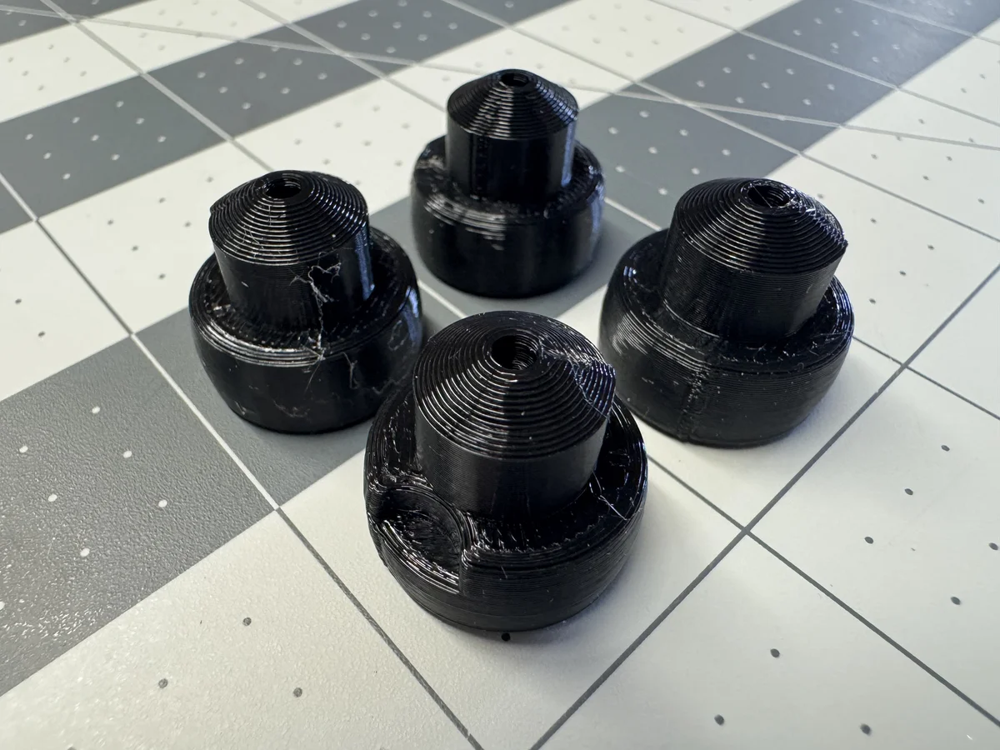{:standalone}

J'ai adopté une approche similaire sur ma **Courier** de 1917 — essentiellement une **Oliver 3** fabriquée en Autriche (la pièce pourrait donc aussi convenir à une Oliver 3). Ici, les pieds s'emboîtent directement dans le châssis sans visserie, et l'ajout d'une encoche latérale en gradin m'a permis d'élargir légèrement la base au-delà du bâti en fonte pour obtenir une assise plus large et plus stable :

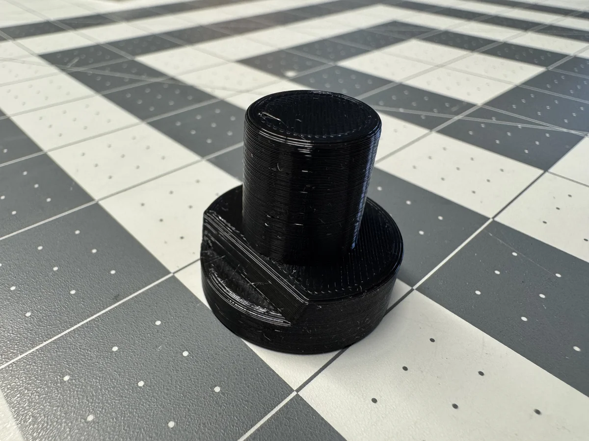{:standalone}

### 2. Coupelles métalliques, vis et coussinets multi-pièces (1906–1949)

Dans les années 1910 et 1920, de nombreuses machines de bureau standard logeaient leurs pieds en caoutchouc dans des coupelles métalliques embouties fixées au châssis par des vis. C'est le cas des pieds vissés des **Royal « flatbed » modèles 1, 5 et 6** (que l'on peut imprimer plus courts ou plus hauts selon sa préférence), des hauts pieds trapus en coupelle de mon **Underwood 5** de 1920, et des larges pieds en coupelle de la **Remington Vertical Adder Model 21** des années 1920 (qui conviennent probablement aussi aux Remington standard de la même époque).

<!-- Photo supplémentaire facultative dans assets/ : IMG_1702.webp = Remington Model 21 -->

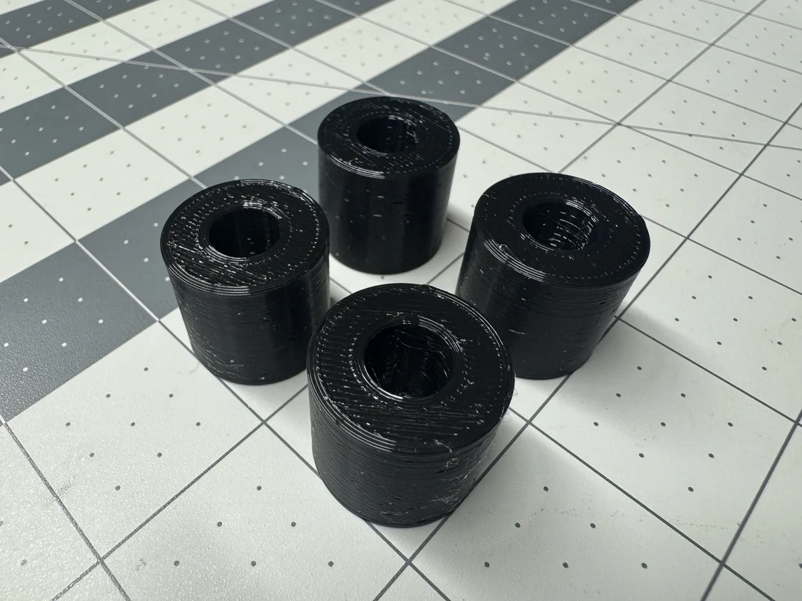{:standalone}

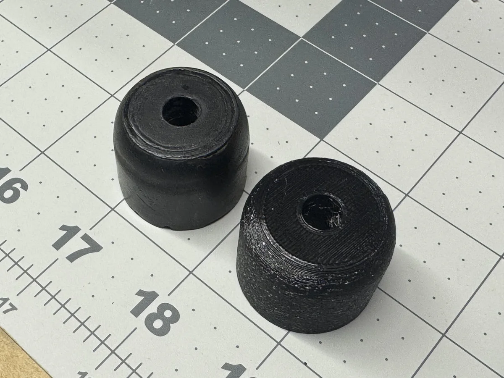{:standalone}

À la fin des années 1930 et dans les années 1940, l'isolation contre les vibrations devient plus sophistiquée. La **Royal KHM** de 1938 prend la quincaillerie de fixation en sandwich entre le pied principal, plutôt carré, en dessous et un coussinet amortisseur séparé en caoutchouc au-dessus :

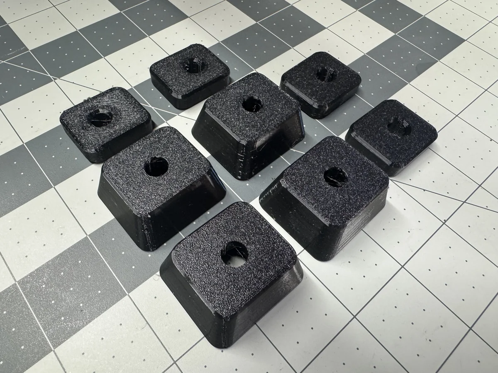{:standalone}

Les Underwood d'après-guerre ont évolué dans la même direction. Sur mon **Underwood « S »** de 1942, le caoutchouc repose sous des coussinets semblables à du feutre à l'intérieur de coupelles métalliques ; j'ai fait la partie cachée en TPU souple légèrement plus haute que les originaux aplatis, sans modifier l'aspect extérieur. L'**Underwood « SS »** de 1948 et la **Rhythm Touch** de 1949 utilisent des pieds plus larges, en forme de soucoupe, qui partageaient peut-être à l'origine la même pièce moulée, bien que sur mes machines la visserie de la Rhythm Touch comporte un insert métallique et une rondelle supplémentaires. J'ai modélisé des parois légèrement plus droites pour la Rhythm Touch et doté les deux modèles de dessous rainurés et de chanfreins internes afin qu'ils s'impriment proprement sans supports.

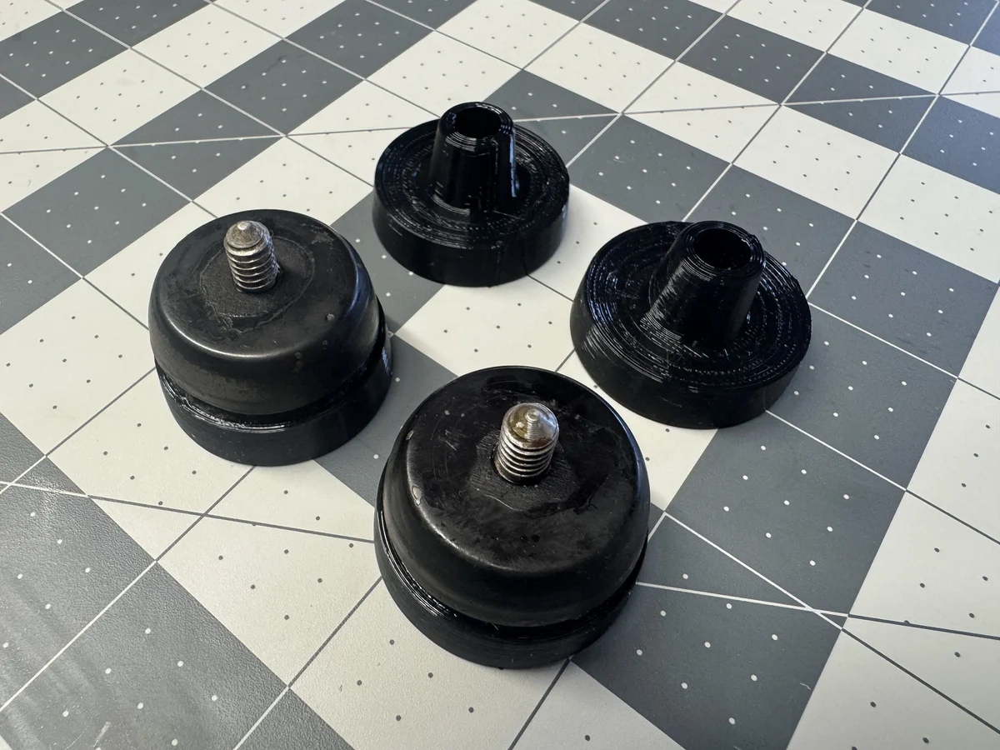{:standalone}

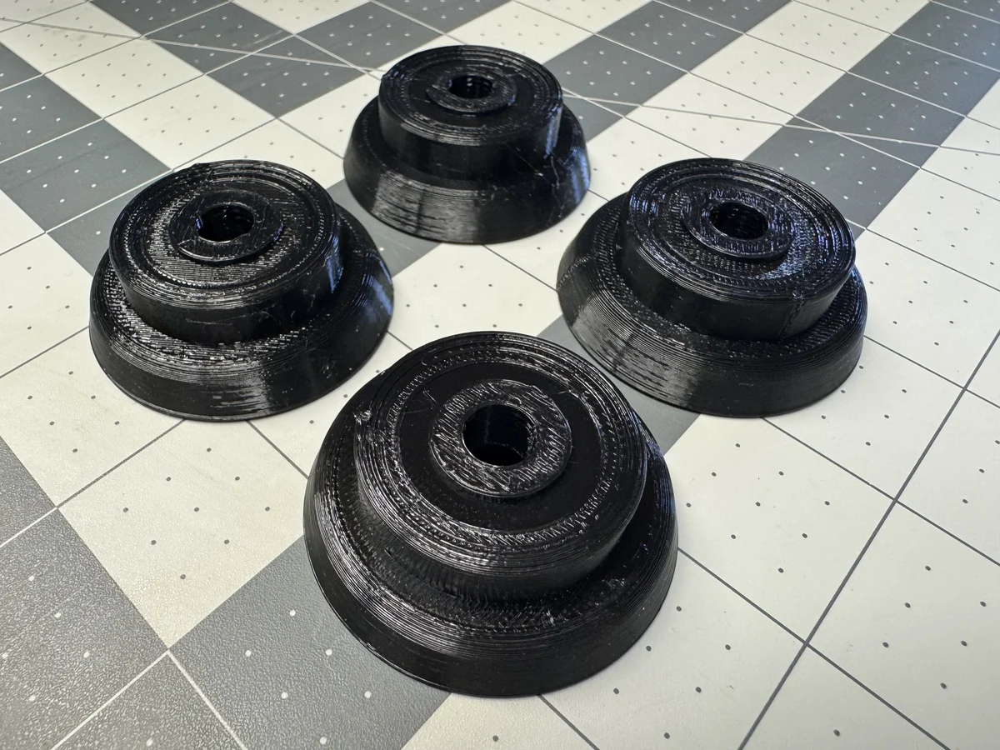{:standalone}

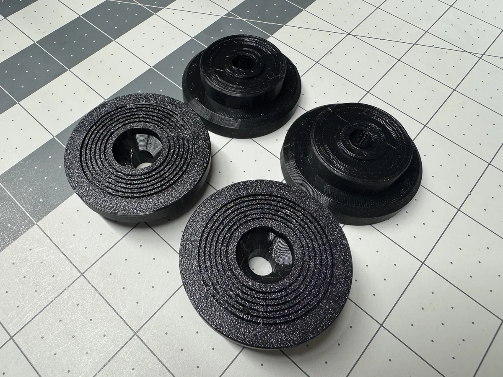{:standalone}

### 3. Valises de transport et reconstitution de formes disparues (1927–années 1960)

Les machines portables fixent souvent des pieds circulaires compacts directement sous le fond de leur valise de transport ou de leur socle à l'aide d'une vis et d'une rondelle. Tant l'**Hermes Media** de 1958 que la **Princess 100** avaient des pieds d'origine écrasés de manière créative, ce qui en a fait des remplacements rapides et gratifiants à imprimer :

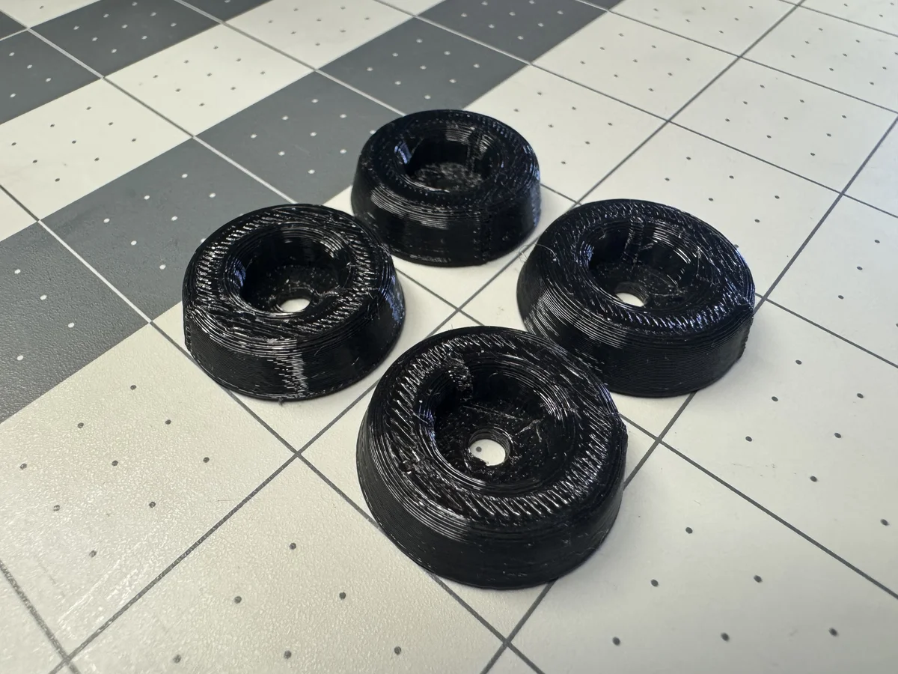{:standalone}

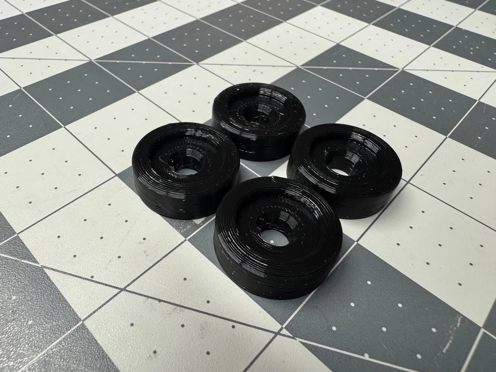{:standalone}

Toutes les portables ne laissent cependant pas d'indices aussi clairs. Reconstituer les pieds de ma **Varityper Folding** de 1927 (étroitement apparentée à la Hammond Folding) a demandé une part d'interprétation. Le fond de la valise comportait de vieux patins de feutre légèrement creusés, et les restes de caoutchouc s'étaient déformés pour épouser cette cuvette — mais si la machine devait pouvoir reposer directement sur une table hors de sa valise, le dessous des pieds devait forcément être plat. Les photos en ligne de Varityper et de Hammond Folding survivantes n'aidaient guère non plus, leurs pieds étant presque tous très dégradés. J'ai opté pour un modèle à base plate qui enveloppe proprement l'intérieur et l'extérieur des pattes métalliques du châssis :

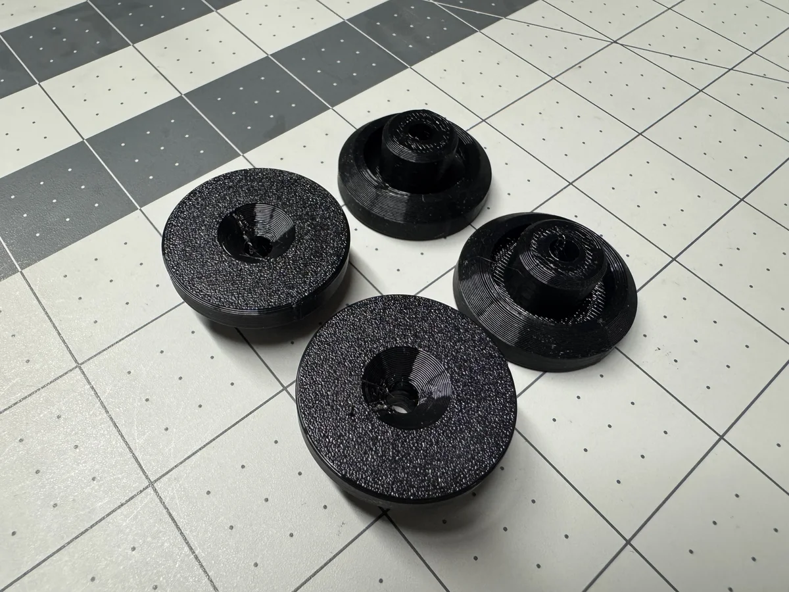{:standalone}

### 4. Au-delà des pieds ronds : lissages, splines et blocs surdimensionnés (années 1950–1960)

Les machines européennes du milieu du siècle m'ont poussé bien au-delà des simples cylindres de révolution dans Fusion. L'**Hermes Ambassador** de 1951 utilise de longs pieds rectangulaires massifs pris en sandwich entre des brides métalliques embouties. Les modéliser a été mon prétexte pour apprendre la fonction de **lissage (*Loft*)** de Fusion, combinée à des chanfreins et des congés — et voir l'original gris en miettes à côté de la pièce neuve en TPU noir se passe de commentaire :

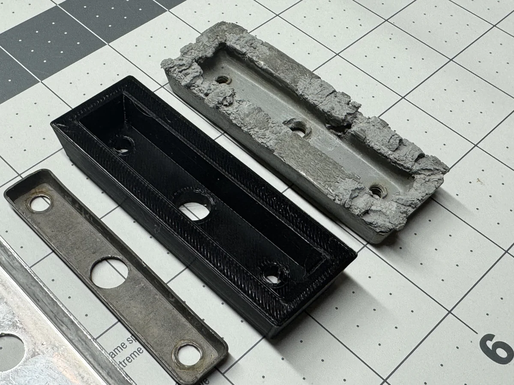{:standalone}

La **Facit TP2** des années 1960 reprend un principe très similaire de bloc rectangulaire retenu par une plaque métallique, à une fraction de la taille de l'Ambassador :

<!-- Remarque : IMG_2059.webp montre les 4 pieds de la Facit TP2 côté dessous texturé ; on peut la remplacer par la photo du logement supérieur tirée de Printables si l'on préfère montrer la cavité interne. -->

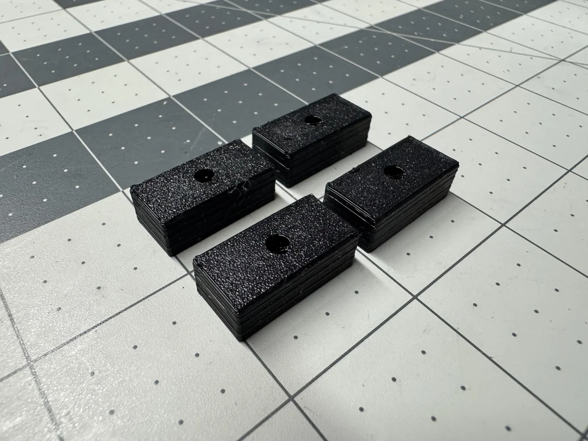{:standalone}

Plus exigeante encore, l'**Erika 10** de 1960 possède des pieds allongés en forme de barque, ni circulaires ni rectangulaires. J'ai combiné un lissage avec une numérisation à plat du contour du pied d'origine, en traçant des splines par-dessus le scan pour approcher la courbe. Ce n'est pas mathématiquement exact — mais les pièces d'usine d'origine ne l'étaient pas davantage !

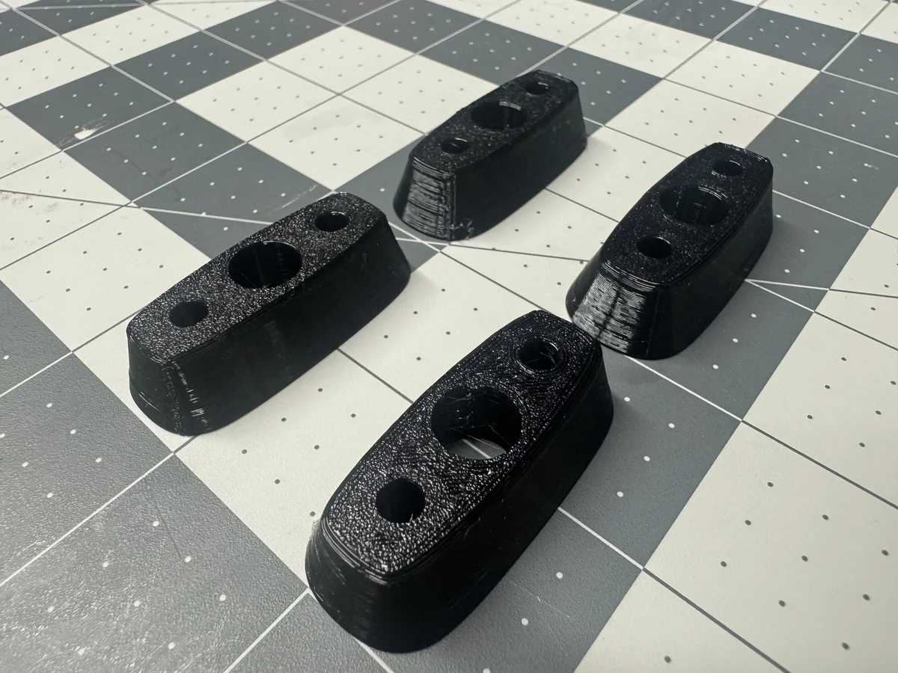{:standalone}

Enfin, deux machines de bureau standard des années 1950 de ma collection logent des formes distinctes à l'avant et à l'arrière dans des coupelles métalliques. L'**Olivetti Lexicon 80** associe des pieds avant ronds et coniques à des pieds arrière allongés à deux vis, dont la profonde cavité interne accueille une barrette métallique de maintien :

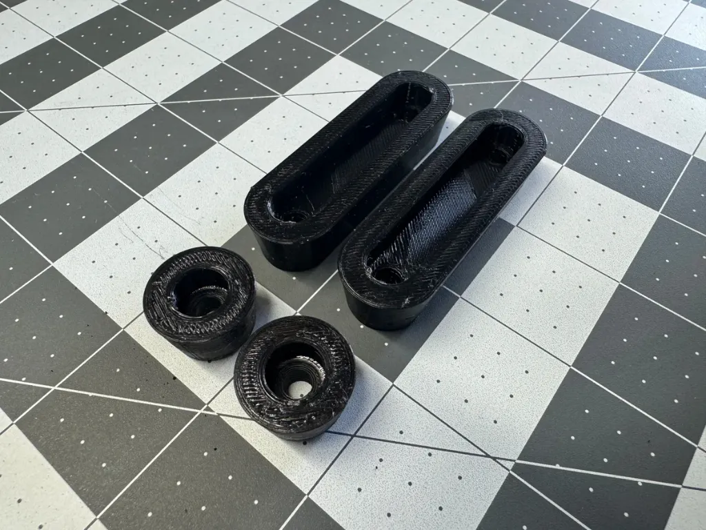{:standalone}

Et tout en haut de l'échelle, les patins de mon **Adler Standard** mesurent plus de cinq centimètres de large — les plus grands pieds que j'aie imprimés jusqu'ici. Les pieds avant comportent un trou central plus large pour dégager un écrou en plus des vis de fixation, tandis que les pieds arrière présentent une ouverture vers l'arrière. Pour de futures révisions, j'ajouterai peut-être des sculptures sous la semelle afin que cette grande surface plane reste aussi adhérente que possible :

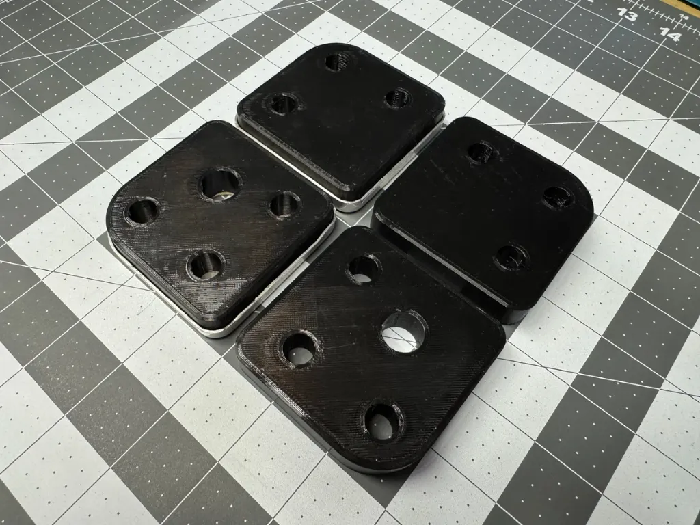{:standalone}

## Catalogue complet sur Printables

Tous les modèles ci-dessous sont disponibles sur [mon profil Printables](https://www.printables.com/@ebruchez_3481058/models) sous licence Creative Commons Attribution - Partage dans les Mêmes Conditions (CC BY-SA 4.0). Parce que les maillages `.stl` seuls sont fastidieux à modifier lorsqu'une autre machine demande un pied légèrement plus haut ou un trou de vis plus large, **chaque téléchargement inclut les fichiers CAO sources Autodesk Fusion (`.f3d`) et `.step`** aux côtés des fichiers d'impression `.stl` et `.3mf`.

| Machine à écrire                           | Lien                                                                                                      | Année(s)          | Fixation et remarques                                                               |
|--------------------------------------------|-----------------------------------------------------------------------------------------------------------|-------------------|-------------------------------------------------------------------------------------|
| Remington 2                                | [Printables](https://www.printables.com/model/1548387-remington-2-typewriter-rubber-foot)                 | 1885              | Emboîté                                                                             |
| Densmore 1b                                | [Printables](https://www.printables.com/model/1546628-densmore-1b-typewriter-rubber-foot)                 | 1894–1896         | Emboîté                                                                             |
| Densmore 4                                 | [Printables](https://www.printables.com/model/1541028-densmore-4-typewriter-rubber-foot)                  | 1899              | Vissé ; versions cylindrique et conique                                             |
| Royal « flatbed » 1 / 5 / 6                | [Printables](https://www.printables.com/model/1565685-royal-flatbed-156-typewriter-rubber-foot)           | 1906–1913         | Vissé ; variantes plus courtes ou plus hautes                                       |
| Remington Model 7 avec tabulateur Gorin    | [Printables](https://www.printables.com/model/1544036-remington-7-typewriter-rubber-foot)                 | 1907              | Emboîté ; haut, renforcé par une tige d'acier interne                               |
| Smith Premier 5 avec tabulateur Gorin      | [Printables](https://www.printables.com/model/1540555-smith-premier-typewriter-rubber-foot)               | 1907              | Emboîté ; haut                                                                      |
| Blickensderfer 5                           | [Printables](https://www.printables.com/model/1545715-blickensderfer-5-typewriter-rubber-foot)            | 1909              | Emboîté avec trou supérieur pour vis à bois et encoche de dégagement arrière        |
| Courier                                    | [Printables](https://www.printables.com/model/1916844-courier-typewriter-rubber-foot)                     | 1917              | Emboîté avec encoche latérale de dégagement (Oliver 3 autrichienne)                 |
| Underwood 5                                | [Printables](https://www.printables.com/model/1540512-1920-underwood-5-typewriter-rubber-foot)            | 1920              | Coupelle métallique et vis ; variante haute                                         |
| Remington Vertical Adder Model 21          | [Printables](https://www.printables.com/model/1545724-remington-model-21-typewriter-rubber-foot)          | Années 1920       | Coupelle métallique et vis                                                          |
| Varityper / Hammond Folding                | [Printables](https://www.printables.com/model/1562187-varityper-folding-or-hammond-folding-typewriter-fo) | 1927              | Emboîté ; enveloppe l'intérieur et l'extérieur des pattes métalliques du châssis    |
| Royal KHM                                  | [Printables](https://www.printables.com/model/1562252-royal-khm-typewriter-foot)                          | 1938              | En sandwich avec la quincaillerie métallique + coussinets supérieurs en caoutchouc  |
| Underwood « S »                            | [Printables](https://www.printables.com/model/1549982-underwood-s-typewriter-rubber-foot)                 | 1942              | Coupelle métallique et vis ; se loge sous des coussinets supérieurs type feutre     |
| Underwood « SS »                           | [Printables](https://www.printables.com/model/1552390-underwood-ss-typewriter-foot)                       | 1948              | Coupelle métallique et vis ; base large rainurée imprimable sans supports           |
| Underwood Rhythm Touch                     | [Printables](https://www.printables.com/model/1562199-underwood-rhythm-touch-typewriter-foot)             | 1949              | Coupelle métallique, insert, rondelle et vis ; large                                |
| Adler Standard                             | [Printables](https://www.printables.com/model/1916810-adler-standard-typewriter-rubber-feet)              | Années 1950       | Larges blocs carrés en coupelles métalliques ; formes avant et arrière distinctes   |
| Olivetti Lexicon 80                        | [Printables](https://www.printables.com/model/1916835-lexicon-80-typewriter-rubber-feet)                  | Années 1950       | Logés en coupelles métalliques ; pieds avant ronds et pieds arrière oblongs à 2 vis |
| Hermes Ambassador (première série)         | [Printables](https://www.printables.com/model/1540422-early-hermes-ambassador-typewriter-rubber-foot)     | 1951              | Grande barre rectangulaire prise en sandwich entre des brides métalliques           |
| Hermes Media                               | [Printables](https://www.printables.com/model/1554200-hermes-media-typewriter-foot)                       | 1958              | Compact ; vis et rondelle dans les coupelles du fond de valise                      |
| Princess 100                               | [Printables](https://www.printables.com/model/1709663-princess-typewriter-rubber-foot)                    | Années 1950–1960  | Cylindrique ; vissé à la valise de transport                                        |
| Erika 10                                   | [Printables](https://www.printables.com/model/1562194-erika-10-typewriter-foot)                           | 1960              | Coupelle métallique et 2 vis ; forme oblongue lissée sur splines                    |
| Facit TP2                                  | [Printables](https://www.printables.com/model/1709671-facit-typewriter-rubber-foot)                       | Années 1960       | Bloc rectangulaire compact avec plaque métallique encastrée et vis                  |

## Compromis et au-delà des pieds

Ce que j'apprécie le plus dans cette méthode, c'est la vitesse d'itération : passer d'un reste de caoutchouc effrité et d'un pied à coulisse à un pied en TPU monté sur la machine prend au plus quelques heures, souvent bien moins. Mieux encore, comme le filament ne coûte que quelques centimes par pied, j'ai pu équiper des machines en attente de restauration avant de les remettre sur leurs étagères de rangement — protégeant ainsi à la fois les étagères et les machines jusqu'à ce que vienne leur tour sur l'établi.

Il existe bien sûr deux compromis par rapport au caoutchouc moulé :

- **Adhérence :** le TPU Shore 85A est légèrement moins collant que du caoutchouc neuf, même si sous le poids d'une machine à écrire je n'ai rencontré aucun problème de glissement en pratique.
- **Esthétique :** le TPU imprimé présente un léger brillant et des lignes de couches visibles. Sous le châssis d'une machine à écrire, les pieds attirent rarement le regard, cela ne me dérange donc pas du tout. Pour les perfectionnistes, quelqu'un m'a récemment suggéré de polir légèrement le TPU sur un disque de polissage afin d'atténuer les lignes de couches et d'obtenir un fini mat proche du caoutchouc ; les résines SLA souples — ou l'utilisation de positifs imprimés en 3D pour couler des moules en silicone destinés au caoutchouc moulé — sont aussi des pistes possibles, même si pour mes besoins l'impression directe en TPU est déjà largement suffisante.

Une fois l'imprimante bien réglée pour le TPU Shore 85A, d'autres pièces en caoutchouc dégradées commencent aussitôt à sauter aux yeux. Par exemple, je n'avais pas réalisé à quel point les tampons amortisseurs des leviers de retour chariot se fendaient ou s'aplatissaient avant d'inspecter mon Underwood « S » de 1942 et mon Underwood « SS » de 1948 — chacune utilise deux minuscules anneaux amortisseurs qui prennent quelques minutes à modéliser et à imprimer ([également sur Printables](https://www.printables.com/model/1562263-underwood-typewriter-carriage-return-lever-bumper)) :

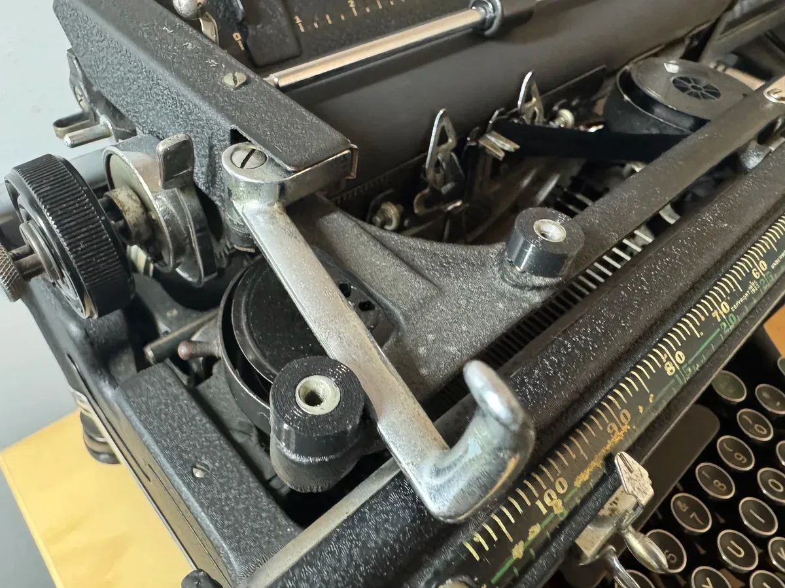{:standalone}

Sur ma liste des prochaines expériences figurent les galets de presse-papier et d'entraînement (même si le tube en caoutchouc constitue une alternative simple), d'autres modèles de pieds au fil des nouvelles machines qui passeront sur l'établi, ainsi que des essais avec des TPU encore plus souples ou des TPU moussants à dureté variable.
