## Introduction

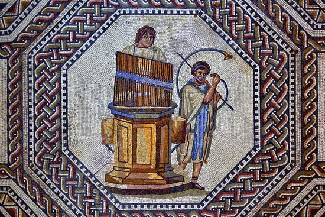{:standalone width="75%"}

En octobre 2013, dans le cadre d'une quête pour comprendre les origines du clavier de piano moderne, je m'étais [fixé pour objectif](/posts/october-reading-resolution/) de lire un ouvrage de 300 pages recommandé par le conservateur du [Musée Suisse de l'Orgue](https://www.orgue.ch/), Jean-Jacques Gramm[^passed-away] : le classique érudit de Jean Perrot sur l'histoire ancienne de l'*orgue à tuyaux*.[^perrot]

On pourrait croire le sujet confidentiel ! Pourtant, le livre s'est révélé passionnant, riche en histoire technique et culturelle. Il m'a fallu environ quatre mois de lecture assidue et de prise de notes[^perrot-notes] pour en venir à bout, après quoi j'ai commencé à rédiger un article — avant de le laisser inachevé pendant des années.[^meanwhile] En voici enfin les principaux enseignements, accompagnés d'un article compagnon consacré à [l'origine du clavier musical moderne](/fr/posts/origine-du-clavier-musical-moderne/).

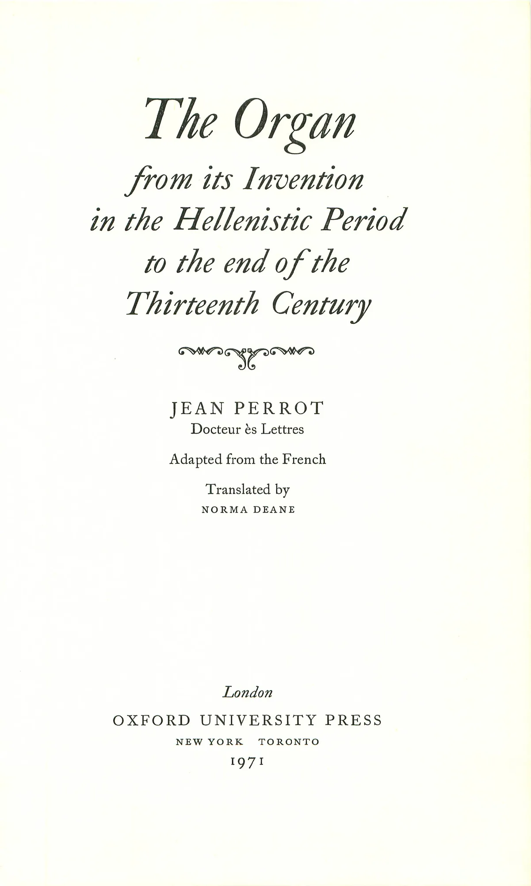{:standalone width="35%" .img-shadow}

La plus grande surprise, d'emblée, c'est l'*ancienneté* de l'orgue à tuyaux[^organon] : il remonte au IIIe siècle av. J.-C., il y a environ 2 300 ans. Plus remarquable encore, la plupart des éléments fondamentaux d'un orgue à tuyaux moderne étaient déjà présents dès l'origine :

- des *tuyaux* soigneusement alignés par ordre de taille,[^nennig-pipes]
- des *pompes* à air mécaniques,
- un *régulateur* de pression d'air,
- et un *clavier* à ressorts joué avec les doigts.

## L'ingénierie de l'*hydraulis* (et au-delà)

### Ctésibios et les témoignages parvenus jusqu'à nous

Autant qu'on le sache, l'orgue a été inventé de toutes pièces par un seul homme : [Ctésibios][ktesibios-link] d'Alexandrie, qui vécut vers 285–222 av. J.-C. — un « geek » avant l'heure, passionné par les machines pneumatiques et les pompes.

Les Grecs de l'Antiquité connaissaient déjà des instruments à vent tels que l'*aulos* (un tuyau à anche double), alimentés par les poumons du musicien. Utiliser une machine pour souffler de l'air dans une rangée de tuyaux représentait une véritable percée. Pour rendre l'instrument musical, Ctésibios dut concevoir un système capable non seulement de pomper de l'air, mais aussi de maintenir une pression d'air suffisamment constante pour que le son demeure stable et agréable d'une note à l'autre.

Sa solution consistait à pousser l'air d'une pompe à cylindre vers une citerne où le poids de l'eau régulait la pression alimentant le *sommier* (le coffre qui distribue aux tuyaux l'air sous pression, appelé le *vent* en facture d'orgues). En raison du rôle joué par l'eau, l'instrument fut baptisé *hydraulis* (du grec *hydōr*, « eau », et *aulos*), ou *orgue hydraulique*.

Ctésibios décrivit son invention dans un traité malheureusement perdu, et comme des siècles le séparent des plus anciens récits conservés, nous ne pouvons pas savoir avec une certitude absolue dans quelle mesure il s'appuya sur des essais antérieurs. Malgré tout, un ensemble étonnamment riche de sources antiques a survécu :

- **Textes classiques :** deux descriptions techniques détaillées de l'orgue gréco-romain ont été recopiées et transmises à travers les millénaires — l'une par [Vitruve](https://fr.wikipedia.org/wiki/Vitruve) (Ier siècle av. J.-C.) et l'autre par [Héron d'Alexandrie](https://fr.wikipedia.org/wiki/H%C3%A9ron_d%27Alexandrie) (Ier siècle apr. J.-C.).
- **Iconographie :** des dizaines de mosaïques, bas-reliefs, lampes et figurines en terre cuite représentent l'instrument en action.
- **Archéologie :** de véritables vestiges matériels ont été mis au jour, notamment l'[hydraulis de Dion][dion-hydraulis-link] du Ier siècle av. J.-C. (découvert en Grèce en 1992) et le petit [orgue d'Aquincum][aquincum-organ-link] du IIIe siècle apr. J.-C. trouvé en Hongrie romaine (dont la plaque dédicatoire le désigne comme une *hydra*, même si sa soufflerie a brûlé dans un incendie et que les spécialistes débattent encore pour savoir s'il fonctionnait à l'eau ou à soufflets).

L'une des pièces documentaires les plus frappantes est un schéma grec en trois couleurs tiré des *Pneumatiques* de Héron, conservé dans un manuscrit de Venise datant des environs de 1300 (*Marcianus gr. Z. 516*) et fidèlement reproduit dans des copies grecques ultérieures telles que le *Burney MS 108* du XVIe siècle à la British Library — tous descendant en droite ligne de l'Antiquité.[^hero-drawing] On y embrasse toute la machine d'un seul coup d'œil : la citerne d'eau avec sa cloche inversée à gauche, la pompe à piston au centre, le sommier et les tuyaux au-dessus, et le mécanisme du clavier avec ses ressorts de rappel en corne et ses tirettes à droite.



### Idées reçues sur le rôle de l'eau

De l'Antiquité aux temps modernes, le rôle exact de l'eau dans l'*hydraulis* a laissé perplexes de nombreux commentateurs. Vitruve lui-même [avertissait ses lecteurs][vitruvius-link] combien il est difficile de se le représenter à partir du seul texte :

> J'ai fait tous mes efforts pour exposer clairement par écrit un sujet obscur, mais sa théorie n'est pas aisée et ne se laisse pas aisément comprendre de tous, sinon de ceux qui ont quelque pratique en ces matières. Si quelqu'un n'a pas réussi à la saisir, il constatera assurément, lorsqu'il verra la chose elle-même, qu'elle est conçue avec soin et ingéniosité dans tous ses détails.

Entre le XVIe et le XIXe siècle en particulier, des érudits proposèrent des reconstitutions délicieusement imaginatives — quoique mécaniquement impossibles. Il est utile de dissiper trois mythes tenaces :

- **Idée reçue n° 1 : L'eau fournissait l'énergie.** Faux : l'*hydraulis* était actionné par la force humaine, généralement par des assistants ou des jeunes gens qui actionnaient des leviers de haut en bas à la force des bras.
- **Idée reçue n° 2 : L'eau circulait dans les tuyaux pour produire le son.** Faux : comme tous les orgues à tuyaux depuis lors, l'*hydraulis* sonnait en soufflant de l'*air* dans ses tuyaux.
- **Idée reçue n° 3 : Il fallait une alimentation continue en eau courante.** Faux : le *volume* d'eau restait fixe. Il suffisait de remplir la citerne une fois et de faire l'appoint de temps en temps pour compenser l'évaporation ou les fuites. Comme seul le *poids* statique de cette eau régulait la pression de l'air, l'*hydraulis* restait un instrument relativement transportable.

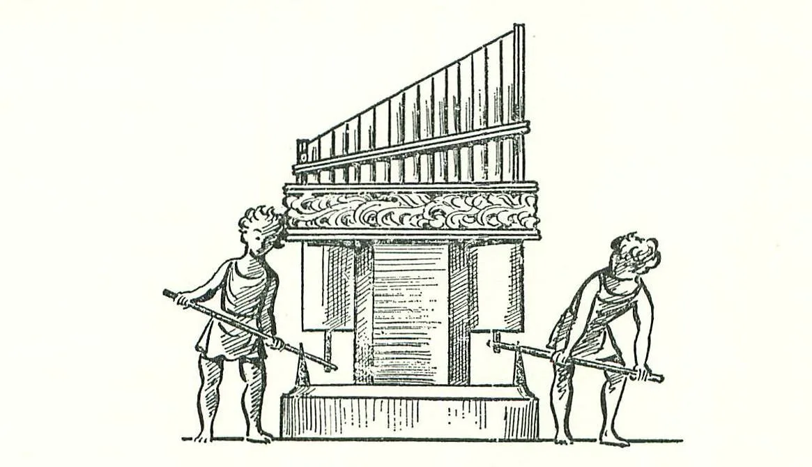{:standalone width="55%" .img-shadow}

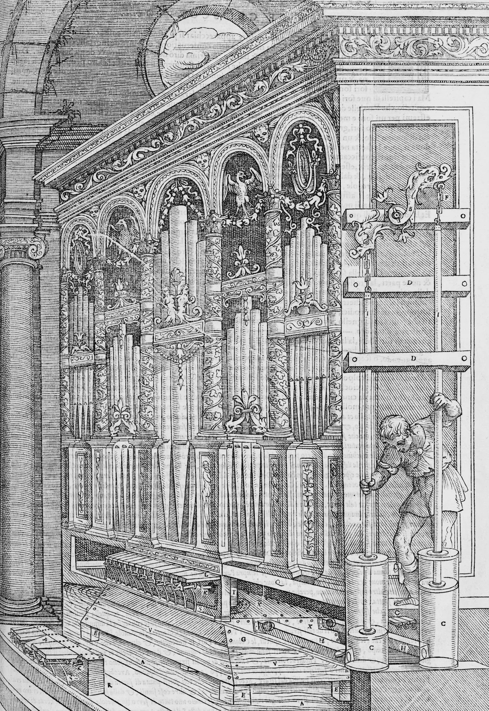{:standalone width="50%"}

### Ce que faisait réellement l'eau

Imaginez que vous raccordiez directement une pompe à vélo manuelle à une flûte : comme le piston doit être ramené en arrière entre chaque coup de pompe, l'air ne circule que par intermittence, ce qui rend impossible de tenir une note stable. Employer deux pompes en alternance (comme le faisaient la plupart des orgues gréco-romains) comble un peu les creux, mais la pression continue de pulser à chaque mouvement.

Dans l'*hydraulis*, l'eau joue le rôle d'un tampon de pression — essentiellement un accumulateur chargé par gravité — permettant à l'organiste de jouer des lignes continues ou de tenir des notes sans que la hauteur ni le volume ne fluctuent. L'air issu des pompes alimente à la fois le sommier au-dessus et un entonnoir ou une cloche inversée, appelée *pnigeus*, immergée près du fond de la citerne d'eau.

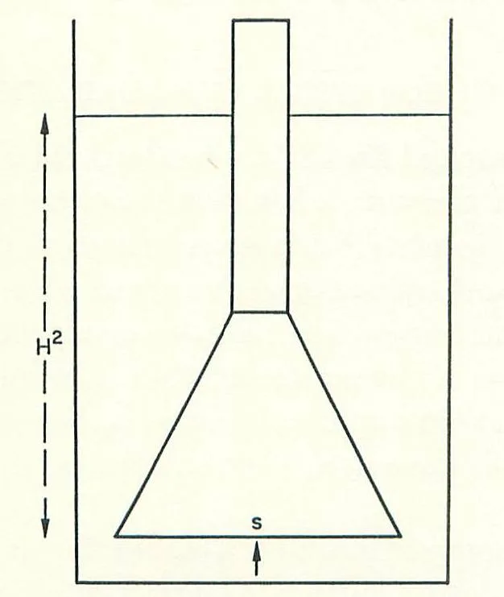{:standalone width="50%" .img-shadow}

Lorsque la pompe refoule l'air, l'excédent chasse l'eau hors du *pnigeus*, faisant monter le niveau d'eau alentour. Pendant la brève pause où le piston inverse sa course, le poids de cette eau déplacée fait refluer l'eau dans le *pnigeus*, chassant régulièrement l'air emmagasiné vers le sommier et les tuyaux. Sur la coupe moderne de l'orgue de Vitruve ci-dessous, on suit aisément la manière dont l'eau (11) et le *pnigeus* (12) stabilisent le flux d'air en route vers les tuyaux.

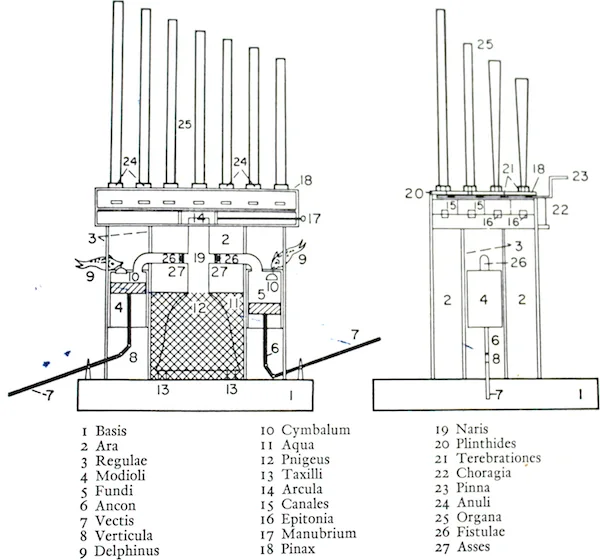{:standalone width="65%"}

Lors de ma visite au [Musée Suisse de l'Orgue](https://www.orgue.ch/) à Roche, en Suisse, j'ai pu voir de mes propres yeux une reconstitution fonctionnelle grandeur nature de l'*hydraulis* de Héron — avec sa grande citerne d'eau en cuivre en dessous, la pompe à piston cylindrique et son long levier de fer à gauche, et les tuyaux de laiton étagés surplombant les leviers de touches en bois (avec le schéma manuscrit de Héron encadré sur le mur de pierre à gauche !) :

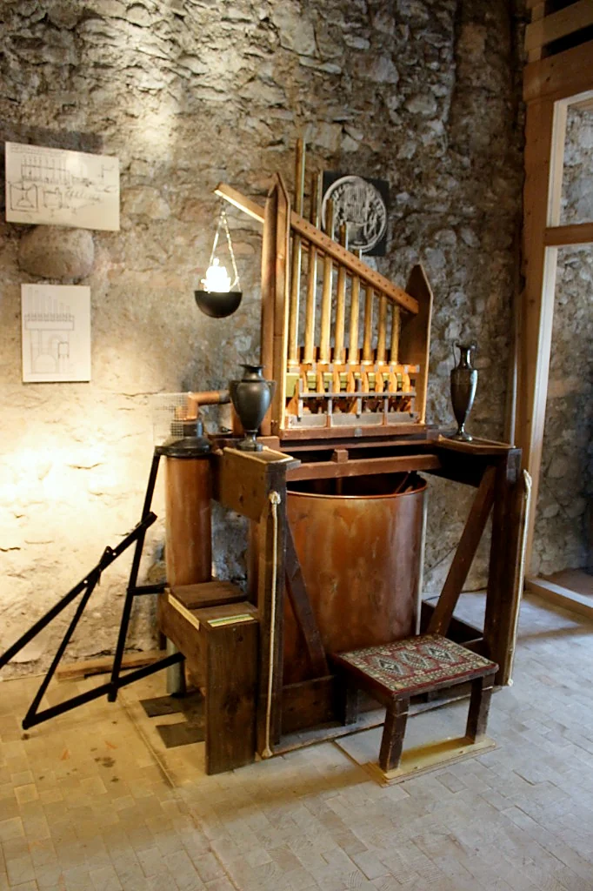{:standalone width="50%"}

### De l'eau aux soufflets

Nous ignorons précisément quand sont apparus les premiers *orgues à soufflets* — qui se passaient totalement d'eau. Les soufflets de forge existaient déjà depuis des millénaires, mais les adapter à un orgue exigeait encore de résoudre la régulation de la pression et l'étanchéité du sommier. Au IIe siècle apr. J.-C., les orgues à soufflets étaient assurément en usage et, à la chute de l'Empire romain d'Occident, l'*hydraulis* régulé par l'eau avait largement disparu.[^bellows-hydraulic]

Les orgues à soufflets étaient plus légers, plus faciles à déplacer et épargnaient aux facteurs les soucis de corrosion et d'entretien d'un réservoir d'eau. À leurs débuts, toutefois, ils ne pouvaient égaler les hautes pressions d'air ni la puissance sonore de l'*hydraulis*, de sorte que les premiers instruments à soufflets furent plutôt réservés aux intérieurs avant de gagner en taille dans l'Antiquité tardive — comme on le voit sur le socle de l'obélisque de Théodose à Constantinople (vers 390 apr. J.-C.), où des assistants se tiennent debout directement sur les soufflets pour les lester du poids de leur corps.

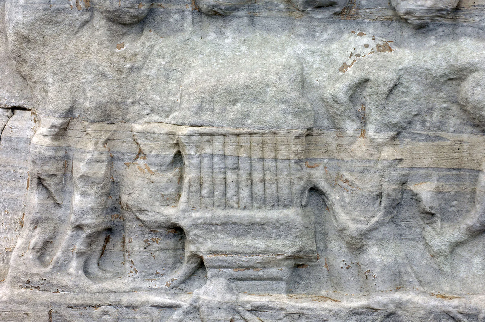{:standalone width="75%"}

## Gladiateurs, empereurs et premiers organistes

Peu après le prototype de Ctésibios, l'orgue arriva à maturité et se répandit dans tout le bassin méditerranéen. Un orgue gréco-romain typique possédait deux pompes et entre 7 et 18 tuyaux par rang, jusqu'à quatre rangs de tuyaux, et des intervalles allant grossièrement du demi-ton au ton entier.

Un contraste saisissant avec les siècles ultérieurs est que dans l'Antiquité, **l'orgue ne fut jamais utilisé dans le culte chrétien primitif, et très rarement dans les rituels des temples païens**.[^rhodes] Il menait plutôt une double vie essentiellement profane :

- **Dans l'arène :** alimenté par une forte pression d'air — et, comme le soupçonnent Perrot et certains historiens, peut-être doté de puissants tuyaux à anche en plus de rangs à bouche[^reeds] — l'*hydraulis* perçait le vacarme des amphithéâtres, accompagnant les jeux du cirque et les combats de gladiateurs aux côtés des cors en bronze.
- **Dans les palais et les banquets :** harmonisé avec des tuyaux à bouche plus doux, il était tout aussi prisé en intérieur pour une musique suave et expressive, au point de devenir un instrument favori des empereurs romains — au premier chef Néron, fasciné par les nouveaux mécanismes d'orgues.

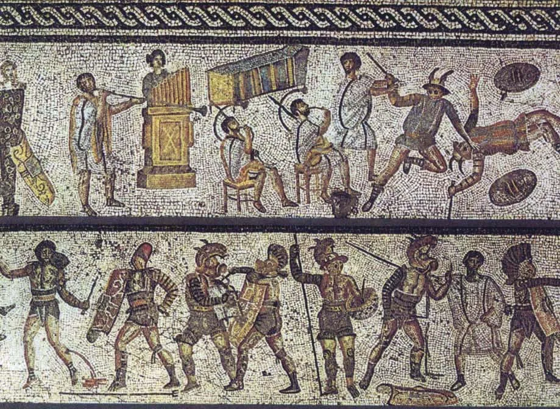{:standalone width="85%"}

Qui jouait de ces instruments ? Selon la tradition antique, la femme de Ctésibios, Thaïs, fut la toute première organiste — et les inscriptions, terres cuites et mosaïques conservées (dont la mosaïque de Zliten ci-dessus) confirment que les femmes organistes occupaient une place réelle dans la vie musicale gréco-romaine. Les interprètes se tenaient debout ou assis derrière les tuyaux, face au public, jouant des deux mains avec agilité sur un clavier à ressorts de rappel[^manual] — un mécanisme que j'explore en détail dans [mon article compagnon](/fr/posts/origine-du-clavier-musical-moderne/).

## Perdu en Occident, préservé en Orient

Après l'effondrement de l'Empire romain d'Occident au Ve siècle, l'orgue disparut complètement d'Europe occidentale pendant environ trois cents ans. Durant cette longue éclipse, l'orgue à soufflets gréco-romain survécut à **Constantinople**, capitale de l'Empire byzantin.

À Byzance, l'orgue demeura un symbole profane de majesté impériale plutôt qu'un instrument d'église, le clergé chrétien s'opposant généralement à la musique instrumentale dans la liturgie. Les récits d'époque décrivent d'éblouissants orgues « d'argent » et « d'or » joués lors des banquets de la cour, des processions et des fêtes de l'Hippodrome, les instruments d'or étant réservés à l'Empereur lui-même. Sur le plan technique, l'orgue byzantin semble être resté fidèle aux modèles à soufflets de la fin de l'époque romaine.

Depuis la Méditerranée orientale, l'orgue voyagea également vers l'est : dès le VIIIe siècle, il était connu et construit à **Bagdad**, et au XIIIe siècle, un orgue attesté parvint même jusqu'en Chine comme présent diplomatique offert à [Kubilai Khan](https://fr.wikipedia.org/wiki/Kubilai_Khan) — le souverain mongol auquel Marco Polo rendit plus tard visite.

Pendant ce temps, l'orgue fit un retour spectaculaire en Europe occidentale en **757 apr. J.-C.**, lorsque l'empereur byzantin Constantin V envoya un instrument depuis Constantinople à [Pépin le Bref](https://fr.wikipedia.org/wiki/P%C3%A9pin_le_Bref), roi des Francs, en signe de diplomatie. Les chroniqueurs rapportèrent l'émerveillement qu'il suscita : plus personne en Occident ne se souvenait de l'orgue gréco-romain.

Environ soixante-dix ans plus tard, en **826 apr. J.-C.**, un prêtre et facteur d'orgues vénitien nommé Georgius (probablement formé dans la tradition byzantine) arriva à la cour du fils de Charlemagne, Louis le Pieux, à Aix-la-Chapelle. Il est le premier facteur d'orgues connu en Occident depuis quelque cinq siècles. Une fois encore, le but n'était pas la liturgie religieuse, mais le prestige royal pour rivaliser avec Constantinople.

En paraphrasant Perrot, la survie de l'orgue au cours du premier millénaire suivit un extraordinaire relais géographique :

> Inventé en Égypte en milieu grec, l'orgue conquit le monde romain, survécut à Constantinople tout en essaimant à l'est vers Bagdad, et revint finalement en Europe occidentale par la cour franque.

## L'entrée à l'église : reculs et réinvention (IXe–XIIIe siècles)

### Les moines, maîtres mécaniciens

Georgius transmit son savoir-faire à des élèves, et son succès assouplit progressivement l'attitude du clergé occidental envers les instruments. Construire un orgue exigeait de savoir lire et écrire, de maîtriser la géométrie, la menuiserie et la métallurgie — autant de compétences concentrées dans les monastères médiévaux. Ce qui avait commencé comme une tolérance prudente devint une adoption généralisée (non sans quelques grognements d'ecclésiastiques plus austères !). La papauté elle-même s'y intéressa et, aux IXe et Xe siècles, les orgues faisaient leur apparition dans les cathédrales et les abbayes de toute l'Europe.

### Un pas en arrière, un pas en avant

Aucun orgue matériel datant du Xe au début du XIIe siècle n'a survécu, mais des traités monastiques — au premier rang desquels ceux de l'Anonyme de Berne (XIe siècle) et du moine Théophile (début du XIIe siècle) — décrivent la facture d'orgues de leur temps avec une précision remarquable.

De façon surprenante, ces textes révèlent une nette régression technique par rapport à Vitruve et à Héron. Les instruments médiévaux étaient généralement plus petits, et beaucoup avaient complètement perdu le clavier antique à ressorts, revenant à de simples **tirettes** en bois que le joueur devait tirer pour faire parler un tuyau et repousser pour le faire taire — une mécanique bien plus lente et maladroite. Perrot attribue ce retour en arrière à la fois à la perte des traités techniques antiques et aux conditions économiques plus austères du haut Moyen Âge européen.

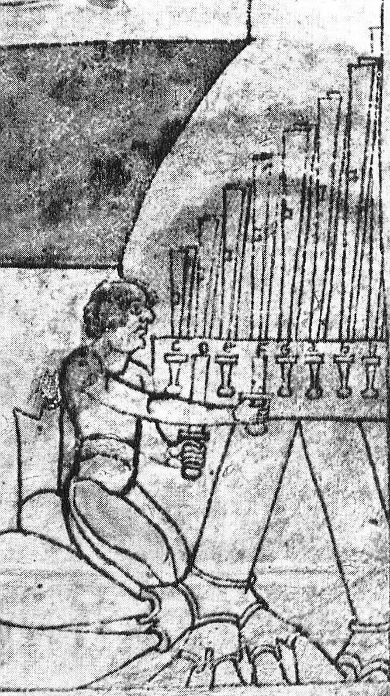{:standalone width="45%"}

À l'autre extrême se trouve un célèbre poème latin de la fin du Xe siècle célébrant un orgue gigantesque construit à la [cathédrale de Winchester][winchester-link] en Angleterre, prétendument doté de 400 tuyaux répartis sur dix rangs, de 40 tirettes jouées par deux organistes côte à côte et de 26 soufflets actionnés par 70 hommes robustes ! Notre unique source étant un poème dithyrambique, les chiffres sont presque certainement exagérés — mais le récit de Winchester marque un jalon authentique : c'est la plus ancienne mention de **tirettes gravées de lettres de l'alphabet** permettant au musicien d'identifier chaque note.[^harding-bible]

### Savoir-faire, emplacement dans l'église et essor de la polyphonie

Ces mêmes traités des Xe–XIIe siècles nous offrent une plongée saisissante dans un atelier de facteur d'orgues médiéval. Les artisans roulaient de fines feuilles de cuivre soudées à l'étain pour former des tuyaux coniques ou cylindriques (en conservant curieusement le même diamètre pour tous les tuyaux de l'étendue), les montaient sur des sommiers de bois et de cuivre rendus étanches au plomb fondu, et les alimentaient par des soufflets en peau de bélier — dont les grincements et les claquements pouvaient couvrir la musique ! Pour calculer la longueur des tuyaux, les moines théoriciens partaient des rapports mathématiques du monocorde (`1:2` pour l'octave, `2:3` pour la quinte, `8:9` pour un ton entier) et s'aperçurent vite que les tuyaux à bouche demandaient une **correction d'extrémité** liée à leur diamètre — devançant de huit siècles la célèbre formule d'Aristide Cavaillé-Coll de 1860. Dans l'église, l'orgue était habituellement logé sous une arcade murale, derrière des rideaux anti-poussière dissimulant à la fois les souffleurs et l'organiste aux regards des fidèles — un renversement complet par rapport à l'arène romaine, où l'interprète se tenait bien en vue.

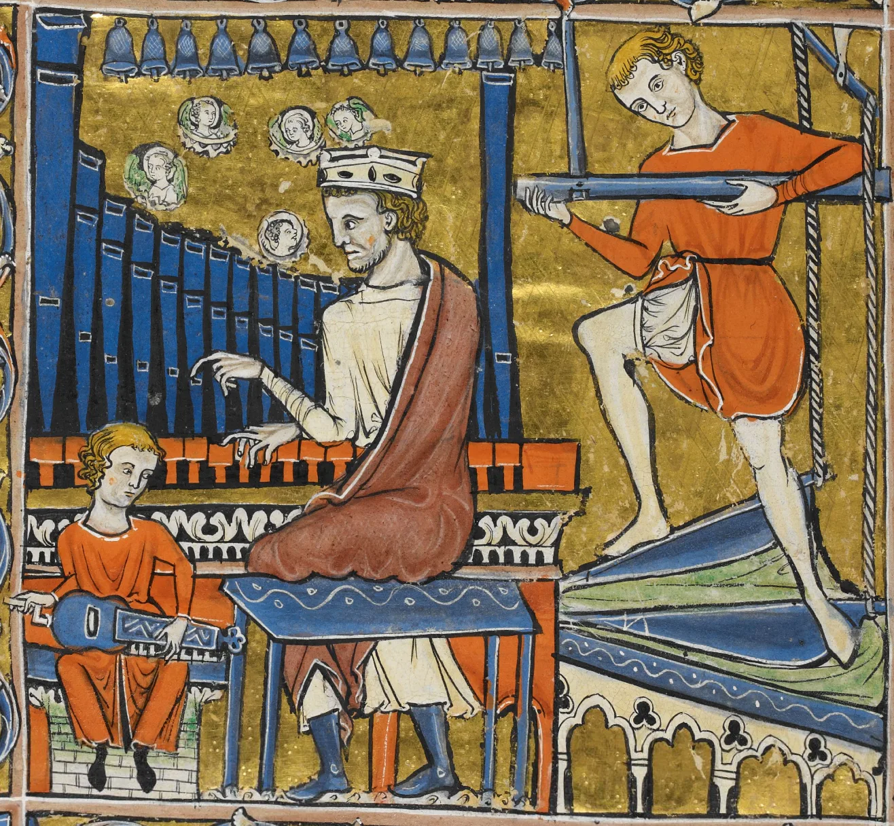{:standalone width="65%"}

Au XIIIe siècle, de véritables claviers à leviers aux touches de bois renforcées de fer se répandaient de nouveau, et l'orgue s'était scindé en trois formats distincts : les instruments fixes d'église (de plus en plus grands au rythme de l'architecture gothique), les *positifs* transportables posés sur une table ou au sol, et les petits *portatifs* suspendus à une sangle pour la musique profane — le modèle le plus fréquemment représenté dans les enluminures médiévales. Les orgues jouaient en solo, accompagnaient le chant et les hymnes, ou rejoignaient des ensembles aux côtés d'instruments tels que le *cymbalum* (un jeu de petites cloches accordées frappées au marteau, visible juste au-dessus du roi David dans le [Psautier de Rutland][rutland-link] ci-dessus). Surtout, parce qu'un seul musicien pouvait soutenir simultanément deux lignes consonantes ou plus sur une gamme diatonique (généralement enrichie d'un *si*♭), l'orgue médiéval contribua à nourrir l'*organum* — et, avec lui, l'essor plus large de la **polyphonie** occidentale.

## Conclusion

Avec le recul, l'histoire ancienne de l'orgue à tuyaux se lit presque comme un roman improbable. Conçu à Alexandrie au IIIe siècle av. J.-C. par un ingénieur obsédé par les pompes à air, il est né déjà pourvu de tuyaux étagés, d'une pression d'air stabilisée et d'un clavier joué avec les doigts. Il a tonné derrière les gladiateurs romains, diverti les empereurs à Rome et à Constantinople, voyagé jusqu'à Bagdad et à la cour de Kubilai Khan, fait son retour en Europe occidentale comme une merveille diplomatique, survécu à un épisode médiéval d'amnésie technique, avant de se réinventer dans les monastères et les cathédrales comme l'instrument d'église par excellence.

Pourtant, face à ma question initiale — *d'où vient le clavier de piano moderne ?* — le récit de Perrot s'arrête en plein suspense. À la fin du XIIIe siècle, après plus de 1 500 ans de facture d'orgues, les claviers n'étaient encore essentiellement qu'une unique rangée de larges leviers, sans ces groupes surélevés de deux et trois « touches noires » que nous reconnaissons aujourd'hui au premier coup d'œil. Comment cette disposition chromatique familière a pris forme au cours du siècle et demi suivant est l'enquête que je poursuis dans [L'origine du clavier musical moderne](/fr/posts/origine-du-clavier-musical-moderne/).

---

[^passed-away]: Décédé depuis en 2022 à l'âge de 95 ans.

[^perrot]: Jean Perrot, *L'Orgue de ses origines hellénistiques à la fin du XIIIe siècle : Étude historique et archéologique*, Paris, Picard, 1965 ; j'en ai lu la traduction anglaise de Norma Deane, *The Organ, from its Invention in the Hellenistic Period to the End of the Thirteenth Century*, Oxford University Press, 1971 (les citations de Perrot ci-dessous sont retraduites depuis cette édition anglaise).

[^perrot-notes]: J'ai pris d'abondantes [notes de lecture][reading-notes-link] (en anglais) au fil de ma lecture entre octobre 2013 et janvier 2014.

[^meanwhile]: En chemin, ma curiosité pour les claviers mécaniques m'a valu un détour d'une décennie vers une autre famille de machines à touches : les machines à écrire anciennes !

[^organon]: Le mot grec *organon* (en latin *organum*) désignait à l'origine n'importe quel « outil » ou « instrument » au sens général. Comme les auteurs antiques et médiévaux employaient ce terme aussi bien pour les outils ou instruments de musique en général que pour l'orgue à tuyaux en particulier, les historiens doivent interpréter les mentions anciennes avec la plus grande prudence.

[^nennig-pipes]: Curieusement, sur la mosaïque de Nennig (IIIe siècle apr. J.-C.) en tête de cet article, le mosaïste a inversé l'ordre habituel des tuyaux, plaçant les plus longs tuyaux graves à la droite de l'organiste — probablement une erreur de mémoire, car presque toutes les autres représentations antiques placent les plus petits tuyaux aigus à la droite du musicien.

[^hero-drawing]: Jean Perrot remarque : *« Ces schémas figuraient certainement dans l'original, puisque les lettres correspondent. De plus, il est fort peu probable qu'un copiste ait été capable de les inventer. »*

[^bellows-hydraulic]: Pour ajouter à la confusion, les auteurs médiévaux continuèrent pendant des siècles, par simple habitude littéraire, à appeler *hydraulis* des orgues purement pneumatiques à soufflets.

[^rhodes]: Perrot relève une rare exception liturgique au IIIe siècle apr. J.-C. : une inscription grecque de Rhodes mentionnant un joueur d'orgue hydraulique (*hydraulēs*) *« chargé de réveiller le dieu »*, aux côtés de concours organisés lors de fêtes dans des sanctuaires comme le temple d'Apollon à Delphes (90 av. J.-C.).

[^reeds]: La question de savoir si les orgues gréco-romains comportaient réellement des tuyaux à anche reste débattue parmi les organologues : tous les tuyaux antiques mis au jour jusqu'ici (à Pompéi, Aquincum et Dion) sont des tuyaux à bouche, bien que les fortes pressions hydrauliques aient pu également alimenter des anches.

[^manual]: Dans la terminologie de l'orgue, un clavier joué avec les mains est appelé *clavier manuel* (par opposition au *pédalier* joué avec les pieds).

[^harding-bible]: L'illustration de la [Bible d'Étienne Harding][harding-bible-link] (début du XIIe siècle) le montre clairement, avec huit tirettes en forme de gardes d'épée portant les lettres des notes (`C` à `h`).

[reading-notes-link]: https://github.com/ebruchez/public/blob/master/Reading/2013-10%20-%20The%20Organ.md
[ktesibios-link]: https://fr.wikipedia.org/wiki/Ct%C3%A9sibios
[vitruvius-link]: https://en.wikisource.org/wiki/Ten_Books_on_Architecture/Book_X#Chapter_8
[aquincum-organ-link]: https://commons.wikimedia.org/wiki/File:Roman_pipe_organ_Aquincum.jpg
[dion-hydraulis-link]: https://en.wikipedia.org/wiki/Water_organ#The_hydraulis_of_Dion
[winchester-link]: https://web.archive.org/web/20220813191017/http://organ-au-logis.pagesperso-orange.fr/Pages/Winchester.htm
[harding-bible-link]: https://fr.wikipedia.org/wiki/Bible_d%27%C3%89tienne_Harding
[rutland-link]: https://commons.wikimedia.org/wiki/File:Salterio_de_Rutland_(%27The_Rutland_Psalter%27),_c._1260,_el_rey_David_tocando_el_%C3%B3rgano,_F._97v,_Add_MS_62925,_British_Library,_detalle.jpg
