## Introduction

Vous êtes-vous déjà demandé quand était apparue la disposition familière du clavier de piano moderne — ce motif répété de sept touches blanches et cinq touches noires surélevées ? Lorsque j'ai cherché une réponse claire pour la première fois, il s'est avéré étonnamment difficile de la trouver en ligne. Cette question m'a mené vers des bibliothèques bien réelles, des prêts entre bibliothèques et, finalement, un ouvrage de 300 pages consacré à l'histoire de l'orgue à tuyaux antique et médiéval.[^perrot]

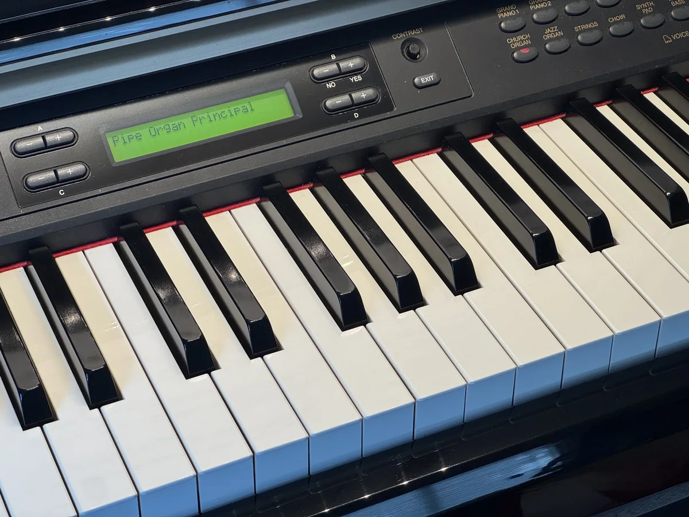{:standalone width="75%"}

Pourquoi les orgues à tuyaux ? Parce que les premiers claviers musicaux étaient des claviers d'*orgue*.[^manual] Contrairement à une flûte ou à une harpe, un orgue à plusieurs tuyaux alimenté par des pompes ou des soufflets mécaniques a besoin d'un système de soupapes permettant au musicien de choisir quel tuyau parle et à quel moment. Dans un article compagnon, [L'histoire ancienne de l'orgue](/fr/posts/histoire-ancienne-de-l-orgue/), je retrace le parcours de cette machine remarquable depuis l'Égypte hellénistique jusqu'aux cathédrales médiévales. Ici, je m'intéresse à l'interface elle-même : comment une rangée de leviers d'orgue antiques a évolué jusqu'au clavier chromatique dont nous jouons aujourd'hui.

## Un clavier à ressorts il y a 2 300 ans

### La mécanique des touches de Héron d'Alexandrie

Pour moi, le fait le plus stupéfiant du livre de Jean Perrot[^perrot] est que l'*hydraulis* gréco-romain (l'orgue à tuyaux régulé par l'eau) possédait *déjà* quelque chose que nous reconnaîtrions immédiatement comme un clavier musical joué avec les doigts. L'invention a au moins 2 000 ans et remonte très probablement à l'inventeur de l'orgue lui-même, Ctésibios d'Alexandrie, au IIIe siècle av. J.-C.

Grâce à un traité du Ier siècle apr. J.-C. dû à Héron d'Alexandrie, nous connaissons la recette mécanique exacte de cette transmission antique :

- des **tirettes** perforées logées dans le sommier sous chaque tuyau,
- des **touches** disposées horizontalement devant le musicien,
- des **équerres** pivotantes (renvois d'équerre) reliant chaque touche abaissée à sa tirette afin que l'air pénètre dans le tuyau, et
- des **spatules de corne** flexibles faisant office de ressorts de rappel, attachées par des cordes en boyau pour refermer la tirette et ramener la touche dès que le doigt se relève.

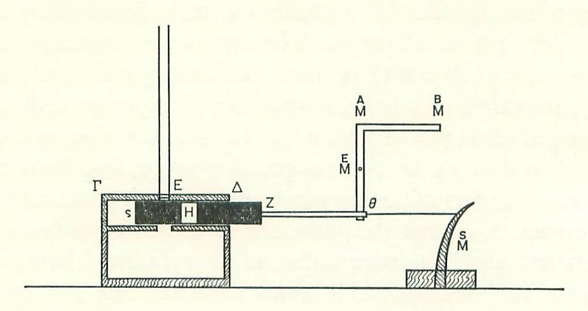{:standalone width="65%" .img-shadow}

Les reconstitutions modernes de l'*hydraulis* ont confirmé la réactivité de ce mécanisme. Tout comme sur un orgue ou un piano moderne (même si le piano utilise la gravité et des contrepoids plutôt que des ressorts), les touches étaient disposées à peu près horizontalement, s'enfonçaient sous la pression du doigt et revenaient automatiquement au relâchement. Sur la reconstitution fonctionnelle d'*hydraulis* que j'ai photographiée au [Musée Suisse de l'Orgue](https://www.orgue.ch/) à Roche, en Suisse, on voit le schéma de Héron prendre vie en bois, en laiton et en corne — huit leviers coudés en bois pivotant sur un axe horizontal juste sous leurs tuyaux, avec des ressorts de rappel recourbés en corne sombre dissimulés en dessous :

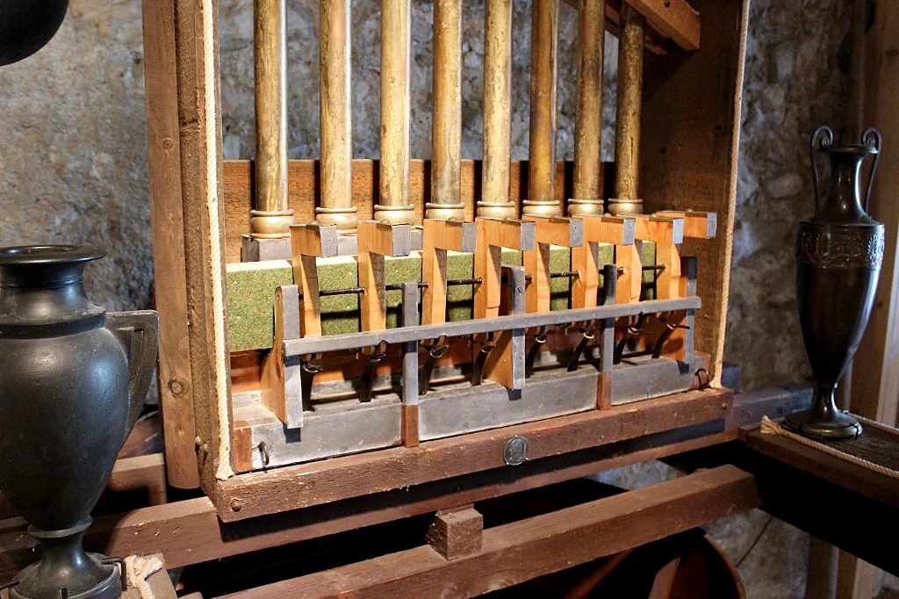{:standalone width="75%"}

### Indices tirés de l'archéologie, des textes et des mosaïques

Comme les artistes gréco-romains représentaient presque toujours l'orgue de face — mettant en valeur son socle décoré, ses tuyaux brillants et le visage du musicien — le clavier lui-même restait caché derrière les tuyaux. Heureusement, l'archéologie et les auteurs de l'Antiquité tardive comblent une bonne partie de ces lacunes :

- **Vestiges matériels :** si l'[hydraulis de Dion][dion-link] (Ier siècle av. J.-C., mis au jour en Grèce en 1992) a perdu ses pièces de clavier périssables — ne conservant que ses tuyaux de cuivre, les plaques de son sommier et le collier de son bâti — l'[orgue d'Aquincum][aquincum-link] (IIIe siècle apr. J.-C., enseveli lors d'un incendie vers 294 apr. J.-C.) a préservé de véritables composants métalliques conformes à la description de Héron, dont des gaines de touches en bronze (contenant des traces de bois calciné) et des ressorts de rappel en bronze d'environ 9 cm.
- **Descriptions antiques :** au IVe siècle, Porphyrius Optatianus évoque *« une rangée de touches carrées par lesquelles la main du musicien ouvre et ferme en mesure les passages pour l'air »* — des touches *« qui frémissent toujours au moindre effleurement »*. Son contemporain, l'empereur Julien (« l'Apostat »), décrit un *« homme aux doigts agiles […] maniant les touches qui donnent voix aux tuyaux »*, et l'homme d'État romain Cassiodore (VIe siècle) mentionne explicitement des *« touches de bois »*.
- **Rares vues arrière :** une lampe en terre cuite du IIe siècle apr. J.-C. conservée au musée de Carthage (signée *Possessoris*) montre un clavier de 18 touches oblongues, relativement larges, et le bas-relief tardo-antique de l'orgue de « Rusticus », près de Rome, figure *« 15 touches plus longues que larges, serrées les unes contre les autres comme sur le clavier moderne »*.[^perrot]



À quel point cela ressemblait-il à un piano moderne ? Imaginez une unique rangée de touches « blanches », sans encore de touches « noires » surélevées. Comme chaque touche se trouvait directement dans l'axe de la tirette alimentant son tuyau — sans abrégé pour décaler latéralement le mouvement — l'espacement des touches devait suivre celui des tuyaux, avec un entraxe d'environ 5 à 7 cm entre les touches, bien plus large que sur un piano moderne. Malgré tout, les auteurs antiques insistent constamment sur la dextérité agile des doigts des deux mains plutôt que sur des coups de poing : des tirettes *« continuellement en mouvement »* sous des *« doigts savants »*.

### Pourquoi les notes aiguës sont-elles à droite ?

Un détail qui m'intrigue particulièrement est l'ordre des tuyaux. Même lorsque les mosaïques antiques masquent les touches, la gradation de la longueur des tuyaux trahit le sens de la gamme — et dans presque toutes les représentations gréco-romaines conservées, les tuyaux les plus courts (les aigus) se trouvent à la **droite** de l'organiste, exactement comme les notes aiguës sur un piano d'aujourd'hui !

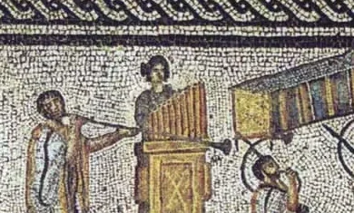{:standalone width="60%"}

Perrot traite cette convention du grave à gauche vers l'aigu à droite comme une habitude arbitraire qui se serait simplement perpétuée depuis l'époque hellénistique. Je ne peux m'empêcher de penser que l'ergonomie y a peut-être aussi joué un rôle : la plupart des musiciens sont droitiers, et les lignes mélodiques agiles tendent naturellement vers le registre aigu où se place la main droite.

Résumant les témoignages antiques, Perrot conclut :

> Le clavier du piano […] dérive directement de celui de l'orgue gréco-romain, et la position des mains sur ce clavier primitif a probablement contribué dans une large mesure à l'évolution de la musique polyphonique.

## Amnésie médiévale et renaissance diatonique

Après la chute de l'Empire romain d'Occident, le savoir-faire de la facture d'orgues s'effilocha en Europe occidentale (comme je le raconte dans [L'histoire ancienne de l'orgue](/fr/posts/histoire-ancienne-de-l-orgue/)). Lorsque les traités monastiques reprennent du Xe au début du XIIe siècle, de nombreux orgues occidentaux avaient complètement perdu le clavier gréco-romain à rappel par ressorts, revenant à de lentes **tirettes** en bois qu'il fallait tirer à la main puis repousser pour interrompre la note. En parallèle, les facteurs médiévaux introduisirent un repère visuel précieux : tant le poème de Winchester (Xe siècle) que le traité du moine Théophile (*Schedula diversarum artium*) décrivent l'inscription de **lettres de l'alphabet** directement sur les tirettes ou les touches afin que l'organiste sache quelle hauteur chacune commandait.[^cambridge]

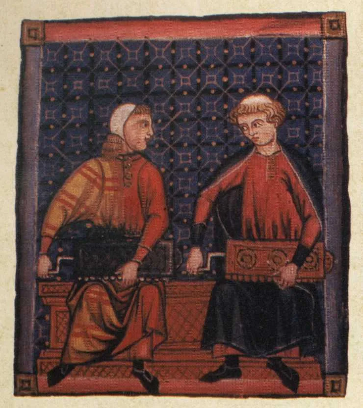{:standalone width="45%"}

Au XIIIe siècle, de véritables claviers en bois à rappel par ressort ou par levier (souvent renforcés de fer) étaient de nouveau largement répandus sur les orgues d'église, les positifs et les petits portatifs tenus à la main — visibles dans des manuscrits comme le Psautier de Rutland (v. 1260) et les [Cantigas de Santa Maria](https://fr.wikipedia.org/wiki/Cantigas_de_Santa_Mar%C3%ADa) ci-dessus. Pour autant que nous puissions en juger, cependant, les claviers du XIIIe siècle disposaient toujours une gamme diatonique (souvent enrichie d'un *si*♭) sur une **unique rangée de touches régulièrement espacées**. Il n'existe encore aucun signe clair d'une seconde rangée surélevée de « touches noires ».

## Diviser le ton : Halberstadt et Norrlanda (1330–1400)

C'est au XIVe siècle que le chromatisme — et un second niveau de touches — fait enfin son entrée dans les sources historiques :

- Vers **1330**, le théoricien Jacques de Liège note que sur certains instruments, dont l'orgue, *« presque partout le ton est divisé en deux demi-tons inégaux »* (dans l'accord pythagoricien).[^encyclopedia]
- Dans la première moitié du XIVe siècle, **Jean de Murs** (Johannes de Muris) mentionne explicitement des touches de demi-tons pour ***fa*♯** et ***sol*♯**.[^grove]
- Vers **1360**, le [Codex de Robertsbridge](https://fr.wikipedia.org/wiki/Codex_Robertsbridge) conserve la plus ancienne musique connue écrite spécifiquement pour un instrument à clavier (presque certainement l'orgue), exigeant une étendue de deux octaves et une tierce, entièrement chromatique au-dessus du *fa*.[^grove] En écouter aujourd'hui une interprétation rappelle combien la musique médiévale pour clavier sonnait différemment du répertoire baroque ou classique ultérieur :

  <iframe width="100%" style="aspect-ratio: 16 / 9; border: 0; border-radius: 6px;" src="https://www.youtube.com/embed/3QF4BCKYZxc" title="Codex de Robertsbridge (v. 1360) interprété à l'orgue" loading="lazy" allowfullscreen></iframe>

### L'orgue de Halberstadt (1361)

Nous arrivons ainsi en **1361**, année où le facteur d'orgues Nicholas Faber acheva un orgue de cathédrale monumental à **Halberstadt, en Allemagne**, dont le vent était fourni par vingt soufflets actionnés par dix hommes.[^allen] [^watanabe] Profondément rénové en **1495** par Gregor Kluge, le vieil orgue de Halberstadt fut documenté en détail dans le célèbre traité *Syntagma Musicum* (1619–1620) de Michael Praetorius. Sur ses claviers supérieurs de *Diskant* (panneaux de gauche et en haut à droite ci-dessous, dessinés avec 14 touches de `B` à `c'` — du *si* grave au *do* médium —, tandis que le clavier inférieur et le pédalier comptent 12 longs leviers), la voilà enfin : **l'inconfondable disposition chromatique 7 et 5 d'un clavier moderne !**

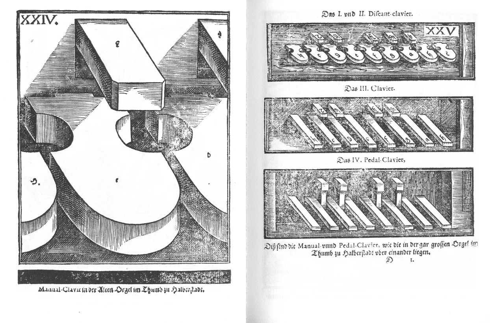{:standalone width="85%"}

Bien sûr, jouer l'orgue de Halberstadt n'avait rien à voir avec le toucher d'un Steinway moderne. Ses touches de claviers supérieurs ressemblent à des leviers en forme de bêche, espacés de 5 à 8 cm — assez larges pour que les organistes aient longtemps traîné la réputation (peut-être exagérée) de « batteurs d'orgue » enfonçant les touches à pleine main plutôt qu'avec nos doigtés agiles modernes.[^allen] [^cambridge] [^grove] Et comme Praetorius vit l'instrument après sa réfection de 1495, les historiens débattent encore de la part de cette disposition qui remonte réellement à 1361 plutôt qu'à 1495.

### La preuve matérielle en Suède : l'orgue de Norrlanda (v. 1400)

Heureusement, nous n'avons pas à nous fier aux seules gravures tardives : de la fin du XIVe siècle, du bois médiéval intact nous est parvenu ! Conservés au Musée historique de Suède à Stockholm, les vestiges de l'**orgue de Norrlanda** (provenant de l'île de Gotland), datés vers 1370–1400 (ou avant 1430), constituent le plus ancien ensemble conservé au monde réunissant buffet, sommier, pédalier et clavier manuel.[^rumsey]



*Crédits photo : gros plan d'archives du clavier via [Wikimedia Commons / Riksantikvarieämbetet (Kulturmiljöbild)](https://commons.wikimedia.org/wiki/File:Norrlanda_kyrka_-_KMB_-_16000200025694.jpg) (domaine public) ; détail en couleur de la console recadré d'après [Statens historiska museer (SHM)](https://samlingar.shm.se/media/22F919ED-EA74-48A9-BB0B-546AEFB49C7F) ([objet `116311_HST`](https://samlingar.shm.se/object/1158466A-7686-4E18-88B9-B0D4BE39E7CF), [CC BY 4.0](https://creativecommons.org/licenses/by/4.0/)).*

Son clavier chromatique de 22 notes (`c` à `a'`, soit de *do* à *la*) se divise nettement en deux niveaux principaux, avec une particularité révélatrice : **le *si*♭ reste en bas, sur la rangée inférieure**, aux côtés des touches naturelles diatoniques (soit 14 touches basses, avec *la*, *si*♭, *si*♮ et *do* côte à côte), ce qui laisse les 8 touches diésées (*do*♯, *ré*♯, *fa*♯ et *sol*♯ sur deux octaves) groupées par paires surélevées au-dessus ![^rumsey] (La minuscule touche isolée perchée encore plus haut vers le centre de la photo aurait rempli une fonction accessoire, comme un bourdon, plutôt qu'une note mélodique ordinaire.[^meeus]) Les facteurs avaient clairement inventé le clavier chromatique à deux étages, même si le *si*♭ n'était pas encore monté rejoindre *fa*♯ et *sol*♯.

### Un détour plein d'enseignements à Vérone : pourquoi l'art médiéval est un terrain miné

Parce que les instruments médiévaux conservés comme celui de Norrlanda sont rarissimes, la tentation est grande de s'appuyer fortement sur les peintures et sculptures pour dater l'apparition des touches surélevées. En pratique, l'art médiéval est un véritable terrain miné pour la datation — comme j'en ai fait l'expérience directe en 2022 au Museo di Castelvecchio de Vérone, en photographiant une statue en pierre de *Sainte Cécile* attribuée au Maître de Sainte-Anastasie et datée sur le cartel de la **première moitié du XIVe siècle** :

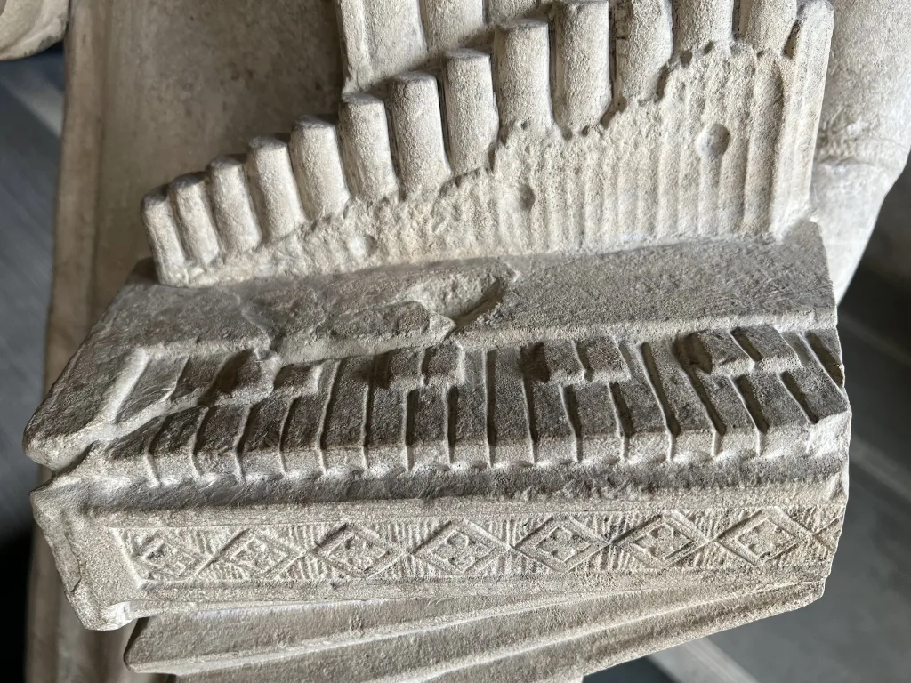{:standalone width="75%"}

Au premier coup d'œil, ce petit orgue portatif fait l'effet d'une bombe : de jolies touches surélevées en forme de blocs, antérieures à la fois à Halberstadt (1361) et à Norrlanda (v. 1400) ! Mais la lecture attentive des petits caractères du cartel du musée ramène vite sur terre : la statue a subi d'importantes restaurations au XIXe siècle, et **la main, le bras et l'orgue portatif sont des ajouts ultérieurs taillés dans la pierre d'une autre carrière** — à tel point que les conservateurs ne sont même plus certains que la sculpture représentait à l'origine sainte Cécile. En observant les touches de plus près, un second piège saute aux yeux : la licence artistique. Au lieu d'une véritable disposition chromatique 2 et 3 (ou même des paires musicalement asymétriques de Norrlanda, où *do–ré–mi* compte trois naturelles et *fa–sol–la–si♭–si* en compte cinq), le sculpteur s'est contenté de répéter quatre paires identiques et symétriques de touches surélevées (`2–2–2–2`) comme simple raccourci décoratif signifiant « clavier ».

## Touches en blocs, retable repeint et plus ancien orgue jouable de Suisse (années 1430–1456)

### Le secret infrarouge de *L'Agneau mystique* (1432)

Une génération plus tard à peine, ***L'Agneau mystique*** (le polyptyque de Gand) d'Hubert et Jan van Eyck, achevé en 1432, nous rapproche spectaculairement de l'apparence d'un clavier moderne. Sur le panneau des *Anges musiciens*, les altérations surélevées présentent désormais des **formes rectangulaires en « blocs »** insérées juste entre les extrémités arrondies des touches naturelles :

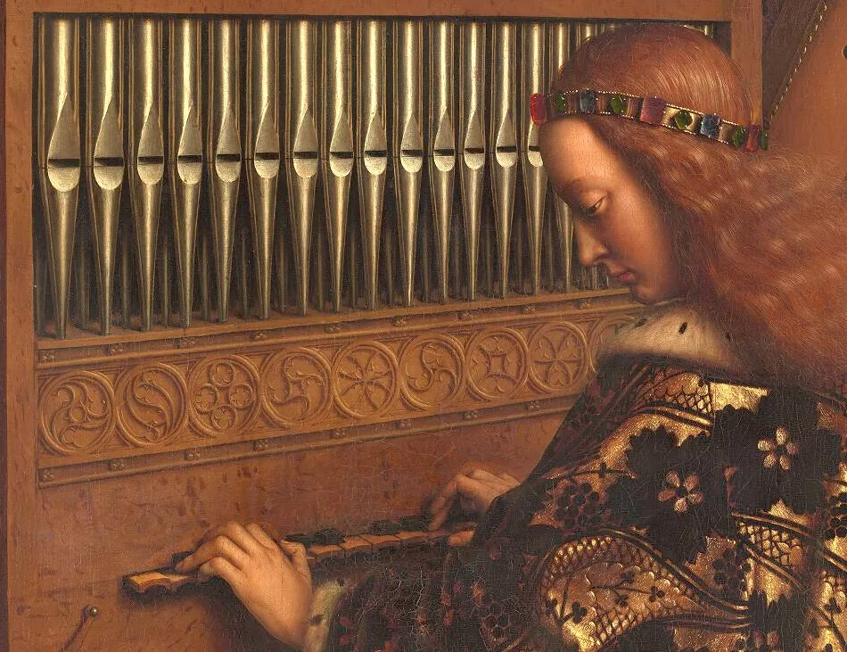{:standalone width="75%"}

En y regardant de près, toutefois, les proportions semblent un peu étranges — jusqu'à ce qu'on découvre ce qui se cache sous la peinture ! Dans une étude devenue classique de 1974, l'organologue Edwin M. Ripin a montré que **la photographie infrarouge du panneau révèle un clavier plus ancien peint en dessous**.[^ripin] Sur la reconstitution dessinée par Ripin par-dessus le cliché infrarouge ci-dessous, les dièses en forme de blocs disparaissent, remplacés par des plaques de touches incurvées dans le style de Norrlanda, placées en retrait derrière les naturelles — en commençant par une octave grave purement diatonique sur *sol* (sans aucune altération sous la main gauche) avant que trois touches surélevées n'apparaissent ensemble plus haut :[^meeus]

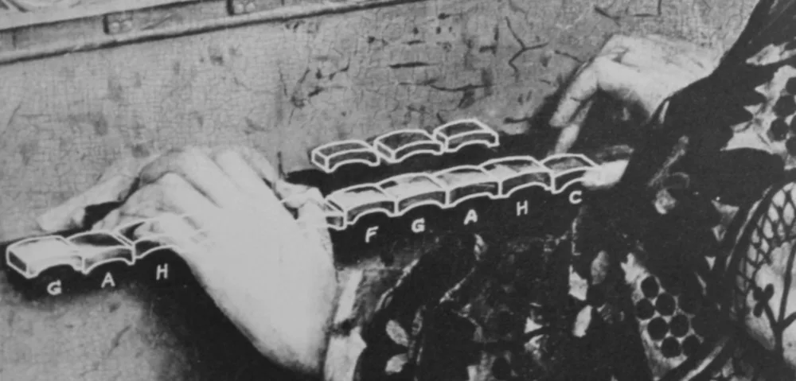{:standalone width="75%"}

Même la main gauche de l'ange a été repeinte plus haut ! Sur le clavier antérieur, dépourvu de touches surélevées sous cette partie de la main, les doigts pouvaient reposer à plat ; une fois peintes des touches surélevées (ou *feintes*) modernes en blocs — presque certainement par Jan van Eyck lui-même avant l'achèvement du polyptyque en 1432, comme l'imagerie haute résolution ultérieure du projet belge de conservation [Closer to Van Eyck][van-eyck-link] permet aisément de l'observer en ligne — la main dut être voûtée au-dessus d'elles. Cette « mise à jour de clavier » en cours d'exécution explique pourquoi les palettes visibles des touches naturelles paraissent trapues, puisqu'elles devaient se partager le faible espace initialement dévolu aux seules naturelles (même si les palettes des orgues historiques sont restées comparativement courtes, autour de 3,5 cm, jusqu'au XVIIIe siècle[^grove]). Quoi qu'il en soit, en **1432**, les touches noires en forme de blocs groupées selon le motif moderne 2 et 3 étaient déjà assez réelles pour inciter van Eyck à actualiser son tableau !

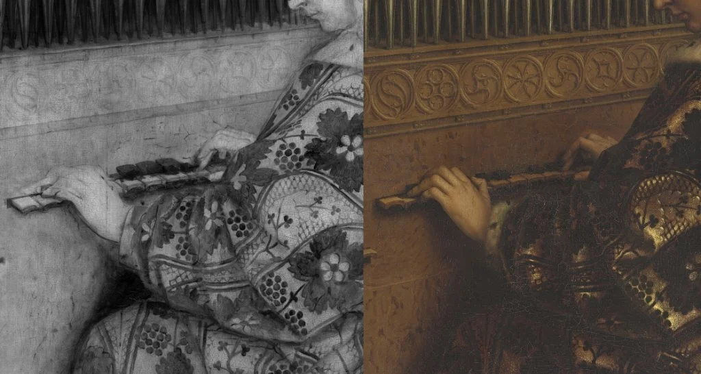{:standalone width="100%"}

### Brunswick (1456) et l'orgue de Valère à Sion (v. années 1430)

Le *Syntagma Musicum* de Praetorius nous fournit un autre jalon daté de **1456** : les claviers de l'orgue de l'Aegidienkirche à Brunswick (*Braunschweig*), en Allemagne. Ici, les touches naturelles sont plus longues et mieux proportionnées que sur le panneau repeint de Gand et, bien que les altérations en blocs soient un peu plus hautes que celles d'aujourd'hui, la géométrie d'ensemble est indéniablement moderne :

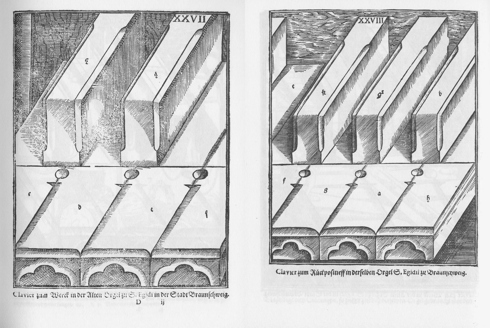{:standalone width="75%"}

Enfin, je ne peux résister à l'envie de mentionner le **plus ancien orgue jouable du monde**, construit vers **1430–1435** dans la basilique de Valère à **Sion, en Suisse** — non loin de l'endroit où j'ai grandi ![^valere] J'ai eu la chance de bénéficier d'une visite privée et d'une démonstration par Edmond Voeffray, organiste titulaire de l'orgue de Valère. En observant et en photographiant le clavier de Valère de tout près, mon intuition immédiate fut qu'il avait l'air beaucoup trop net et moderne pour être resté intact depuis les années 1430 :



Et de fait, les archives confirment cette intuition : si le buffet gothique en nid d'hirondelle, les volets peints de 1435 et plusieurs rangs de tuyaux à forte teneur en plomb sont authentiquement médiévaux, le clavier visible de 45 notes date d'une importante reconstruction effectuée en **1687** par le facteur d'orgues soleurois Christoph Aebi, qui agrandit et repositionna le clavier (remarquez l'[« octave courte »](https://fr.wikipedia.org/wiki/Octave_courte) baroque tout à gauche).[^valere-aebi] Malgré cela, au vu de ce que l'on observe déjà à Halberstadt (1361), Norrlanda (v. 1400), Gand (1432) et Brunswick (1456), l'orgue original de Sion des années 1430 possédait presque certainement déjà lui aussi un clavier chromatique à deux rangées.

## Conclusion

En embrassant d'un seul regard dix-sept siècles de facture d'orgues, l'évolution de notre clavier musical s'ordonne selon une séquence remarquablement claire :

- **IIIe siècle av. J.-C. – VIe siècle apr. J.-C. (*hydraulis* et orgues à soufflets gréco-romains) :** des touches horizontales jouées aux doigts et munies de ressorts de rappel sont inventées en même temps que les premiers orgues — espacées de 5 à 7 cm sur une seule rangée, plaçant déjà les graves à gauche et les aigus à droite.
- **Xe – XIIIe siècles (renouveau médiéval) :** après une période où de nombreux orgues occidentaux régressent vers des tirettes lettrées à tirer et pousser, les claviers diatoniques joués aux doigts (incluant souvent un *si*♭) reviennent — toujours sur une unique rangée, sans « touches noires » surélevées.
- **Première moitié du XIVe siècle :** théoriciens (Jacques de Liège, Jean de Murs) et partitions pour clavier (*Codex de Robertsbridge*, v. 1360) attestent la division chromatique en demi-tons de la gamme diatonique.
- **1361 / 1495 (Halberstadt) :** les gravures de Praetorius représentant l'orgue de Halberstadt (construit en 1361, rénové en 1495) consignent la disposition moderne en deux rangées de 7 et 5 touches sur ses claviers supérieurs, encore bâtis avec de larges leviers en forme de bêche.
- **v. 1370–1400 (Norrlanda) :** les plus anciens fragments de clavier médiéval conservés confirment dans le bois d'origine l'existence de paires surélevées de dièses, le *si*♭ restant encore en bas sur la rangée inférieure.
- **1432 (*L'Agneau mystique*) :** Jan van Eyck peint des altérations rectangulaires en forme de blocs directement par-dessus une couche picturale antérieure à basse diatonique — nous offrant une preuve visuelle irréfutable de touches en blocs d'aspect moderne dès 1432.
- **1456 (Brunswick) :** des touches naturelles plus longues associées à des altérations en blocs groupées par 2 et 3 amènent le clavier d'orgue — et, dans son sillage, le clavecin, le clavicorde et finalement le piano — à peu près exactement à la géométrie que nous jouons encore aujourd'hui.

---

[^perrot]: Jean Perrot, *L'Orgue de ses origines hellénistiques à la fin du XIIIe siècle : Étude historique et archéologique*, Paris, Picard, 1965 (traduction anglaise de Norma Deane, *The Organ, from its Invention in the Hellenistic Period to the End of the Thirteenth Century*, Oxford University Press, 1971 ; les citations de Perrot ci-dessus sont retraduites depuis cette édition anglaise).

[^manual]: Dans la terminologie de l'orgue, un clavier joué avec les mains est appelé *clavier manuel* (pour le distinguer du *pédalier* joué avec les pieds).

[^cambridge]: Nicholas Thistlethwaite et Geoffrey Webber (dir.), *The Cambridge Companion to the Organ*, Cambridge University Press, 1998.

[^encyclopedia]: Douglas Earl Bush et Richard Kassel (dir.), *The Organ: An Encyclopedia*, Routledge, 2006.

[^grove]: *Grove Music Online* (Oxford Music Online), articles « Keyboard » et « Organ ».

[^allen]: John S. Allen, [« The Traditional Music Keyboard »](https://bikexprt.com/music/traditio.htm), 1997.

[^watanabe]: Ruth Watanabe, [« Michael Praetorius and his *Syntagma Musicum* »](https://rbscp.lib.rochester.edu/2470), *University of Rochester Library Bulletin*, vol. X, n° 3 (printemps 1955).

[^rumsey]: David Rumsey, *The Norrlanda Organ* (monographie sur l'orgue de Gotland, v. 1370–1400, conservé au Statens Historiska Museum de Stockholm), ainsi que les discussions sur les claviers anciens dans les archives HPSCHD-L concernant l'emplacement du *si*♭ sur les claviers du XIVe siècle.

[^ripin]: Edwin M. Ripin, « The Norrlanda Organ and the Ghent Altarpiece », dans *Studia instrumentorum musicae popularis III* (Mélanges offerts à Ernst Emsheimer), Musikhistoriska museet, Stockholm, 1974, p. 193–196.

[^meeus]: Nicolas Meeùs, [« Le clavier disparu : Le clavier originel de l'orgue de *L'Agneau mystique* »](http://nicolas.meeus.free.fr/NMOrgano/NMAgneauMystique.pdf) (traduction française de *Celesta* 1.2, avril 1987, p. 102–109), qui analyse à la fois le dessin sous-jacent du retable de Gand et la disposition de 22 notes (`c`–`a'`) ainsi que la touche accessoire centrale du clavier de Norrlanda.

[^valere]: Voir [Orgue de la basilique de Valère](https://fr.wikipedia.org/wiki/Orgue_de_la_basilique_de_Val%C3%A8re).

[^valere-aebi]: Le facteur d'orgues soleurois Christoph Aebi signa sa réfection de 1687 à l'intérieur de la soufflerie (*« Christoph Aeby 1687 »*), portant l'étendue du clavier à son ambitus actuel de 45 notes (`C` à `c'''` avec octave courte dans les graves).

[dion-link]: https://en.wikipedia.org/wiki/Water_organ#The_hydraulis_of_Dion
[aquincum-link]: https://commons.wikimedia.org/wiki/File:Roman_pipe_organ_Aquincum.jpg
[van-eyck-link]: https://closertovaneyck.kikirpa.be/
