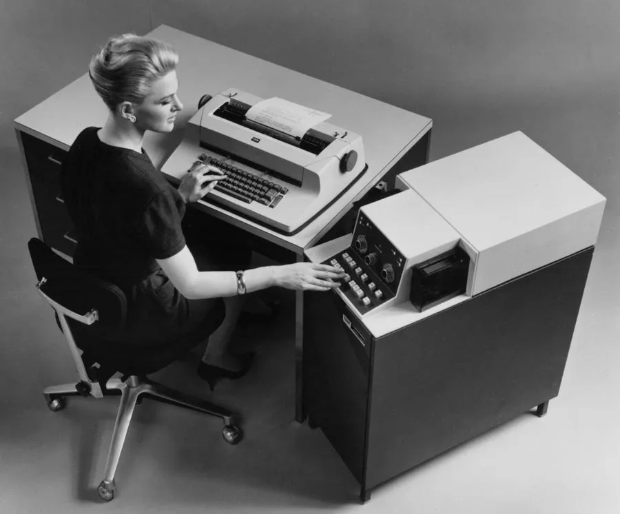
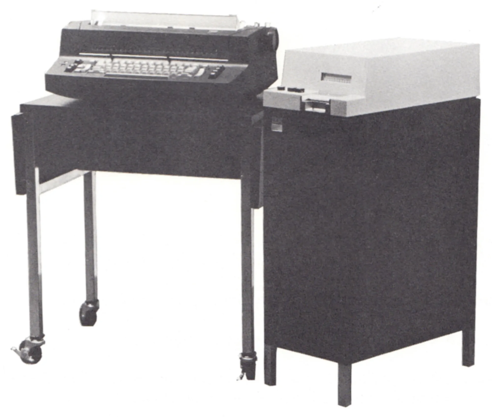
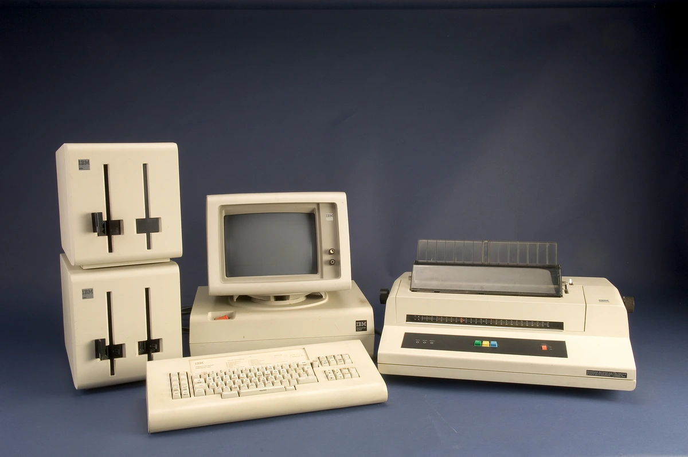
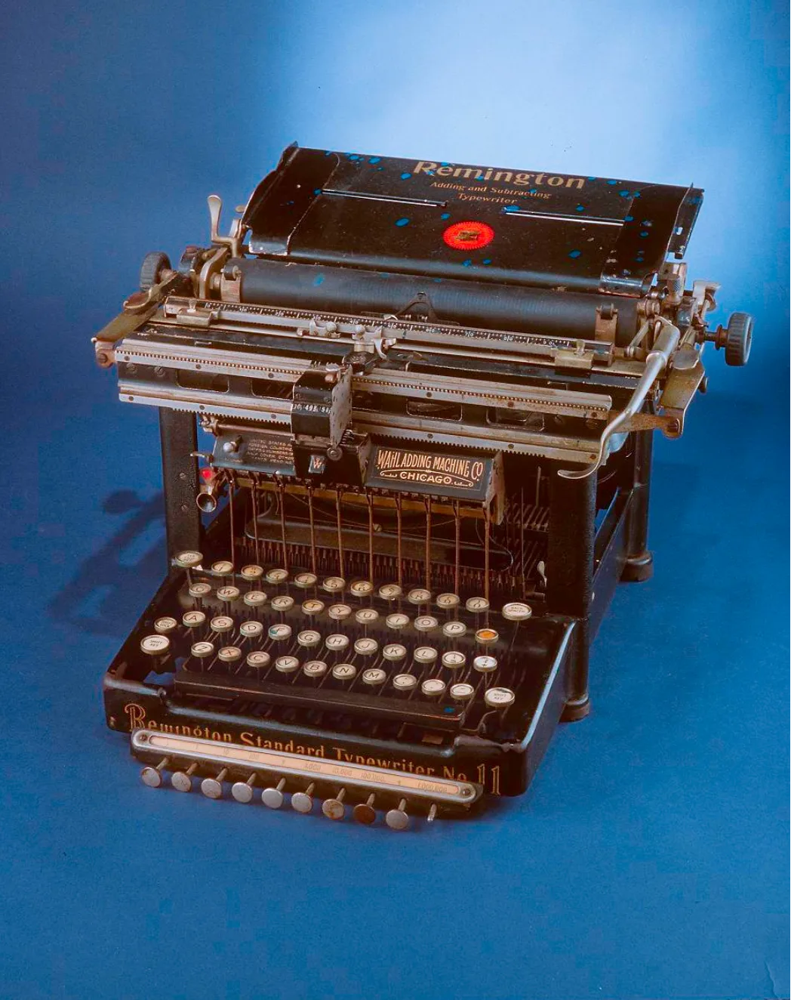
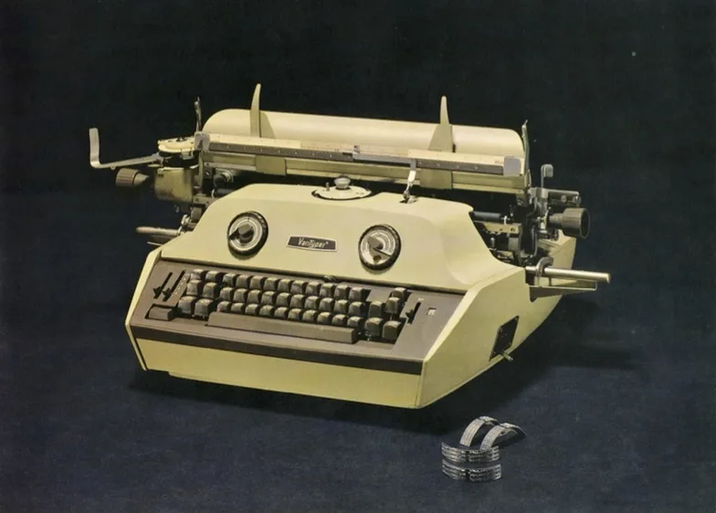
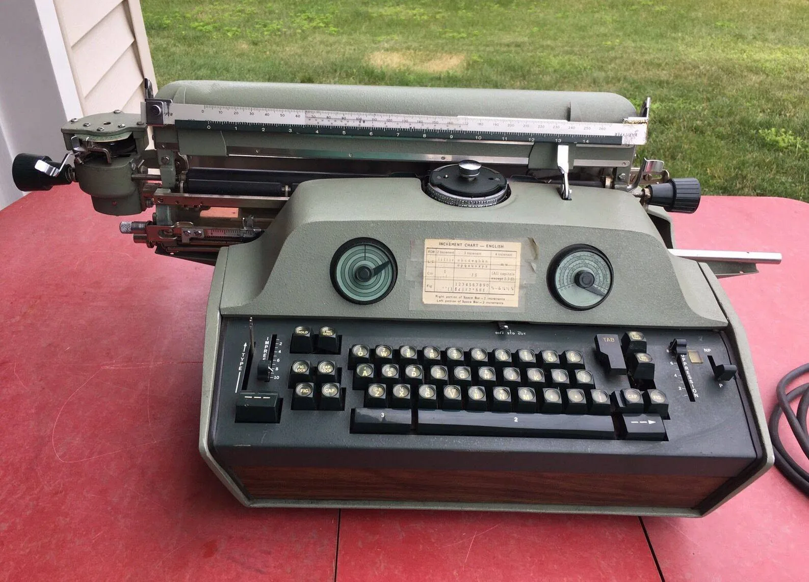
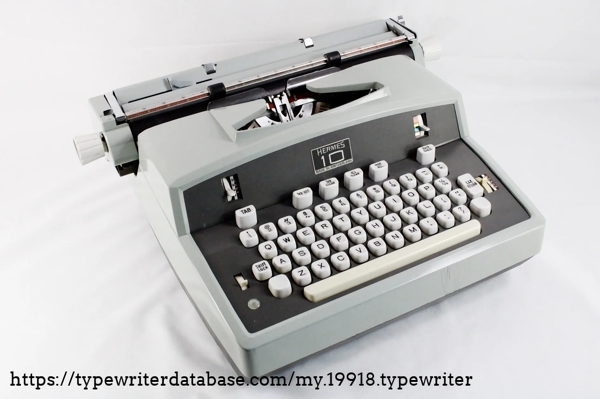
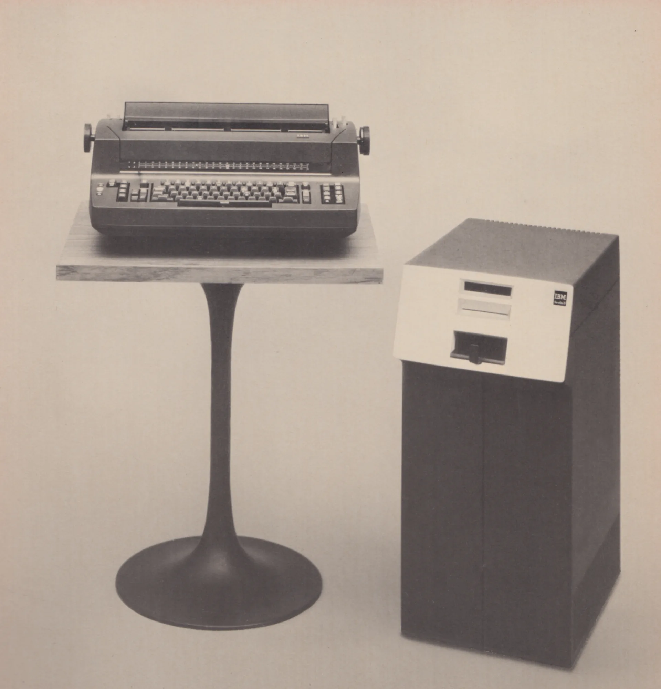

# Typewriter bucket list

[//]: # (
 )

[//]: # (    <object )

[//]: # (        type="text/html")

[//]: # (        data="https://typewriterdatabase.com/typewriter_list_ajax.php?output=htm&css=1&hunter_search=3614&collection_search=My+Collection">)

[//]: # (    </object>)

[//]: # (
)

## Introduction

I have a typewriter collection which [you can see to a large extent on TWDB](https://typewriterdatabase.com/typewriters.php?hunter_search=3614&collection_search=My+Collection). But a collector is never entirely satisfied, and there are several machines I'd love to find, if they are affordable and/or in restorable condition. Below is a list of such machines.[^shippping]

See also:

- [Computer bucket list](/pages/computer-bucket-list/)
- [Typewriter bucket list items found](/pages/typewriter-bucket-list-found/)

## IBM Magnetic Tape/Selectric Typewriter

I'd love to find the rare IBM Magnetic Tape/Selectric Typewriter (MT/ST, also known as MT72 in Europe), which came out in 1964.[^mtst-ebay][^mtst-diagrams][^mtsc] It is a large machine, with a special desk and a large console, as you can see on the picture below.

{:standalone style="max-width: 75%; width: 100%"}

[//]: # (![IBM Magnetic Tape/Selectric Typewriter]&#40;/assets/pages/typewriter-bucket-list/ibmmtsc.webp&#41;{:standalone})
[//]: # (*Credit: [Norsk Teknisk Museum]&#40;https://digitaltmuseum.org/011015239416/7-0-ibm-op-fotografier&#41;*)

## Original IBM Mag Card typewriter

The first IBM Magnetic Card/Selectric Typewriter (MC/ST), which came out in 1969, seems to be quite rare. I am aware of a museum in Europe that has an instance (alongside an MT/ST). It had a different style of console compared to the newer and more stylish Mag Card/II console. In fact it looks more like the MT/ST, although possibly a little smaller.

{:standalone style="max-width: 75%; width: 100%"}

## IBM Displaywriter System

The Displaywriter System is a word processing system that IBM produced in the early 1980s. It is at the intersection of typewriters and computers.

{:standalone style="max-width: 75%; width: 100%"}

*Credit: [National Museum of American History](https://americanhistory.si.edu/collections/object/nmah_1289571)*

## Remington 11 adding and subtracting machine

I own a [Remington Model-121 Vertical Adder](https://typewriterdatabase.com/192x-remington-vertical-adder-model121.12936.typewriter), a [Model-23 Bookkeeping Machine](https://typewriterdatabase.com/192x-remington-bookkeeping-machine-23.12494.typewriter), and a [Model-21 Vertical Adder](https://typewriterdatabase.com/192x-remington-vertical-adder-21.14165.typewriter). Missing from this small collection is the beautiful, and earlier, Remington 11 with Adding and Subtracting mechanism. This features the so-called "Wahl mechanism" in the front.

I know that a few of those are around, as I've seen them for sale a couple of times: once in Europe, and once in the US, but too far away from me. Hopefully one is waiting form me somewhere.

{:standalone style="max-width: 60%; width: 100%"}

*Credit: [National Museum of American History](https://americanhistory.si.edu/collections/search/object/nmah_904253?fbclid=IwAR02VU29QBYN5V7w2-Z0fcxLodE5XzPoDFhsFpXcw-2eqcN21Ns-3nRcbDo)*

## VariTyper Model 660/1010/1030

I own a [collection of Varityper-branded machines](/pages/typewriter-collection-varityper/), including some 1930s and 1940s models, and a beautiful Model 610 F from the late 1950s or early 1960s. I'd love to find some of the missing models, such as the Model 660 or 1010, shown below. Model 1010 is an improvement over model 720, and features a power keyboard. It also has a faux wood finish on the front of the machine's drawer.

I have seen a few 1010 for sale, but in places too far for me, and shipping is a challenge. I think that the 1030 is a European model of the 1010. I know that a pair of these machines were unfortunately scrapped not long ago in the UK!

I am also interested in completing my collection of Varityper shuttles (or fonts). Those are sometimes sold as "Hammond" shuttles, but they are typically not compatible with Hammond typewriters. They have a gray metal look, unlike the original black Hammond shuttles.

[//]: # (![The current &#40;2022&#41; Varityper collection]&#40;/assets/posts/varityper-610f/2x/montage.webp&#41;{:standalone width="50%"})

{:standalone style="max-width: 75%; width: 100%"}

{:standalone style="max-width: 75%; width: 100%"}

## Hermes 10

The Hermes 10 is a typewriter which is the electric twin of the Hermes 3000. It is a beautiful machine, and I'd love to find one in good condition for a decent price.

{:standalone}

*Credit: [Joe Van Cleave](https://typewriterdatabase.com/typewriters.php?hunter_search=1775&collection_search=My+Collection)*

## Other machines of the IBM Mag Card family

I own the following "Mag Card/II family" machines:

- [IBM Mag Card/A](https://typewriterdatabase.com/1976-ibm-mag-carda.17985.typewriter)
- [IBM Memory Typewriter](https://typewriterdatabase.com/1974-ibm-memory-typewriter.15426.typewriter)
- [IBM Memory Typewriter 100](https://typewriterdatabase.com/1981-ibm-memory-typewriter-100.18932.typewriter)
- [IBM Electronic Selectric Composer](https://typewriterdatabase.com/1978-ibm-electronic-selectric-composer.20011.typewriter)

The following machines would be nice to complete that collection:

- Mag Card II
- Mag Card Executive
- Mag Card Composer

{:standalone style="max-width: 75%; width: 100%"}

## See also

- [Typewriter collection on TWDB](https://typewriterdatabase.com/typewriters.php?hunter_search=3614&collection_search=My+Collection)
- [Typewriter Collection: Completed Restorations](/pages/typewriter-collection-completed-restorations/)
- [Typewriter Collection: Future Restorations](/pages/typewriter-collection-future-restorations/)
- [Typewriter collection: Hermes Typewriters](/pages/typewriter-collection-hermes/)
- [Typewriter collection: IBM Typewriters](/pages/typewriter-collection-ibm/)
- [Typewriter collection: Varityper](/pages/typewriter-collection-varityper/)
- [Typewriter collection: Accounting Machines](/pages/typewriter-collection-accounting/)
- [Computer bucket list](/pages/computer-bucket-list/)

---

[^shippping]: Please note that [shipping](../../posts/typewriter-shipping-update/) many of these machines is difficult, although possible with care.

[^mtst-ebay]: As of 2023, there is a Mag Tape with missing parts (including the typewriter top case and platen), for sale on eBay. The seller even has a video tour of the machine. However, this is a "make me an offer" type of scenario and the seller doesn't appear eager to sell the machine. But this is very interesting because of the video tour, and it is good to know that at least one example of the machine is out there.

[^mtst-diagrams]: I have also obtained diagrams/schematics for the MT/ST's electronics and relay-based system of the machine!

[^mtsc]: In March 2024, I was lucky enough to find a complete IBM Magnetic Tape/Selectric Composer, which is similar, but different, to the MT/ST, as it doesn't have word processing capabilities, but instead works as a composition system. You can see these entries on TWDB:
    
    - [IBM Magnetic Tape/Selectric Composer](https://typewriterdatabase.com/1969-ibm-magnetic-tape-selectric-composer.22538.typewriter)
    - [IBM Magnetic Tape/Selectric Recorder](https://typewriterdatabase.com/1969-ibm-magnetic-tape-selectric-recorder.22539.typewriter)
    
    But I would like to find an MT/ST as well!
